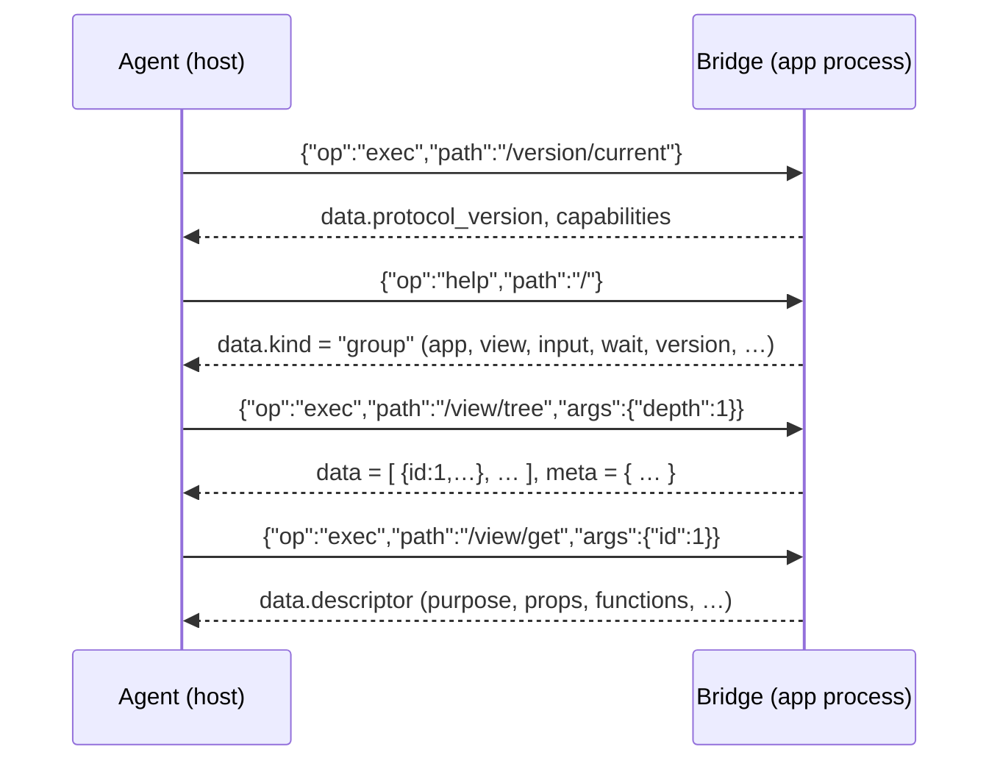

# Android CLI Protocol <span class="version-badge info">v1.0.0</span>

**A Specification for a Self-Describing, In-App Command Tree for Android Applications**

**Version:** 1.0.0
**Status:** Draft
**Created:** Oct 29, 2026
**Last Updated:** Oct 29, 2026

---

## Introduction

The Android CLI Protocol maps the ergonomics of a traditional command-line
interface — a hierarchical command tree, progressive `--help` documentation,
and predictable output — onto the runtime of an Android application. The app
integrates a small runtime that registers a command tree and component
descriptors; a caller — typically an AI agent on a host machine — reaches it
through a bridge (RECOMMENDED: an ADB-forwarded local socket) and explores
and operates the live app through structured commands such as `/view/tree`
or `/view/props`, receiving uniform JSON envelopes.

Android CLI is a sibling of the [HTTP CLI Protocol](http-cli.md) and the
[Web CLI Protocol](web-cli.md). The family shares one output envelope, one
error model, one progressive-help philosophy, one component-id identity
model, and one async model; where this document restates a shared mechanism
it is normative for Android CLI. Shared standard nomenclature and
recommended implementation architecture: [cli-family.md](cli-family.md).

### Design goals

1. **Progressive, help-driven discovery.**
   Every level of the command tree explains itself *on demand*. Callers drill
   down one level at a time and never download the whole surface. Token
   consumption stays proportional to the task, not to the size of the app.

2. **A uniform output contract.**
   Every result — data, help, or failure — uses one envelope, one error model,
   and one async model (bounded, cancellable, settle-aware). Machine
   consumers parse one shape; humans read the same JSON.

3. **Declared component semantics.**
   Screens, views, and composables carry *author-written descriptions* —
   purpose, prop semantics, enums, exposed actions, error codes,
   internationalization metadata — authored at development time and
   **injected into the compiled build** as data. An agent reading
   `/view/get` learns what a screen or widget is *for*, not merely what the
   uiautomator dump shows.

4. **Platform-neutral core, official adapters.**
   The command tree and envelope are adapter-agnostic. Reference bindings for
   the classic **View system** and **Jetpack Compose** are sketched in this
   document; other UI toolkits follow the same registration contract.

5. **Graceful degradation and safe defaults.**
   Runtimes without descriptors still serve structural introspection
   (`origin: "inferred"`). Mutation commands are opt-in, confirmation-gated,
   and off in release profiles by default.

### Non-goals

- This protocol does not replace platform UI automation (uiautomator,
  accessibility services, screenshot-driven control); it is a discovery- and
  task-oriented façade over a cooperating app's own runtime.
- It does not define any application resource or domain model. Descriptors
  and command extensions are entirely implementation-defined.
- It does not control system UI windows (status bar, permission dialogs,
  other apps' windows) — only the host app's own UI tree.
- It does not support runtime insertion of new nodes into a live composition
  or view hierarchy beyond what the app's own APIs expose (mirroring the
  Web CLI position on hook insertion).
- It does not cover cross-app automation: one bridge serves one app process
  on one device.

### Terminology

| Term | Meaning |
|------|---------|
| **Bridge** | The transport endpoint inside the app through which callers exchange request/response JSON with the runtime. |
| **Command path** | The slash-separated, root-anchored path that identifies a node, e.g. `/view/props`; `/` is the root. |
| **Group node** | A tree node that has children. Its representation is a listing of its children. |
| **Command node** | A leaf node that performs an operation when invoked through `exec`. |
| **Descriptor** | An author-written, JSON-serializable document describing a screen, view, composable, or module: its purpose, props, exposed functions, error codes, and i18n metadata. |
| **Registry** | The in-app store of descriptors and their runtime bindings, from which both dispatch and help are derived. |
| **Component id** | An auto-increment integer that identifies one live UI node (view, composable) for its whole life within the app process; assigned at first discovery, never reused. |
| **Origin** | Whether a node's semantics are `declared` (a descriptor exists) or `inferred` (runtime introspection only). |
| **Adapter** | The UI-toolkit binding (View, Compose, …) that materializes `view` commands from live toolkit internals. |
| **Settle** | The point at which a mutation's effect becomes observable (UI-thread commit, followed by a frame where geometry changes). |
| **Envelope** | The top-level JSON object of every successful or failed result. |
| **Projection** | Caller-side selection of result fields via the reserved `fields` parameter. |

### Conformance language

The key words MUST, MUST NOT, REQUIRED, SHALL, SHALL NOT, SHOULD, SHOULD NOT,
RECOMMENDED, MAY, and OPTIONAL in this document are to be interpreted as
described in RFC 2119 and RFC 8174 when, and only when, they appear in all
capitals.

---

## Changes from previous versions

This is the first release of the Android CLI Protocol. See the repository
`CHANGELOG.md` for subsequent revisions.

---

## Protocol overview & data flow

A caller first reaches the bridge, negotiates capabilities, then walks the
tree with help calls before executing commands:

```
0. adb forward tcp:PORT localabstract:android-cli   → reach the bridge
1. {"op":"exec","path":"/version/current", …}       → detection + negotiation
2. {"op":"help","path":"/", …}                      → root group help (top-level groups)
3. {"op":"help","path":"/view", …}                  → group help (commands under view)
4. {"op":"exec","path":"/view/tree","args":{…}}     → one level of the UI tree
5. {"op":"exec","path":"/view/props","args":{…}}    → execute
```

Every step is one JSON request and one JSON response on the bridge; help
documents and command results share one envelope.



---

## Detection & bootstrap

### The bridge

A conformant runtime exposes a bridge endpoint inside the app process. The
standard binding is an **abstract local socket** with the RECOMMENDED name
`android-cli`:

```
adb forward tcp:0 localabstract:android-cli
```

The wire format is newline-delimited JSON (UTF-8), pipelined:

**Request** (one JSON object per line):

```json
{"id": "r1", "op": "exec", "path": "/view/props", "args": {"id": 3}, "options": {}, "token": "…"}
```

| Field | Presence | Description |
|-------|----------|-------------|
| `id` | REQUIRED | Caller-chosen correlation string; responses echo it. |
| `op` | REQUIRED | `exec`, `help`, or `cancel` (OPTIONAL). |
| `path` | for `exec`/`help` | Canonical command path; `help` defaults to `/`. |
| `args` | OPTIONAL | Command arguments (exec only); omitted ⇒ `{}`. |
| `options` | OPTIONAL | `detail`, `locale` (help); `timeout`; see the async model. |
| `token` | OPTIONAL | Session secret for token-gated runtimes (see Security). |

**Response** (one JSON object per line): the shared envelope with an echoed
`id`:

```json
{"id": "r1", "data": {"id": 3, "props": {…}}, "meta": {"request_id": "…"}}
```

Rules:

- Responses MAY arrive out of order; `id` is the only correlation key.
- `op: "help"` is the family's help mechanism — a first-class operation,
  **never a parameter of `exec`**. `exec` MUST reject an `args` object
  containing `help` or `detail` with `invalid_param` and a `hint` naming
  `help`.
- `op: "cancel"` (OPTIONAL) references an in-flight `id` and causes it to
  settle promptly with an `aborted` error envelope.
- Runtimes MAY expose alternative bindings (instrumentation, emulator
  console, wireless debugging); whichever binding is used, the request/
  response objects and envelope are exactly as specified here.

### Detection procedure (informative)

```
1. adb shell pidof <package>                       → is the app process alive?
2. adb forward tcp:PORT localabstract:android-cli  → connect
3. {"id":"r0","op":"exec","path":"/version/current"}
   → connect refused ⇒ no Web-CLI-equivalent present;
     fall back to platform UI automation (uiautomator / accessibility / screenshots)
```

### Capability negotiation

`/version/current` is the authoritative statement of what a runtime supports:

| Capability | Meaning |
|------------|---------|
| `app` | `/app/*` commands are available. |
| `view` | `/view/*` commands are available. |
| `input` | `/input/*` commands are available. |
| `declared` | At least one descriptor is registered; `/view/get` can return authored semantics. |
| `write` | Mutation commands (`/view/set`, `/view/call` writes, `/input/*`) are enabled. |
| `wait` | The `/wait/for` command is available. |
| `net`, `log`, `intent` | Extension groups. |

A capability absent from the array MUST be treated as unavailable; attempting
its commands MUST fail with `unsupported` (not `unknown_command`, which
reserves "path does not resolve at all").

### Degradation modes

| Mode | When | Behavior |
|------|------|----------|
| `declared` | Descriptors registered (app ships Android CLI) | Full semantics: summaries, prop docs, enums, error codes, i18n metadata. |
| `inferred` | Runtime without descriptors | Structural introspection only; nodes carry `origin: "inferred"`; `/view/call` is unavailable unless function bindings exist. |

A single runtime MAY mix modes per node. Clients MUST NOT assume declared
text exists.

---

## Core model: the command tree

### Nodes

A runtime's capabilities are exposed as a tree of **group nodes** and
**command nodes** rooted at the bridge. The root is a group node addressed
as `/` (path normalization below).

- A call addressed to a **group node** returns its Help document (a listing
  of its direct children). Group nodes are never executed.
- A call addressed to a **command node** executes the command with the
  supplied `args`; its Help document is obtained through `help`.

Command paths are rooted at `/`, mirroring the URL-path style of HTTP CLI:
the root is `/`, and below it `/view/props`, `/view/box`, `/version/current`.
This leading-slash form is canonical — help documents emit it and every
example uses it. Runtimes MUST accept the canonical form; they MUST also
accept the same path with its leading slash omitted ("view/props" ≡
"/view/props") and with a trailing slash added ("/view/props/" ≡
"/view/props"). Omitted `path` in `help` (or `""`) addresses the root like
`"/"`.

### Naming rules

Each path segment (node name):

- MUST match `^[a-z][a-z0-9_-]*$` (lowercase ASCII, digits, `_`, `-`).
- MUST be unique among its siblings. Names are case-sensitive; uppercase is
  not permitted.
- MUST NOT contain `/`, `.`, `?`, `#`, or whitespace.

Standard top-level group names are reserved for their standard meaning:
`version`, `app`, `view`, `input`, `wait`, `net`, `log`, `intent`.
Implementations MAY add custom groups (e.g. `data`), which SHOULD NOT
collide with the reserved names.

### Command effects

Each command node declares an `effects` class in its Help document:

| `effects` | Meaning |
|-----------|---------|
| `none` | Pure metadata; free of side effects (help, version). |
| `read` | Reads app/UI state; MUST be free of side effects. |
| `write` | Mutates app/UI state (prop writes, actions, input events). |
| `varies` | Effect depends on arguments (e.g. `/view/call` on a function's own declaration). |

- `none` and `read` commands MUST NOT mutate state.
- `write` commands and `varies` commands resolving to a write MUST require the
  reserved `confirm` parameter (see
  [Mutation & confirmation](#mutation--confirmation)).
- Implementations that wish to keep destructive operations away from
  non-human callers SHOULD omit those commands from the tree, or ship with
  the `write` capability disabled.

### Reserved parameter names

Commands MUST NOT declare parameters named `help`, `fields`, `detail`,
`locale`, `confirm`, or `timeout`; these names belong to the protocol
surface:

- `help` and `detail` are consumed by the `help` bridge operation.
- `fields`, `locale`, `confirm`, and `timeout` are consumed as reserved keys
  inside `exec` args.

Because the names are reserved, `exec` MUST reject an `args` object
containing `help` or `detail` with `invalid_param` and a `hint` naming
`help`. `timeout` (integer milliseconds) bounds a single call's wall-clock
time and is honored by every command; on expiry the call settles with a
`timeout` error rather than hanging.

The names `limit`, `offset`, `page`, and `cursor` are RECOMMENDED for
pagination but are not reserved.

---

## Component descriptors

Descriptors are the protocol's answer to "what is this screen or widget
*for*?" They are authored by developers next to the code they describe,
serialized as data, and **injected into the compiled build** so that runtime
introspection carries human-written semantics.

### Authoring locations (informative)

A descriptor MUST be JSON-serializable. Typical authoring forms:

- a colocated Kotlin/Java source (`TaskRow.cli.kt`) exporting the descriptor
  object;
- a component-level option (an annotation or a static property on a custom
  View / composable);
- a standalone manifest (`android-cli.descriptors.json`) merged at build
  time.

All forms compile down to the same registry entries; the serialized form
below is normative.

### Serialized descriptor

```json
{
  "id": "task-row",
  "name": "TaskRow",
  "kind": "composable",
  "summary": "Displays one task with completion toggle and selection.",
  "description": "Renders a single task row. Long titles truncate. Tapping
     the row selects the task; the checkbox toggles completion.",
  "version": "1.2.0",
  "tags": ["tasks", "row"],
  "props": [
    {
      "name": "task",
      "type": "object",
      "required": true,
      "description": "The task to display; must carry id, title, and done."
    },
    {
      "name": "density",
      "type": "enum",
      "enum": ["compact", "comfy"],
      "default": "comfy",
      "description": "Row height variant."
    }
  ],
  "state": [
    { "name": "selected", "type": "boolean", "description": "Whether the row is selected.", "readonly": true }
  ],
  "functions": [
    {
      "name": "markDone",
      "summary": "Marks the task complete and re-renders the row.",
      "params": [],
      "returns": { "type": "object", "description": "The updated task." },
      "effects": "write",
      "async": true,
      "timeout_ms": 5000,
      "errors": ["task/not_found"]
    }
  ],
  "error_codes": [
    {
      "code": "task/not_found",
      "summary": "The referenced task does not exist.",
      "hint": "List available ids via /data/tasks."
    }
  ],
  "i18n": { "default_locale": "en", "locales": ["en", "de"] }
}
```

### Descriptor fields

| Field | Kind | Presence | Description |
|-------|------|----------|-------------|
| `id` | slug | REQUIRED | Stable identifier, unique within the registry. Matches `^[a-z][a-z0-9_-]*$`. |
| `name` | string | REQUIRED | Human-readable name, typically the class/composable name. |
| `kind` | enum | REQUIRED | `screen`, `view`, `composable`, or `module`. |
| `summary` | text | REQUIRED | One-line purpose. RECOMMENDED ≤ 120 characters. |
| `description` | text | OPTIONAL | Long form: behavior, edge cases, composition. |
| `version` | string | OPTIONAL | Descriptor version (semver RECOMMENDED), independent of app version. |
| `tags` | string[] | OPTIONAL | Free-form labels for search (`/view/find?tag=`). |
| `props` | prop[] | OPTIONAL | Input parameters (attributes). |
| `state` | state[] | OPTIONAL | Exposed internal state entries readable via `/view/state`. |
| `functions` | function[] | OPTIONAL | Actions the component exposes for invocation via `/view/call`. |
| `error_codes` | error[] | OPTIONAL | Error codes this component/function family may return. |
| `i18n` | object | OPTIONAL | `{ "default_locale": "en", "locales": ["en", "de"] }` — the component's own internationalization surface. |
| `deprecated` | object | OPTIONAL | `{"use_instead": "task-row-v2", "note": "…"}`. |

**Prop descriptors** (entries of `props`):

| Field | Presence | Description |
|-------|----------|-------------|
| `name` | REQUIRED | Prop name (identifier-shaped). |
| `type` | REQUIRED | One of `string`, `integer`, `number`, `boolean`, `enum`, `array`, `object`, `function`, `resource`, `view`, `any`. |
| `required` | OPTIONAL | Default `false`. |
| `default` | OPTIONAL | Default value, native JSON type. Omitted ⇒ no default. |
| `enum` | REQUIRED when `type` is `enum` | Allowed values, as strings. MUST be absent otherwise. |
| `description` | REQUIRED | One-line semantics. |
| `readonly` | OPTIONAL | Default `false`. `true` for props that must not be written via `/view/set`. |
| `example` | OPTIONAL | A representative value. |

**State descriptors** (entries of `state`): `name`, `type`, `description`
(REQUIRED), `readonly` (OPTIONAL, default `true`).

**Function descriptors** (entries of `functions`):

| Field | Presence | Description |
|-------|----------|-------------|
| `name` | REQUIRED | Function name (identifier-shaped). |
| `summary` | REQUIRED | One-line purpose. |
| `description` | OPTIONAL | Long form. |
| `params` | OPTIONAL | Parameter descriptors (same shape as props minus `readonly`/`example`). |
| `returns` | REQUIRED | `{ "type": <value type>, "description": <text> }`. For `async` functions, the **resolved** value. |
| `effects` | REQUIRED | `none`, `read`, or `write`. Gates `/view/call` confirmation. |
| `async` | OPTIONAL | Default `false`. `true` when the binding is asynchronous (suspend function, callback, future); `/view/call` awaits the resolved value within `timeout`. |
| `timeout_ms` | OPTIONAL | Recommended await bound for this function in milliseconds; runtime default applies when absent. |
| `errors` | OPTIONAL | Error codes this function may return. |
| `deprecated` | OPTIONAL | As above. |

**Error descriptors** (entries of `error_codes`):

| Field | Presence | Description |
|-------|----------|-------------|
| `code` | REQUIRED | Stable identifier matching `^[a-z][a-z0-9_]*(/[a-z][a-z0-9_]*)*$`. Custom codes SHOULD be namespaced `<scope>/<code>`; bare codes are reserved for the [standard table](#standard-error-codes). |
| `summary` | REQUIRED | One-line meaning. |
| `description` | OPTIONAL | Long form. |
| `hint` | OPTIONAL | Actionable next step — RECOMMENDED on every caller-fixable error. |

### Localized text

Any human-readable text field MAY be accompanied by a sibling
`<field>_i18n` object mapping BCP-47 locale tags to translations:

```json
"summary": "Displays one task with completion toggle and selection.",
"summary_i18n": { "de": "Zeigt eine Aufgabe mit Abschluss-Schalter und Auswahl." }
```

When `locale` is supplied (a reserved `exec` args key, or a `help` option),
a runtime that has a translation for the requested locale MUST return the
translated text, falling back to the unlocalized field otherwise.

### Registration & build injection (normative)

1. Descriptors MUST be available from the registry at runtime — embedded in
   the build or shipped as a lazily loaded manifest — and MUST be reachable
   through the standard bridge regardless of storage.
2. Descriptors are **data**: they MUST survive minification and shrinking
   unchanged. Implementations MUST NOT rely on reflection, function names,
   or source comments surviving compilation; where a shrinker would strip
   registration call sites, the build MUST keep them (e.g. keep rules).
3. Registration MUST be idempotent; re-registering an `id` replaces the
   previous entry.
4. Function *bindings* (the callable implementations behind
   `functions[].name`) are kept in memory alongside the serialized
   descriptor and MUST NOT be serialized. `/view/call` resolves
   `(node id, function name)` through the binding table; when no binding
   exists the command fails with `unsupported`.
5. Release profiles SHOULD gate discovery: either register descriptors only
   in debug builds, or serve them with `write` disabled. Descriptors MUST NOT
   contain secrets.

### Descriptor ↔ live node linking

Query commands return nodes shaped as:

```json
{
  "id": 7,
  "descriptor_id": "task-row",
  "name": "TaskRow",
  "adapter": "compose",
  "origin": "declared",
  "summary": "Displays one task with completion toggle and selection.",
  "children_count": 2
}
```

- `id` is REQUIRED on every live node: the instance's auto-increment
  component id (see [Ids](#ids-component-identity)). Targeting commands and
  query filters accept it; a dead instance's id fails with `stale_id`.
- `descriptor_id` is present iff `origin` is `declared`; `name` is the
  runtime node name (class name for views, composable name for Compose).
- `adapter` is OPTIONAL: `view`, `compose`, or the toolkit the node came
  from.
- `summary` is present iff a descriptor exists; clients MUST tolerate its
  absence.
- `status`, when present, is `ready` or `pending`. `pending` marks an async
  boundary (a screen still loading, an in-flight composition) whose subtree
  may still change when it settles.

---

## Progressive help (self-description)

Help is the protocol's discovery mechanism. It is a first-class bridge
operation — never a parameter of `exec`:

```json
{"id": "r2", "op": "help", "path": "/"}
{"id": "r3", "op": "help", "path": "/view"}
{"id": "r4", "op": "help", "path": "/view/props", "options": {"detail": true}}
```

- `help` addresses exactly one node and returns its Help document in the
  success envelope. (`exec` on a group node also returns that group's Help
  document; group nodes are never executed.)
- `options.detail` (boolean) selects the detail level; `options.locale`
  requests localized text; `options.timeout` bounds the call.
- An unknown `path` fails with `unknown_command` and a `hint` pointing at the
  nearest valid `help` call.

### Single source of truth (normative)

The Help document MUST be generated from the same registry that dispatches
calls. Implementations MUST NOT maintain a separate, hand-written help
artifact that can drift from actual behavior. If help says a parameter
exists, the dispatcher MUST honor it; if the dispatcher rejects a parameter,
help MUST NOT advertise it. The same rule binds descriptors: a
`functions[].params` entry is a promise the binding table must keep.

### Group help

A `help` call on a group node returns a **group Help document**:

```json
{
  "data": {
    "kind": "group",
    "path": "/view",
    "name": "view",
    "summary": "UI tree and node operations",
    "subcommands": [
      { "kind": "command", "name": "tree",  "path": "/view/tree",  "effects": "read",   "summary": "List one level of the UI tree" },
      { "kind": "command", "name": "find",  "path": "/view/find",  "effects": "read",   "summary": "Search nodes by name, tag, text, or id" },
      { "kind": "command", "name": "get",   "path": "/view/get",   "effects": "read",   "summary": "Descriptor and live data for one node" },
      { "kind": "command", "name": "props", "path": "/view/props", "effects": "read",   "summary": "Current prop values of a node" },
      { "kind": "command", "name": "state", "path": "/view/state", "effects": "read",   "summary": "Exposed state entries of a node" },
      { "kind": "command", "name": "box",   "path": "/view/box",   "effects": "read",   "summary": "Bounds, padding, and margin of a node" },
      { "kind": "command", "name": "call",  "path": "/view/call",  "effects": "varies", "summary": "Invoke a function the node exposes" },
      { "kind": "command", "name": "set",   "path": "/view/set",   "effects": "write",  "summary": "Write prop values on a live node" }
    ],
    "usage": "op=exec, path=/view/<command>, args={…}"
  }
}
```

**Depth limiting (token economy):** group help MUST list only its *direct*
children, each with a one-line `summary` and its `effects` class. It MUST NOT
inline the nested tree or parameter schemas.

The root group help additionally MAY carry `protocol_version`,
`runtime_version`, `adapters`, `origin`, and `capabilities`.

### Command help

A `help` call on a command node returns a **command Help document**:

```json
{
  "data": {
    "kind": "command",
    "path": "/view/props",
    "name": "props",
    "effects": "read",
    "summary": "Current prop values of a node",
    "description": "Returns the live prop values of the UI node identified by id.",
    "params": [
      { "name": "id",   "type": "integer", "required": true,  "description": "Target node id from /view/tree or /view/find." },
      { "name": "keys", "type": "array",  "required": false, "description": "Restrict to these prop names; omit for all." }
    ],
    "examples": [
      "{\"op\":\"exec\",\"path\":\"/view/props\",\"args\":{\"id\":7,\"fields\":\"text,enabled\"}}"
    ]
  }
}
```

### Help document fields

| Field | Kind | Presence | Description |
|-------|------|----------|-------------|
| `kind` | `"group"` \| `"command"` | REQUIRED | Discriminator of the Help document. |
| `path` | string | REQUIRED | Command path; `"/"` for the root node. |
| `name` | string | REQUIRED | This node's segment name. |
| `effects` | string | command only | `none`, `read`, `write`, or `varies`. |
| `summary` | string | REQUIRED | One-line description. |
| `description` | string | OPTIONAL | Long form; RECOMMENDED on command nodes only. |
| `subcommands` | array | group only | Direct children: `kind`, `name`, `path`, `effects`, `summary` (all REQUIRED). |
| `params` | array | command only | Parameter descriptors. |
| `examples` | array of strings | OPTIONAL | Copy-pasteable request lines. |
| `usage` | string | OPTIONAL | Human-readable invocation hint. |
| `deprecated` | object | OPTIONAL | `{"use_instead": "/view/get", "note": "…"}`. |

### Parameter descriptor fields

| Field | Presence | Description |
|-------|----------|-------------|
| `name` | REQUIRED | Parameter name. MUST NOT be a reserved name. |
| `type` | REQUIRED | One of `string`, `integer`, `number`, `boolean`, `enum`, `array`, `object`. |
| `required` | OPTIONAL | Default `false`. |
| `default` | OPTIONAL | Default value, native JSON type; omitted ⇒ no default. |
| `enum` | REQUIRED when `type` is `enum` | Allowed values, as strings. |
| `description` | REQUIRED | One-line semantics. |

Arguments are passed as native JSON values. A value that fails the declared
type, or an `enum` value not in the list, MUST be rejected with
`invalid_param` and the error's `hint` MUST list the allowed values. Unknown
arguments SHOULD be rejected with `invalid_param` and a hint naming the
closest declared parameter (implementations MAY instead ignore them, but
MUST document the choice).

### Two-level help: summary by default, detail on demand

- **Summary level (default).** Group help: direct children with `kind`,
  `name`, `path`, `effects`, `summary`, plus `usage`; no `description`.
  Command help: `params` and `usage`; no long-form `description` or
  `examples`.
- **Detail level (`help` with `options.detail: true`).** The same document
  plus long-form `description` and `examples`.

Rules: `detail` is a boolean `help` option (`true` selects detail,
`false`/absent selects summary; any other value ⇒ `invalid_param`); the
summary document MUST be a strict subset of the detail document; clients
MUST tolerate missing fields at summary level.

### Self-description guarantee

Help documents are authoritative. A conformant client MAY rely on:

- every child listed in a group Help document being invocable at its `path`;
- every command Help document listing every parameter the dispatcher accepts
  (except reserved names);
- errors on unknown commands or parameters carrying a `hint` that points back
  to the nearest valid `help` call.

---

## Requests

### Executing a command

```json
{"id": "r5", "op": "exec", "path": "/view/set", "args": {"id": 7, "props": {"density": "compact"}, "confirm": true}}
```

- **Read:** `{"op":"exec","path":"/view/props","args":{"id":7,"fields":"text,enabled"}}`
- **Write:** the line above; `confirm: true` is mandatory for writes.
- **Help:** `{"op":"help","path":"/view/set","options":{"detail":true}}` —
  the `help` operation, never an `exec` parameter.
- `args` is a plain object; omitted ⇒ `{}`. Non-object `args` MUST be
  rejected as a programming error.
- Reserved keys inside `args` (`fields`, `locale`, `confirm`, `timeout`) are
  always interpreted by the protocol, never by the command; `help` and
  `detail` MUST NOT appear in `args`.

### Field projection

Every command that returns JSON objects supports the reserved `fields`
parameter, a comma-separated whitelist of top-level keys to return:

```json
{"op":"exec","path":"/view/get","args":{"id":7,"fields":"descriptor_id,name,summary"}}
```

- Only the requested keys are returned, for a single object or each element
  of an array in `data`.
- On live-node results, `id` is always retained even when `fields` omits it —
  projection MUST NOT destroy the targeting key.
- Unknown keys in `fields` MUST be ignored (forward compatibility).
- `fields` MUST NOT change the meaning of a result or the `meta` block.
- Nested selection (dot paths) is NOT defined in this version; runtimes MUST
  ignore or reject dotted names consistently and document which.

### Pagination

List-returning commands SHOULD paginate. Two conventions are allowed; the
implementation picks one and documents it in the command's Help document:

- **Offset form:** `offset` (0-based) + `limit`; or
- **Page form:** `page` (1-based) + `limit`.

When `meta` is present on a list result it SHOULD use:

```json
"meta": { "request_id": "r5", "limit": 20, "total": 137, "has_more": true }
```

Runtimes MUST enforce a maximum `limit` (documented in help) and SHOULD
default to 20.

### Ids (component identity)

Every live UI node carries an **id** (component id): an auto-increment
integer that precisely identifies that instance for its whole life.

- **Assignment at first discovery.** The first tree walk materializes the
  registry and assigns each live node its id in depth-first, document order.
  A node created later is assigned on the walk that first sees it. The
  sequence is integers starting at 1, +1 per assignment.
- **Never reused within an app process.** An id keeps pointing at the same
  instance across recompositions, layout passes, and activity/fragment
  navigation; a destroyed instance's id is retired, not recycled. A new
  process restarts the sequence at 1.
- **Precise targeting & querying.** Targeting commands take `id`; query
  syntax supports it directly — `/view/find {id: [3, 7]}`,
  `/view/find {parent: 7}`, `/view/tree {parent: 7}`.
- **Death of an id.** Targeting a destroyed instance — or an id from before
  a process restart — MUST fail with `stale_id` and a `hint` to re-query
  (`/view/tree` or `/view/find`). An id that was never assigned fails with
  `not_found`.
- Tree reads are point-in-time snapshots. Async composition and layout
  mutate the tree between calls; re-query after `/wait/for` or a write's
  settle, and do not poll blindly.
- `/view/reset` (OPTIONAL command) invalidates all live ids and releases
  retained instances — RECOMMENDED for long agent sessions on heavy apps.
  The counter does not rewind.

### Async calls, concurrency & cancellation

The app runtime is asynchronous by nature — screens load lazily, actions
complete on background threads, layout commits on later frames. The async
model:

- **Calls MAY overlap.** Requests in flight at the same time settle
  independently; responses MAY arrive out of order and are correlated by
  `id`. Runtimes MUST dispatch effectful work in arrival order but MAY
  interleave during internal awaits.
- **Every call is bounded.** The reserved `timeout` (integer ms; an `exec`
  args key, a `help` option) limits a single call's wall-clock time; on
  expiry the call settles with a `timeout` error envelope. A runtime's
  default bound MUST be documented in help and a call MUST NOT hang
  indefinitely. A call whose `id` is still unmet when the process dies
  settles with `internal_error` or the connection closes — documented.
- **Cancellation is caller-side.** `op: "cancel"` referencing an in-flight
  `id` makes that call settle promptly with an `aborted` error envelope (it
  still responds — the envelope is the single parse path); work already
  started MAY still complete.
- **Reads observe instants, not states.** Two reads may legitimately
  disagree. For a consistent window, prefer one call with `fields`, or
  sequence write → read through the settle guarantee and `/wait/for`.

### Mutation & confirmation

- Commands with `effects: "write"` (and `varies` commands resolving to a
  write) MUST reject invocations lacking `confirm: true` with the error code
  `confirm_required`. A mutation is never accidental.
- `/view/set` MUST refuse `readonly` props with `invalid_param` and a hint
  naming the offending prop.
- Runtimes shipped with the `write` capability disabled MUST fail writes with
  `read_only`, keeping the commands discoverable but inert.

**Settle guarantee (read-after-write consistency):** a write command's
success envelope MUST NOT be produced before the runtime has observed the
corresponding UI-thread commit — and, where the change affects geometry or
visibility, a subsequent frame draw. A caller that reads after a successful
write therefore sees the write's effects or a later state — never the
pre-write value with success reported. Runtimes that cannot observe commits
MUST document the weaker guarantee in help; `meta` MAY carry `settled_at`.
Pixel-level effects may trail the commit — use `/wait/for` for those.

---

## Responses

Every result is a single JSON object — the family's shared **envelope**
(`schemas/envelope.schema.json`), carried on the wire with the echoed `id`:

### Success envelope

```json
{ "id": "r5", "data": { … }, "meta": { … } }
```

| Field | Presence | Description |
|-------|----------|-------------|
| `data` | REQUIRED | The result: object, array, scalar, or `null`. Help documents are delivered in `data` like any other result. |
| `meta` | OPTIONAL | Non-semantic metadata: `request_id`, pagination, `locale`, `settled_at`, timing. Clients MUST NOT interpret undocumented `meta` keys. |

### Error envelope

```json
{
  "id": "r6",
  "error": {
    "code": "stale_id",
    "message": "id 7 is no longer live",
    "hint": "re-query with /view/tree or /view/find to obtain live ids",
    "details": { "id": 7 }
  }
}
```

| Field | Presence | Description |
|-------|----------|-------------|
| `code` | REQUIRED | Stable, machine-readable identifier: `^[a-z][a-z0-9_]*$`. |
| `message` | REQUIRED | Human-readable explanation. |
| `hint` | OPTIONAL | Actionable next step — RECOMMENDED on every caller-fixable error. |
| `details` | OPTIONAL | Structured context (e.g. offending parameter name). |

An error result MUST NOT contain `data`; a success result MUST NOT contain
`error`.

### Standard error codes

| `code` | When |
|--------|------|
| `invalid_param` | Value fails type/enum/range validation. |
| `missing_param` | A required parameter is absent. |
| `unknown_command` | Path does not resolve to a node. |
| `not_found` | Command exists but the target (id never assigned, descriptor, resource) does not. |
| `stale_id` | The supplied id was assigned, but its instance is no longer live (destroyed, or the process has restarted). |
| `unsupported` | The path exists but the capability is disabled or unbound (e.g. `/view/call` without a binding). |
| `read_only` | A mutation was attempted in a runtime without the `write` capability. |
| `confirm_required` | A mutating call omitted `confirm: true`. |
| `forbidden` | Token missing, malformed, or mismatched. |
| `conflict` | State conflict (duplicate, version mismatch). |
| `timeout` | The call did not settle within the `timeout` bound. `details.elapsed_ms` and `details.pending` RECOMMENDED. |
| `aborted` | The caller cancelled via `op: "cancel"`. Work already started MAY still complete. |
| `internal_error` | Unexpected runtime fault. |

- `unknown_command` errors MUST include a `hint` pointing at the nearest
  valid `help` call (e.g. `help /view to see available subcommands`).
- Implementations MAY add custom codes; custom codes MUST NOT reuse a
  standard code with a different meaning. Component-level codes SHOULD be
  namespaced (`task/not_found`) and MUST be documented in the owning
  descriptor's `error_codes`. Clients MUST tolerate unknown codes generically.

### Naming & encoding conventions

- JSON keys: `snake_case`. Enum and error-code values: lowercase.
- Identifiers in payloads (ids) are opaque integers. Timestamps, when
  present, are RFC 3339 strings in UTC.
- Omitted key ⇒ not provided. Senders SHOULD NOT use `null` where omission
  expresses the same meaning.
- Unknown result fields MUST be ignored by clients (forward compatibility).

---

## Command surface

The commands below form the standard library. REQUIRED commands are
mandatory for core conformance; RECOMMENDED commands are expected in
full-profile runtimes; the rest are OPTIONAL.

### `/version/current` (REQUIRED)

No parameters. Returns:

| Field | Description |
|-------|-------------|
| `protocol_version` | REQUIRED. Protocol version implemented (semver). |
| `runtime_version` | REQUIRED. Runtime/implementation version (semver). |
| `adapters` | OPTIONAL. Toolkit adapters in effect: `["view", "compose"]`. |
| `origin` | REQUIRED. `declared` or `inferred` (dominant mode; nodes may still differ). |
| `capabilities` | REQUIRED. Array of capability strings. |
| `created_at` | OPTIONAL. RFC 3339 UTC timestamp of runtime installation. |

### Root help (REQUIRED)

`help` on `/` (or with no path) returns root group help: top-level groups
with summaries, plus the negotiation fields above. This is the agent's map
of the app.

### `/app/info` (RECOMMENDED, `app` capability)

No parameters. Returns:

| Field | Description |
|-------|-------------|
| `package` | Application package name. |
| `version_name` / `version_code` | App version (from the manifest). |
| `debuggable` | Whether the build is debuggable. |
| `foreground_screen` | `{ "name": "TaskListScreen", "descriptor_id": "task-list-screen" }` — the screen currently in front. |

### `/view/tree` (RECOMMENDED, `view` capability)

One level of the UI tree — the progressive-help principle applied to trees.

| Param | Type | Required | Description |
|-------|------|----------|-------------|
| `parent` | integer | no | Parent node id; omit for the roots. |
| `depth` | integer | no | Levels to return (default 1; runtime-documented maximum). |
| `limit` / `offset` | integer | no | Pagination over the listed level. |

`data`: array of node objects (`id`, `descriptor_id?`, `name`, `adapter?`,
`origin`, `summary?`, `children_count`, `children?` when `depth` > 1);
`meta` carries pagination. Depth is deliberately shallow by default: drill
down with `parent`.

### `/view/find` (RECOMMENDED)

Search nodes; returns a flat, paginated list of nodes (same shape as
`/view/tree` items).

| Param | Type | Required | Description |
|-------|------|----------|-------------|
| `id` | array | one of id/name/text/tag | Restrict to these node ids (exact match). |
| `parent` | integer | no | Only direct children of this node id. |
| `name` | string | one of id/name/text/tag | Substring match on node name. |
| `text` | string | one of id/name/text/tag | Substring match on rendered text. |
| `tag` | string | one of id/name/text/tag | Match `descriptor.tags`. |
| `prop` | string | no | Filter `"key=value"` on prop values. |
| `limit` / `offset` | integer | no | Pagination. |

### `/view/get` (RECOMMENDED)

Descriptor + live summary for one node.

| Param | Type | Required | Description |
|-------|------|----------|-------------|
| `id` | integer | yes | Target node id. |

`data`:

```json
{
  "id": 7,
  "descriptor_id": "task-row",
  "origin": "declared",
  "descriptor": { "…full serialized descriptor…" },
  "live": { "name": "TaskRow", "props_present": ["task", "density"], "children_count": 2 }
}
```

`descriptor` is omitted for `origin: "inferred"` nodes. This is the "what is
this for" read: summary, prop semantics, enums, exposed functions, error
codes, and i18n metadata in one round-trip.

### `/view/props` (RECOMMENDED)

Current prop values.

| Param | Type | Required | Description |
|-------|------|----------|-------------|
| `id` | integer | yes | Target node id. |
| `keys` | array | no | Restrict to these prop names. |

`data`: `{ "id": 7, "props": { … } }`. Values are JSON-representable
projections; functions render as `"<function>"`, views as `"<view>"`,
resources as `"<resource>"`, and cyclic structures as `"<circular>"` —
runtimes MUST bound serialization and document the projections.

### `/view/state` (OPTIONAL)

Exposed state entries (from `state` descriptors, or adapter-introspectable
state).

| Param | Type | Required | Description |
|-------|------|----------|-------------|
| `id` | integer | yes | Target node id. |
| `keys` | array | no | Restrict to these entry names. |

`data`: `{ "id": 7, "state": [ { "name": "selected", "value": false } ] }`.

### `/view/box` (RECOMMENDED)

Geometry for one node.

| Param | Type | Required | Description |
|-------|------|----------|-------------|
| `id` | integer | yes | Target node id. |

`data`:

```json
{
  "id": 12,
  "bounds": { "left": 0, "top": 240, "right": 1080, "bottom": 336 },
  "rect": { "x": 0, "y": 240, "width": 1080, "height": 96 },
  "padding": { "top": 12, "right": 16, "bottom": 12, "left": 16 },
  "margin":  { "top": 8, "right": 0, "bottom": 8, "left": 0 },
  "visible_on_screen": true
}
```

`margin` is present where the toolkit exposes layout params (View adapter);
Compose adapters MAY omit it.

### `/view/call` (OPTIONAL, `write` gating per function)

Invoke an exposed function/action.

| Param | Type | Required | Description |
|-------|------|----------|-------------|
| `id` | integer | yes | Target node id. |
| `function` | string | yes | Function name from the descriptor's `functions`. |
| `args` | object | no | Arguments per the function's `params`. |
| `confirm` | boolean | for `effects: "write"` | Must be `true` to permit mutation. |

`data`: `{ "result": <return value, projected as in /view/props> }`.
Failures: `unsupported` when no binding is registered,
`missing_param`/`invalid_param` per the function's `params`, component error
codes from `error_codes` on business failure.

**Async functions:** when the binding is asynchronous (`async: true` —
suspend function, callback, future), the runtime MUST await the resolved
value and place it in `result`, bounded by the reserved `timeout` (default
bound documented in help; RECOMMENDED ≤ 30000 ms). A function that does not
settle within the bound fails with `timeout` (`details.elapsed_ms` and
`details.pending: true` RECOMMENDED) and a hint to retry with a larger
`timeout` or observe the effect via `/wait/for`.

### `/view/set` (OPTIONAL, `write` capability)

Write prop values.

| Param | Type | Required | Description |
|-------|------|----------|-------------|
| `id` | integer | yes | Target node id. |
| `props` | object | yes | Map of prop name → new value. |
| `confirm` | boolean | yes | Must be `true`. |

`data`: `{ "id": 7, "applied": { "density": "compact" }, "skipped": { … } }`.
`applied` reports accepted writes; `skipped` reports rejected ones with
per-key reasons — partial success is reported, not thrown.

### `/input/*` (OPTIONAL, `input` capability; all `effects: "write"`)

Synthetic user interaction on the app's own UI. All input commands require
`confirm: true` and the `write` capability.

**`/input/tap`** — tap a node or coordinates.

| Param | Type | Required | Description |
|-------|------|----------|-------------|
| `id` | integer | one of id/x+y | Tap the center of this node id. |
| `x` / `y` | integer | one of id/x+y | Tap these screen coordinates (px). |
| `confirm` | boolean | yes | Must be `true`. |

`data`: `{ "tapped": { "id": 7 } }` (or `{ "tapped": { "x": 120, "y": 640 } }`).

**`/input/text`** — type into a node (or the focused field).

| Param | Type | Required | Description |
|-------|------|----------|-------------|
| `id` | integer | no | Target text node; omit for the focused node. |
| `text` | string | yes | Text to enter. |
| `replace` | boolean | no | Default `false` (append); `true` replaces existing text. |
| `confirm` | boolean | yes | Must be `true`. |

`data`: `{ "id": 7, "text": "…" }` (echo of the resulting value where
readable).

**`/input/key`** — press a key.

| Param | Type | Required | Description |
|-------|------|----------|-------------|
| `key` | enum | one of key/code | `back`, `home`, `enter`, `tab`, `del`, `esc`. |
| `code` | integer | one of key/code | Raw key code for keys outside the enum. |
| `confirm` | boolean | yes | Must be `true`. |

`data`: `{ "pressed": "back" }`.

Input commands drive the whole UI including destructive flows; they are the
protocol's most privileged surface (see Security).

### `/wait/for` (RECOMMENDED, `wait` capability)

Condition-based waiting — the family's replacement for blind sleeps.
`effects: "read"`. Resolves when the condition holds, or fails with
`timeout`.

| Param | Type | Required | Description |
|-------|------|----------|-------------|
| `id` | integer | one condition family | Target node id. |
| `state` | enum | with `id` | `visible`, `hidden`, or `gone` — wait until the node reaches this state (`gone` = destroyed/detached). |
| `prop` | string | with `id` | Wait until this prop holds `value`. |
| `value` | any | with `prop` | Expected value (JSON). |
| `text` | string | one condition family | Wait until this string appears in rendered text. |
| `screen` | string | one condition family | Wait until this screen (descriptor id or name) is in the foreground. |
| `timeout` | integer | no | Reserved; bound in ms. Default documented in help; RECOMMENDED ≤ 30000. |

Exactly one condition family MUST be supplied: `id`+`state`,
`id`+`prop`+`value`, `text`, or `screen`. More or fewer ⇒
`invalid_param` / `missing_param` with a hint listing the families.

`data`: `{ "waited": true, "elapsed_ms": 80, "id": 7 }` (`id` present when
the condition resolved one). On expiry: `timeout` with
`details.elapsed_ms` and a hint to widen `timeout` or re-read current state.

### Extension groups (OPTIONAL)

`net` (network observation), `log` (app-scoped error/event log), and
`intent` (firing explicit intents — hard write-gated) follow the same
node/help/envelope contract. Runtimes that provide them MUST document their
commands in help and declare the matching capability.

---

## Integration guide: adding Android CLI to an application

The normative outline an implementing agent follows when modifying a
codebase to support Android CLI:

1. **Add the runtime.** Integrate (or vendor) an Android CLI runtime module
   and start its bridge at app startup in debug builds (RECOMMENDED) or per
   the chosen profile.
2. **Author descriptors.** For each public screen/view/composable/module,
   write a descriptor covering: purpose (`summary`/`description`), `props`
   (types, enums, defaults, semantics), `functions` (params, returns,
   effects, error codes), `error_codes`, and `i18n` metadata.
3. **Register.** Call the runtime's registration API with each descriptor
   and its function bindings. Registration MUST be idempotent and MUST
   survive minification/shrinking (descriptors are data; keep registration
   call sites).
4. **Wire the adapter(s).** Enable the View and/or Compose adapter so that
   `/view/*` commands resolve live instances. Without an adapter only
   `/app/*`, `/version/*`, and help are available.
5. **Choose the profile.** Debug: full capabilities. Release: RECOMMENDED
   read-only (`write` off) and secret-free descriptors; optionally omit the
   bridge entirely.
6. **Verify.** Run the conformance probes: `/version/current`, `help /`,
   `help /view`, round-trip `/view/get` on a known node, and confirm every
   declared function either binds or is marked unavailable.

### View system binding (informative)

- Traverse the view hierarchy from the activity's decor view; link views ↔
  ids via the registry.
- Back `/view/props` with view accessors (text, visibility, enabled, checked
  …); `/view/box` with `getLocationOnScreen`/`getMeasuredWidth` and layout
  params (margins, padding).
- Register descriptors for custom views at inflation or static init; bind
  actions to explicit methods (never reflection on minified names).

### Jetpack Compose binding (informative)

- Traverse the semantics tree of the composition; composable names come from
  the descriptor (Compose does not preserve function names in release).
- Back `/view/props` with semantics properties (text, content description,
  selected, enabled); `/view/set`/`/input/*` through semantics actions
  (`onClick`, `setText`) where exposed.
- Register descriptors alongside composables; bind actions to explicit
  lambdas passed at registration.

### Host-side agent workflow (informative)

```
1. adb forward + connect  →  absence ⇒ fall back to platform UI automation
2. exec /version/current  →  record protocol_version + capabilities
3. help /                 →  top-level groups
4. exec /app/info         →  foreground screen anchors the session
5. exec /view/tree {depth:1, fields:"id,name,summary,children_count"}
6. exec /view/get {id}    →  learn what a node is for (descriptor)
7. exec /view/props {id}  →  live values; use fields= and limit= throughout
8. writes deliberately:   exec /view/set | /input/tap {…, confirm: true}
9. async flows: /wait/for for conditions; never blind sleeps
```

### Third-party apps (informative boundary)

Unlike web pages, Android offers **no supported way to inject a runtime into
a third-party app's process**. Android CLI requires the app to integrate the
SDK (typically a debug build variant). Agents driving non-cooperating apps
MUST fall back to platform UI automation (uiautomator, accessibility
services, screenshots) — which this protocol does not replace and does not
describe.

---

## Security considerations

- **Bridge exposure:** the RECOMMENDED abstract socket is reachable by any
  process on the device that knows its name. Runtimes in shared-device or
  release contexts MUST gate calls behind a per-session random `token`
  (captured at startup, distributed out of band); calls without a valid
  token MUST fail with `forbidden`.
- **Read-only by default:** release profiles MUST NOT enable `write` without
  an explicit decision. Discovery (help, descriptors) is itself an
  information surface — if that is sensitive, gate it behind the token too.
- **Input is privileged:** `/input/*` commands can drive every UI flow,
  including destructive ones (deletions, payments). Keep them behind the
  `write` capability, `confirm: true`, and RECOMMENDED audit hooks (`log`
  extension). Consider omitting them from release profiles entirely.
- **Descriptor hygiene:** descriptors ship in the build and are readable by
  anyone who can reach the bridge. They MUST NOT contain secrets, internal
  URLs, credentials, or personal data.
- **Value projections:** `/view/props` serializes live values. Runtimes MUST
  redact values matching credential shapes (tokens, keys) or document that
  they do not.
- **Error verbosity:** `internal_error` messages MUST NOT leak stack traces
  or internal identifiers; hints MUST NOT leak data the caller could not
  otherwise see.
- **One app, one device:** a bridge serves exactly one app process. Do not
  relay bridge traffic beyond the host that holds the ADB connection.

---

## Token economy (informative)

Context-window cost is a first-class constraint for agent callers:

1. **Progressive help** — one level per `help` call; two-level help (summary
   by default, `detail: true` on demand).
2. **Progressive trees** — `/view/tree` returns one level with
   `children_count`; deeper structure is fetched by `parent`.
3. **Field projection** — `fields=` returns only needed keys on every
   object-returning command; `id` is always retained.
4. **Ids instead of re-querying** — one integer id identifies a node for its
   whole life; re-targeting costs one small call, not a re-exploration.
5. **Descriptors on demand** — `/view/get` returns semantics for exactly one
   node; `summary` lines on tree nodes let agents triage first.
6. **Condition waiting** — `/wait/for` replaces blind sleeps and poll loops.

Against platform UI automation dumps (uiautomator XML, screenshots), the
structured point queries above are the protocol's central cost advantage.

---

## Versioning & forward compatibility

This specification follows Semantic Versioning:

| Change | Bump |
|--------|------|
| Editorial fixes, clarifications | PATCH |
| New OPTIONAL fields, new reserved parameters, new standard error codes | MINOR |
| New REQUIRED fields, changed meanings, removed elements | MAJOR |

- Clients MUST ignore unknown result fields, unknown wire fields, unknown
  error codes, and additional help entries; therefore MINOR additions are
  non-breaking by construction.
- Runtimes MUST tolerate unknown argument keys per their documented policy
  and MUST NOT change command meaning within a protocol major version.
- `/version/current.protocol_version` reports the protocol;
  `runtime_version` reports the implementation. The two evolve
  independently.

---

## Conformance checklist (informative)

A conformant runtime:

- [ ] Exposes a bridge speaking newline-delimited JSON request/response
      objects (`id`, `op`, `path`, `args`, `options`) with the shared
      envelope; responses echo `id` and MAY arrive out of order.
- [ ] Serves `help` as a first-class operation — never as an `exec`
      parameter — and rejects `help`/`detail` keys in `exec` args with
      `invalid_param` hinting at `help`.
- [ ] Addresses the root with `/`; accepts a leading slash on every path;
      names every node per the naming rules.
- [ ] Generates help from the dispatch registry (no drift); group help lists
      direct children only, with `effects`.
- [ ] Serves two-level help: summary by default, `detail: true` for long
      form, summary a strict subset of detail.
- [ ] Returns every result in the success/error envelope with the standard
      error codes; success and error are mutually exclusive.
- [ ] Supports `fields=` projection (retaining `id`) and bounded pagination
      on list commands.
- [ ] Declares `effects` per command; enforces `confirm: true` on writes;
      fails writes with `read_only` when the `write` capability is off.
- [ ] Answers `/version/current` with `protocol_version`, `runtime_version`,
      `origin`, and `capabilities` that agree with actual behavior.
- [ ] Assigns auto-increment ids at first discovery, never reuses them within
      a process, and fails dead ones with `stale_id` plus a re-query hint.
- [ ] Bounds every async operation (async bindings, `/wait/for`) with a
      documented `timeout` and fails with `timeout`; never hangs a call
      indefinitely; settles cancelled calls with `aborted`.
- [ ] Honors the settle guarantee: write envelopes only after the UI-thread
      commit (or documents a weaker guarantee in help).
- [ ] (Declared mode) Serves descriptors as authored data — `id`, `kind`,
      `summary`, `props` (with enums), `functions` (with params/returns/
      effects), `error_codes`, `i18n` — surviving minification, secret-free.
- [ ] (Write profile) Binds `/view/call` only to registered bindings and
      validates args against declared `params`.

A conformant client:

- [ ] Probes for the bridge and falls back gracefully when absent.
- [ ] Negotiates via `/version/current` before assuming capabilities.
- [ ] Explores via `help` and one-level trees before executing; never
      assumes undocumented parameters.
- [ ] Uses `fields=`, bounded `limit`, and ids instead of re-exploration.
- [ ] Ignores unknown fields, wire fields, and error codes; treats unknown
      capabilities as absent.
- [ ] Sends `confirm: true` deliberately, never by default; uses `/wait/for`
      for conditions instead of blind sleeps.

---

## Example: end-to-end walkthrough

A tasks app installs the runtime and registers descriptors. An agent drives
it over the ADB-forwarded bridge:

```
# 0. Detection
adb forward tcp:42113 localabstract:android-cli

# 1. Negotiation
→ {"id":"r1","op":"exec","path":"/version/current"}
← {"id":"r1","data":{"protocol_version":"1.0.0","runtime_version":"1.0.0",
    "adapters":["view","compose"],"origin":"declared",
    "capabilities":["app","view","input","declared","write","wait"]}}

# 2. Root map
→ {"id":"r2","op":"help","path":"/"}
← {"id":"r2","data":{"kind":"group","path":"/",
    "subcommands":[{"name":"app",…},{"name":"view",…},{"name":"input",…},
                   {"name":"wait",…},{"name":"version",…}]}}

# 3. Where am I?
→ {"id":"r3","op":"exec","path":"/app/info"}
← {"id":"r3","data":{"package":"com.example.tasks","version_name":"2.1.0",
    "debuggable":true,
    "foreground_screen":{"name":"TaskListScreen","descriptor_id":"task-list-screen"}}}

# 4. One level of the UI tree
→ {"id":"r4","op":"exec","path":"/view/tree","args":{"depth":1,"fields":"id,name,summary,children_count"}}
← {"id":"r4","data":[{"id":1,"descriptor_id":"task-list-screen","name":"TaskListScreen",
    "origin":"declared","summary":"Lists tasks with filters and selection.","children_count":3}]}

# 5. What is this row for?
→ {"id":"r5","op":"help","path":"/view/get","options":{"detail":true}}   // or exec /view/get
→ {"id":"r6","op":"exec","path":"/view/get","args":{"id":7,"fields":"descriptor"}}
← {"id":"r6","data":{"descriptor":{"id":"task-row","summary":"Displays one task…",
    "props":{"density":{"type":"enum","enum":["compact","comfy"],…}},
    "functions":[{"name":"markDone","effects":"write","async":true,…
    "error_codes":[{"code":"task/not_found",…}],"i18n":{…}}}}}

# 6. Live values with projection
→ {"id":"r7","op":"exec","path":"/view/props","args":{"id":7,"fields":"text,enabled"}}
← {"id":"r7","data":{"id":7,"props":{"text":"Buy milk","enabled":true}}}

# 7. Condition-based waiting, then a deliberate mutation
→ {"id":"r8","op":"exec","path":"/wait/for","args":{"id":7,"state":"visible","timeout":3000}}
← {"id":"r8","data":{"waited":true,"elapsed_ms":80,"id":7}}
→ {"id":"r9","op":"exec","path":"/view/call","args":{"id":7,"function":"markDone","confirm":true,"timeout":5000}}
← {"id":"r9","data":{"result":{"id":"t_01","title":"Buy milk","done":true}},"meta":{"elapsed_ms":310}}

# 8. Error teaches the next move
→ {"id":"r10","op":"exec","path":"/view/props","args":{"id":99}}
← {"id":"r10","error":{"code":"stale_id","message":"id 99 is no longer live",
    "hint":"re-query with /view/tree or /view/find to obtain live ids"}}
```

---

## Appendix A: machine-readable schemas

Normative JSON Schemas ship alongside this document in the `schemas/`
directory of this version:

- `android-descriptor.schema.json` — screen/view/composable/module
  descriptors
- `android-help.schema.json` — group & command Help documents
- `envelope.schema.json` — the shared success & error envelopes (also used by
  HTTP CLI and Web CLI)
- `parameter.schema.json` — parameter descriptors (shared base)

In case of conflict between this document and the schemas, this document is
normative.

## Appendix B: glossary

| Term | Definition |
|------|------------|
| Bridge | The transport endpoint (RECOMMENDED: ADB-forwarded abstract socket) carrying request/response JSON between the host caller and the in-app runtime. |
| Projection | Filtering result keys via `fields=`. |
| Registry | The in-app descriptor + binding store from which both dispatch and help are derived. |
| Id | An auto-increment integer identifying one live UI node for its whole life within an app process; never reused. |
| Declared vs inferred | Whether a node's semantics come from an authored descriptor or from runtime introspection alone. |
| Binding | The in-memory callable behind a documented `functions[].name`. |
| Settle | The point at which a mutation's effect becomes observable (UI-thread commit; a following frame for geometry). |
| Profile | A runtime configuration deciding which capabilities are enabled (debug-full vs release-read). |
