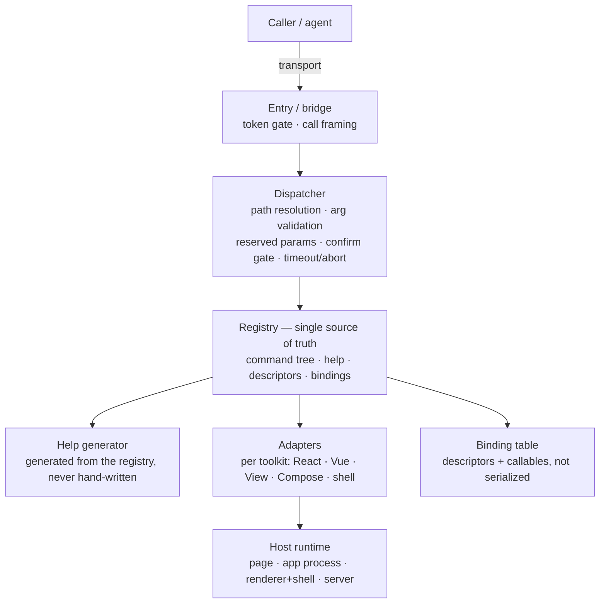

# CLI Protocol Family <span class="version-badge info">v1.0.0</span>

**Shared Architecture and Standard Nomenclature for HTTP CLI, Web CLI, Android CLI, and Electron CLI**

**Version:** 1.0.0
**Status:** Draft
**Created:** Oct 29, 2026
**Last Updated:** Oct 29, 2026

---

## Introduction

The CLI Protocol Family is a set of sibling protocols that map the
ergonomics of a traditional command-line interface — a hierarchical command
tree, progressive `--help` documentation, predictable output — onto the
runtimes an AI agent must explore and operate:

| Protocol | Runtime target | Transport | Call surface |
|----------|----------------|-----------|--------------|
| [HTTP CLI](http-cli.md) | Network service | HTTP | URL-path command tree, `?help` discovery |
| [Web CLI](web-cli.md) | Web page runtime | In-page JavaScript | `exec()` / `help()` methods on a global entry |
| [Android CLI](android-cli.md) | Android app runtime | ADB-forwarded bridge | Call objects (`exec`/`help`/`cancel`) |
| [Electron CLI](electron-cli.md) | Electron app runtime | Loopback HTTP bridge | Call objects (`exec`/`help`/`cancel`) |

All four share one philosophy and one machinery: a **self-describing command
tree** whose help is generated from the very registry that dispatches calls,
a **uniform envelope** with one error model, **declared component semantics**
(descriptors authored at development time), an **auto-increment id** identity
model, and a **bounded, settle-aware async model**.

This family document has two normative parts:

1. **Part I — Standard nomenclature.** The unified vocabulary: parameter
   names, field/property names, function/operation names, and enumerated
   values shared across the protocols. Protocol specs MUST use these names
   as specified here; a protocol spec MAY define additional names but MUST
   NOT redefine a shared one.
2. **Part II — Recommended architecture.** The implementation architecture
   the family recommends (normative-informative): one shared layering, plus a
   reference architecture per protocol.

**Conflict rule:** for a given protocol, its own specification is normative;
this document is normative for the shared vocabulary and where a protocol
spec is silent.

### Conformance language

The key words MUST, MUST NOT, REQUIRED, SHALL, SHALL NOT, SHOULD, SHOULD NOT,
RECOMMENDED, MAY, and OPTIONAL in this document are to be interpreted as
described in RFC 2119 and RFC 8174 when, and only when, they appear in all
capitals.

---

## Family profile matrix (informative)

What each protocol binds, at a glance:

| Dimension | HTTP CLI | Web CLI | Android CLI | Electron CLI |
|-----------|----------|---------|-------------|--------------|
| Entry | Base URL | `globalThis.__WEB_CLI__` | Bridge socket (`android-cli`) | Loopback bridge + discovery file |
| Help form | `?help=1` query | `help()` method | `op: "help"` | `op: "help"` |
| Cancel form | (client abort) | `options.signal` | `op: "cancel"` | `op: "cancel"` |
| Effect marker | `method` (GET/POST/…) | `effects` | `effects` | `effects` |
| Adapters | — | React, Vue, … | View, Compose | Web (renderer), shell |
| Identity scope | resource ids (opaque) | page document | app process | app run |
| Presence family in `/wait/for` | — | — | `screen` | `title` |
| Extra groups | `version` | `comp` `dom` | `app` `view` `input` | `app` `win` `menu` `input` `dev` `dialog` |

---

# Part I — Standard nomenclature

## 1. Naming conventions (family-wide)

| Kind | Rule |
|------|------|
| JSON keys | `snake_case` |
| Command path segments | `^[a-z][a-z0-9_-]*$`; unique among siblings; case-sensitive |
| Command path form | Canonical: leading slash, root = `/` (`/comp/props`). Slash-less input `"comp/props"` and trailing slash `"/comp/props/"` MUST be accepted as equivalent and normalized. |
| Error codes | `^[a-z][a-z0-9_]*$`; custom component codes namespaced `^[a-z][a-z0-9_]*(/[a-z][a-z0-9_]*)*$` (`task/not_found`) |
| Descriptor ids (slugs) | `^[a-z][a-z0-9_-]*$`; unique within the registry |
| Prop / param / function / state names | `^[a-zA-Z_][a-zA-Z0-9_]*$` |
| Localized text | Any text field MAY carry a sibling `<field>_i18n` object: BCP-47 tag → translation |
| Timestamps | RFC 3339 strings in UTC |
| Omission | Omitted key ⇒ not provided; senders SHOULD NOT use `null` for "absent" |
| Forward compatibility | Clients MUST ignore unknown fields, members, ops, and error codes |

## 2. Function, method, and operation names

| Name | Kind | Where | Meaning |
|------|------|-------|---------|
| `exec` | Method (Web) / `op` value (Android, Electron) | All in-app protocols | Execute one command node |
| `help` | Method (Web) / `op` value (Android, Electron) | All | Retrieve one Help document — **first-class; never an `exec` parameter** |
| `cancel` | `op` value | Android, Electron | Cancel an in-flight call by correlation `id` |
| `authorize` | Method (OPTIONAL) | Web | Token handshake returning a scoped call surface |
| `register` | Integration API (informative) | Web, Android, Electron | Register a descriptor + bindings (idempotent) |

**Call-object fields** (Android, Electron wire; the same object is the
conceptual shape of every in-app call):

| Field | Presence | Meaning |
|-------|----------|---------|
| `id` | REQUIRED | Caller-chosen correlation string; responses echo it |
| `op` | REQUIRED | `exec`, `help`, or `cancel` |
| `path` | for `exec`/`help` | Canonical command path; `help` defaults to `/` |
| `args` | OPTIONAL | Command arguments (`exec` only) |
| `options` | OPTIONAL | `detail`, `locale` (help), `timeout`, `signal` |
| `token` | OPTIONAL | Session secret for token-gated runtimes |

HTTP CLI binds the same call concept to HTTP (method + URL path + query
body); Web CLI binds it to method calls (`exec(path, args, options)`,
`help(path, options)`).

## 3. Reserved parameter names

Commands MUST NOT declare these names; the protocol consumes them:

| Name | Consumed by | HTTP CLI | Web CLI | Android CLI | Electron CLI |
|------|-------------|----------|---------|-------------|--------------|
| `help` | the help mechanism | ✓ (query) | ✓ (`help` method) | ✓ (`op: help`) | ✓ (`op: help`) |
| `detail` | help two-level switch | ✓ | ✓ | ✓ | ✓ |
| `fields` | projection | ✓ | ✓ | ✓ | ✓ |
| `locale` | localized text selection | — | ✓ | ✓ | ✓ |
| `confirm` | write confirmation | — | ✓ | ✓ | ✓ |
| `timeout` | per-call bound | — | ✓ | ✓ | ✓ |

Pagination names are RECOMMENDED (not reserved): `limit`, `offset`, `page`,
`cursor`. In-app `exec` MUST reject `help`/`detail` keys in `args` with
`invalid_param` and a hint naming `help`.

## 4. Envelope field names (shared)

Success: `{ "data": …, "meta": … }`. Error: `{ "error": { … } }` — mutually
exclusive.

| Field | Presence | Meaning |
|-------|----------|---------|
| `data` | REQUIRED (success) | Result payload: object, array, scalar, or `null` |
| `meta` | OPTIONAL | Non-semantic metadata (see below) |
| `error` | REQUIRED (failure) | Error object (see below) |
| `error.code` | REQUIRED | Stable machine-readable identifier |
| `error.message` | REQUIRED | Human-readable explanation |
| `error.hint` | OPTIONAL | Actionable next step (RECOMMENDED on caller-fixable errors) |
| `error.details` | OPTIONAL | Structured context (e.g. `parameter`, `id`) |
| `meta.request_id` | OPTIONAL | Correlation identifier |
| `meta.page` / `meta.limit` / `meta.offset` / `meta.total` / `meta.has_more` | OPTIONAL | Pagination block |
| `meta.retry_after_seconds` | OPTIONAL | Throttling hint (HTTP CLI) |
| `meta.locale` | OPTIONAL | Locale applied to the result |
| `meta.settled_at` | OPTIONAL | Settle timestamp (in-app protocols) |
| `meta.elapsed_ms` | OPTIONAL | Wall-clock duration of the call |

Error `details` keys in standard use: `parameter`, `id`, `elapsed_ms`,
`pending`.

## 5. Help document field names (shared)

Discriminated by `kind` (`"group"` | `"command"`):

| Field | Group | Command | Meaning |
|-------|-------|---------|---------|
| `kind` | ✓ | ✓ | `"group"` or `"command"` |
| `path` | ✓ | ✓ | Canonical command path; `/` for root |
| `name` | ✓ | ✓ | This node's segment name |
| `summary` | ✓ | ✓ | One-line description |
| `description` | detail level | detail level | Long form |
| `subcommands` | ✓ | — | Direct children only (progressive disclosure) |
| `params` | — | ✓ | Parameter descriptors |
| `effects` | — | ✓ | `none` \| `read` \| `write` \| `varies` (in-app protocols) |
| `method` | — | ✓ | HTTP method (HTTP CLI's effect marker) |
| `examples` | OPTIONAL | OPTIONAL | Copy-pasteable invocations (detail level) |
| `usage` | OPTIONAL | OPTIONAL | Invocation hint |
| `deprecated` | OPTIONAL | OPTIONAL | `{ "use_instead": …, "note": … }` |
| `protocol_version` | root only | — | Protocol version (semver) |
| `server_version` / `runtime_version` | root only | — | Implementation version (semver) |
| `authentication` | root only | — | Auth discovery object (HTTP CLI) |
| `adapters` | root only | — | Toolkit adapters in effect (in-app protocols) |
| `origin` | root only | — | `declared` \| `inferred` (in-app protocols) |
| `capabilities` | root only | — | Enabled capability strings |

**Parameter descriptor fields** (entries of `params`; also the shape of
descriptor `props`/`functions[].params` with the noted extensions):

| Field | Presence | Meaning |
|-------|----------|-------------|
| `name` | REQUIRED | Parameter name (never a reserved name) |
| `type` | REQUIRED | Declared type (see the value-type vocabulary) |
| `required` | OPTIONAL | Default `false` |
| `default` | OPTIONAL | Default value, native JSON type; omitted ⇒ no default |
| `enum` | REQUIRED iff `type: "enum"` | Allowed values, as strings |
| `description` | REQUIRED | One-line semantics |
| `readonly` | props only | `true` ⇒ writes refused (`/comp/set`, `/view/set`) |
| `example` | props only | A representative value |

**Two-level help:** summary by default; `detail: true` adds `description` and
`examples`. The summary document MUST be a strict subset of the detail
document. **Single source of truth:** help MUST be generated from the
dispatch registry; never hand-written.

## 6. Descriptor field names (shared)

Top level:

| Field | Presence | Meaning |
|-------|----------|-------------|
| `id` | REQUIRED | Stable slug, unique in the registry |
| `name` | REQUIRED | Human-readable name |
| `kind` | REQUIRED | See the kind vocabulary (per protocol) |
| `summary` | REQUIRED | One-line purpose (RECOMMENDED ≤ 120 chars) |
| `description` | OPTIONAL | Long form |
| `version` | OPTIONAL | Descriptor version (semver RECOMMENDED) |
| `tags` | OPTIONAL | Free-form labels for search |
| `props` | OPTIONAL | Input parameter descriptors |
| `state` | OPTIONAL | Exposed state descriptors |
| `functions` | OPTIONAL | Exposed function descriptors |
| `error_codes` | OPTIONAL | Error descriptors |
| `i18n` | OPTIONAL | `{ "default_locale", "locales" }` |
| `deprecated` | OPTIONAL | `{ "use_instead", "note" }` |

**Function descriptor fields:** `name`, `summary`, `description`, `params`,
`returns` (`{type, description}`), `effects` (`none|read|write`), `async`,
`timeout_ms`, `errors`, `deprecated`.

**State descriptor fields:** `name`, `type`, `description`, `readonly`
(default `true`).

**Error descriptor fields:** `code`, `summary`, `description`, `hint`.

## 7. Live-object (node) field names (shared)

| Field | Presence | Meaning |
|-------|----------|-------------|
| `id` | REQUIRED | Auto-increment component id (see §9) |
| `descriptor_id` | iff `origin: "declared"` | Owning descriptor slug |
| `name` | REQUIRED | Runtime object name |
| `origin` | REQUIRED | `declared` \| `inferred` |
| `summary` | iff descriptor | One-line purpose from the descriptor |
| `children_count` | tree nodes | Direct child count (`children_count` may be provisional on `pending` nodes) |
| `status` | OPTIONAL | `ready` \| `pending` (async boundary) |
| `adapter` | OPTIONAL | Toolkit the node came from (`react`, `vue`, `view`, `compose`, …) |

Window objects (Electron) add: `title`, `kind` (`main|auxiliary|tray|hidden`),
`visible`, `focused`, `bounds`. Menu items are addressed by `path`
(slash-joined location), not by id.

## 8. Standard command parameter names (shared)

| Name | Type | Meaning | Used by |
|------|------|---------|---------|
| `id` | integer | Target object id (the universal targeting key) | all targeting commands |
| `parent` | integer | Tree parent id | `comp/tree`, `comp/find`, `view/tree`, `view/find` |
| `depth` | integer | Tree levels to return (default 1) | `*/tree` |
| `keys` | array | Restrict prop/state read to these names | `*/props`, `*/state` |
| `function` | string | Function name to invoke | `*/call` |
| `args` | object | Arguments for the invoked function | `*/call` |
| `props` | object | Prop name → new value map | `*/set` |
| `prop` / `value` | string / any | Wait until `prop` holds `value` | `wait/for` |
| `state` | enum | Wait state: `visible` \| `hidden` \| `gone` | `wait/for` |
| `text` | string | Rendered-text match (find) or appearance (wait) | `*/find`, `wait/for` |
| `selector` | string | CSS selector (renderer elements) | `dom/query` |
| `scope` | integer | Subtree scope by id (`dom/query`); or `app`\|`tray` (`menu`) | `dom/query`, `menu/*` |
| `name` / `tag` | string | Name substring / descriptor tag filter | `*/find` |
| `limit` / `offset` / `page` / `cursor` | integer | Pagination | all list commands |
| `fields` | string | Comma-separated projection whitelist (reserved) | all |
| `detail` | boolean | Help detail level (reserved) | `help` |
| `locale` | string | BCP-47 locale selection (reserved) | all |
| `confirm` | boolean | Must be `true` for writes (reserved) | all writes |
| `timeout` | integer ms | Per-call bound (reserved) | all |
| `win` | integer | Electron window id scoping | Electron renderer commands, `input/*` |
| `x` / `y` / `button` | integer / enum | Pointer coordinates / `left`\|`right`\|`middle` | `input/tap` |
| `key` / `code` / `modifiers` | enum / integer / array | Key name / raw code / `ctrl`\|`alt`\|`shift`\|`meta` | `input/key` |
| `replace` | boolean | Replace vs append text | `input/text` |
| `screen` / `title` | string | Presence family in `wait/for` (Android / Electron) | `wait/for` |

**Value-type vocabulary** (union across the family; protocol schemas
enumerate subsets today and SHOULD converge to the union):

`string`, `integer`, `number`, `boolean`, `enum`, `array`, `object`,
`function`, `any`, plus UI-reference types `node` (canonical), with the
platform aliases `element` (Web, Electron) and `view` (Android) meaning the
same thing, and `resource` (asset reference).

**Projection sentinels** for non-JSON live values:

`"<function>"`, `"<node>"` (aliases `"<element>"`, `"<view>"`),
`"<resource>"`, `"<promise>"`, `"<circular>"`.

## 9. Identity model names (shared)

| Name | Meaning |
|------|---------|
| `id` | Auto-increment integer identifying one live object for its whole life |
| Assignment | At first discovery (tree walk / window listing), depth-first document order; sequence starts at 1, +1 per assignment |
| Scope | Per identity scope (see matrix): never reused within it; a new scope restarts at 1 |
| `stale_id` | The id was assigned, but its instance is no longer live |
| `not_found` | The id was never assigned (beyond the current maximum) |
| Reset | A reset command (`/comp/reset`) invalidates live ids; the counter does not rewind |
| Projection rule | `fields` MUST NOT remove `id` from live-object results |

## 10. Standard error codes

Core codes (all protocols; HTTP CLI maps them to HTTP status codes):

| `code` | When |
|--------|------|
| `invalid_param` | Type/enum/range validation failure |
| `missing_param` | Required parameter absent |
| `unknown_command` | Path does not resolve to a node (hint points at nearest `help`) |
| `not_found` | Target (never-assigned id, descriptor, resource) does not exist |
| `conflict` | State conflict (duplicate, version mismatch) |
| `forbidden` | Credential/token missing, malformed, or insufficient |
| `internal_error` | Unexpected fault (never leaks internals) |

In-app codes (Web, Android, Electron):

| `code` | When |
|--------|------|
| `stale_id` | Id was assigned; its instance is no longer live |
| `unsupported` | Path exists; capability disabled or binding absent |
| `read_only` | Mutation attempted without the `write` capability |
| `confirm_required` | Mutation omitted `confirm: true` |
| `timeout` | Call did not settle within `timeout` |
| `aborted` | Caller cancelled; the call settles with this envelope |

HTTP-transport-only codes: `bad_body`, `method_not_allowed`,
`payload_too_large`, `unsupported_media_type`, `rate_limited`,
`unauthorized` (401 distinct from `forbidden`).

## 11. Enumerated value vocabularies

| Vocabulary | Values | Notes |
|------------|--------|-------|
| `op` | `exec`, `help`, `cancel` | Call-object discriminator |
| Help `kind` | `group`, `command` | |
| `effects` | `none`, `read`, `write`, `varies` | In-app protocols; HTTP CLI uses `method` |
| `origin` | `declared`, `inferred` | |
| Node `status` | `ready`, `pending` | |
| Descriptor `kind` | Web: `component`, `module`, `hook`; Android: `screen`, `view`, `composable`, `module`; Electron: `component`, `window`, `hook`, `module` | Convergence RECOMMENDED in a future MINOR revision |
| Capabilities (shared) | `declared`, `write`, `wait`, `net`, `log` | |
| Capabilities (per protocol) | Web: `dom`, `comp`, `style`; Android: `app`, `view`, `input`, `intent`; Electron: `app`, `win`, `comp`, `dom`, `menu`, `input`, `dev`, `dialog` | Absent capability ⇒ `unsupported` |

## 12. Standard command paths

Reserved top-level group names (MUST NOT be repurposed):

| Protocol | Reserved groups |
|----------|-----------------|
| HTTP CLI | `version` (standard surface); tree is otherwise implementation-defined |
| Web CLI | `version`, `comp`, `dom`, `net`, `log`, `wait` |
| Android CLI | `version`, `app`, `view`, `input`, `wait`, `net`, `log`, `intent` |
| Electron CLI | `version`, `app`, `win`, `comp`, `dom`, `menu`, `input`, `wait`, `net`, `log`, `dev`, `dialog` |

Shared command names (MUST keep these meanings where they exist):

| Path | Meaning |
|------|---------|
| `/version/current` | Protocol/implementation versions, `origin`, `capabilities` |
| `/comp/tree`, `/view/tree` | One level of the UI tree (`parent`, `depth`) |
| `/comp/find`, `/view/find` | Flat search (`id`, `parent`, `name`, `text`, `tag`, `prop`) |
| `/comp/get`, `/view/get` | Descriptor + live data for one id |
| `/comp/props`, `/view/props` | Live prop values (`id`, `keys`) |
| `/comp/state`, `/view/state` | Exposed state entries |
| `/comp/call`, `/view/call` | Invoke an exposed function (`id`, `function`, `args`, `confirm`) |
| `/comp/set`, `/view/set` | Write prop values (`id`, `props`, `confirm`) |
| `/comp/reset` | Invalidate live ids |
| `/dom/query`, `/dom/box`, `/dom/style` | Element find / geometry / computed style |
| `/wait/for` | Condition-based waiting |
| `/app/info` | Application metadata |
| `/input/tap`, `/input/text`, `/input/key` | Synthetic input (`confirm: true`) |

---

# Part II — Recommended architecture

## 13. Shared layering (all protocols)

The family recommends one layering for every implementation:



Principles (RECOMMENDED):

1. **One registry, two consumers.** Dispatch and help derive from the same
   registry. If help says a parameter exists, the dispatcher honors it; if a
   binding is missing, help MUST NOT advertise the function as callable.
2. **Dispatcher as middleware.** Reserved parameters (`fields`, `confirm`,
   `timeout`, …), argument validation, projection, and pagination are handled
   uniformly in the dispatcher, not reimplemented per command.
3. **Adapters isolate toolkits.** Framework/toolkit knowledge (fiber trees,
   semantics trees, window registries) lives behind adapters; the core is
   toolkit-agnostic. Introspection runs where the platform keeps instance
   metadata (e.g. the page's main world for web renderers).
4. **Bindings stay in memory.** Descriptors are data (survive minification);
   callables are not serialized. `/comp/call` resolves through the binding
   table only — never reflection over arbitrary names.
5. **Profiles gate power.** `dev-full` / `release-read` (and `absent`) decide
   capabilities; writes are confirmation-gated everywhere.
6. **Settle is observed, not assumed.** Write envelopes are produced only
   after the adapter observes the corresponding commit.
7. **Black-box conformance.** A conformance suite speaks only the protocol
   (no implementation imports) and runs against any conformant runtime.

## 14. HTTP CLI reference architecture

```
HTTP request
  → front: URL → node resolution (command tree), method check
  → auth middleware (header credentials; 401/403 semantics)
  → dispatcher: query parsing + declared-type coercion,
                 help/detail/fields reserved params, pagination bounds
  → registry: Group/Command tree (single source of truth)
  → handler (read: no side effects; write: POST-class)
  → envelope serializer ({data,meta} | {error}) + status mapping
```

- Help is the `?help=1` query form (HTTP CLI's transport binding of the
  family help operation).
- The standard `version` group (`version/current`, `version/releases`) is
  RECOMMENDED for change discovery (`releases?since=`).
- The black-box conformance suite (`conformance/`) is the family's reference
  harness: envelope shape, help shape, error codes, projection, version
  surface.

## 15. Web CLI reference architecture

```
Page bundle
  → kernel: globalThis.__WEB_CLI__ { protocol_version, exec, help, authorize? }
  → dispatcher (same middleware as the shared layering)
  → registry (descriptors bundled as data + bindings)
  → adapters: React (fiber bridge) / Vue (instance bridge) / inferred fallback
  → observers: wait conditions, error/net/log hooks
```

- The kernel and adapters run in the page's **main world** (framework
  instance metadata is invisible to isolated worlds).
- Third-party injection: a kernel installed via init-script (auto
  re-injection per document) serves `origin: "inferred"` mode with a
  token-closed `exec`.
- Identity scope: one page document. Async model: `options.signal` abort,
  render-commit settle.

## 16. Android CLI reference architecture

```
App process
  → bridge server (abstract local socket, NDJSON call objects, token gate)
  → dispatcher (shared middleware)
  → registry (descriptors in the build + bindings)
  → adapters: View (view hierarchy) / Compose (semantics tree)
  → UI-thread marshaller (settle = UI-thread commit + frame)
  → input synthesizer (platform input pipeline)

Host: adb forward tcp:PORT localabstract:android-cli  →  call objects
```

- Ids are app-process scoped (windows/nodes: one sequence).
- Calls to briefly not-ready surfaces queue within `timeout`.
- No supported injection into third-party app processes — the cooperating
  SDK is required; otherwise fall back to platform UI automation.

## 17. Electron CLI reference architecture

```
Main process (shell)
  → loopback bridge (call objects) + discovery file ({temp}/electron-cli/{app-id}.json)
  → dispatcher (shared middleware)
  → registry (descriptors + bindings) + window/id coordinator
  → shell handlers: /win · /menu · /input (platform input pipeline)
  → per renderer window: Web CLI runtime (main world) via IPC delegation
```

- Renderer surface = Web CLI scoped by the `win` parameter; ids share one
  app-run sequence across windows and nodes; recreated windows get new ids
  (`wait/for {title}` re-resolves).
- Dispatch is allowlisted to the command tree — no raw IPC passthrough.
- Menu affordances are addressed by `path` (menus rebuild dynamically).
- Third-party tiering: cooperating app = full surface; launch-controllable
  third-party = renderer-only via CDP-injected Web CLI kernel; otherwise OS
  automation.

## 18. Cross-cutting implementation checklist

- [ ] Registry generates both dispatch and help (no drift).
- [ ] Reserved parameters handled once, in the dispatcher.
- [ ] Projection never drops `id`; lists are bounded (`limit` + `has_more`).
- [ ] Writes require `confirm: true`; profiles disable `write` outside dev.
- [ ] Every async operation is bounded by `timeout` and cancellable.
- [ ] Settle guarantee documented and honored (or explicitly weakened).
- [ ] Token gate wherever the transport is reachable beyond the caller.
- [ ] Conformance suite runs black-box against the protocol surface.

---

## Versioning

This document versions with the family as a whole and follows Semantic
Versioning alongside the protocol specs. Adding shared names is a MINOR
change (unknown fields are ignored); changing a shared name's meaning is a
MAJOR change and requires the affected protocol specs to move in lockstep.

## Appendix: family name index

| Name | Kind | Section |
|------|------|---------|
| `aborted` | error code | §10 |
| `adapters` | help/version field | §5 |
| `args` | call-object / param | §2, §8 |
| `cancel` | op | §2 |
| `children_count` | node field | §7 |
| `confirm` | reserved param | §3 |
| `confirm_required` | error code | §10 |
| `data` / `meta` / `error` | envelope fields | §4 |
| `declared` / `inferred` | `origin` values | §11 |
| `depth` | param | §8 |
| `descriptor_id` | node field | §7 |
| `detail` | reserved param | §3 |
| `effects` | help/descriptor field | §5, §6 |
| `enum` | param field | §5 |
| `exec` | method / op | §2 |
| `fields` | reserved param | §3 |
| `functions` | descriptor field | §6 |
| `help` | method / op / reserved param | §2, §3 |
| `hint` | envelope field | §4 |
| `id` | call-object, param, node field | §2, §8, §9 |
| `i18n` | descriptor field | §6 |
| `invalid_param` | error code | §10 |
| `keys` | param | §8 |
| `kind` | help/descriptor field | §5, §6, §11 |
| `limit` / `offset` / `page` / `cursor` | pagination params | §3, §8 |
| `locale` | reserved param | §3 |
| `message` / `code` / `details` | envelope fields | §4 |
| `name` | param / field | §5–§8 |
| `not_found` | error code | §10 |
| `offset` | param | §8 |
| `op` | call-object field | §2 |
| `options` | call-object field | §2 |
| `origin` | node/help field | §7, §11 |
| `parent` | param | §8 |
| `path` | call-object / help field | §2, §5 |
| `props` | descriptor / param | §6, §8 |
| `read_only` | error code | §10 |
| `ready` / `pending` | `status` values | §11 |
| `register` | integration API | §2 |
| `required` / `default` / `description` | param fields | §5 |
| `runtime_version` | version field | §5 |
| `scope` | param | §8 |
| `settled_at` | meta field | §4 |
| `stale_id` | error code | §10 |
| `state` | descriptor / param | §6, §8 |
| `summary` | field | §5–§7 |
| `tag` | param | §8 |
| `text` | param | §8 |
| `timeout` | reserved param / error code | §3, §10 |
| `token` | call-object field | §2 |
| `unknown_command` | error code | §10 |
| `usage` / `examples` | help fields | §5 |
| `value` / `prop` | params | §8 |
| `version` | descriptor field / group | §6, §12 |
| `wait/for` | command | §12 |
