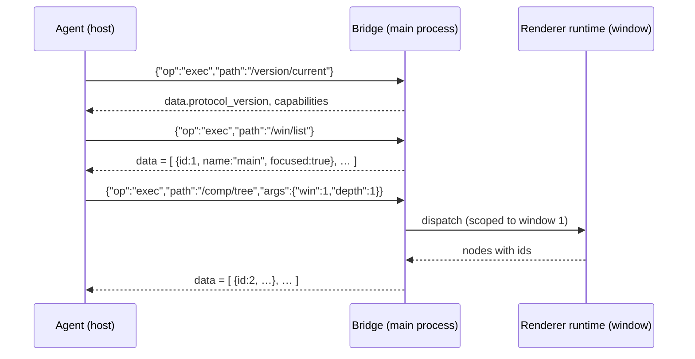

# Electron CLI Protocol <span class="version-badge info">v1.0.0</span>

**A Specification for a Self-Describing, In-App Command Tree for Electron Applications**

**Version:** 1.0.0
**Status:** Draft
**Created:** Oct 29, 2026
**Last Updated:** Oct 29, 2026

---

## Introduction

The Electron CLI Protocol maps the ergonomics of a traditional command-line
interface — a hierarchical command tree, progressive `--help` documentation,
and predictable output — onto the runtime of an Electron desktop
application. The app integrates a small runtime that registers a command
tree and component descriptors; a caller — typically an AI agent on the same
machine — reaches it through a bridge in the main process (RECOMMENDED: a
loopback HTTP endpoint) and explores and operates the live app through
structured commands such as `/win/list` or `/comp/props`, receiving uniform
JSON envelopes.

Electron CLI is a sibling of the [HTTP CLI Protocol](http-cli.md), the
[Web CLI Protocol](web-cli.md), and the [Android CLI Protocol](android-cli.md).
It composes two surfaces from the family:

- a **shell surface** (`/app`, `/win`, `/menu`, `/input`) owned by the main
  process — windows, menus, and desktop input;
- a **renderer surface** (`/comp`, `/dom`) that is the Web CLI command
  surface scoped to a window. An Electron renderer *is* a web page; renderer
  commands keep Web CLI semantics exactly and add a `win` parameter.

The family shares one output envelope, one error model, one progressive-help
philosophy, one component-id identity model, and one async model. Shared
standard nomenclature and recommended implementation architecture:
[cli-family.md](cli-family.md).

### Design goals

1. **Progressive, help-driven discovery.**
   Every level of the command tree explains itself *on demand*. Callers drill
   down one level at a time; token consumption stays proportional to the
   task, not to the size of the app.

2. **A uniform output contract.**
   Every result — data, help, or failure — uses one envelope, one error model,
   and one async model (bounded, cancellable, settle-aware).

3. **Declared component semantics.**
   Windows, components, and modules carry *author-written descriptions* —
   purpose, prop semantics, enums, exposed actions, error codes,
   internationalization metadata — authored at development time and
   **injected into the compiled build** as data.

4. **Shell + renderer composition.**
   Desktop-specific surfaces (windows, menus, input) live alongside the
   family's web surface, so an agent drives the whole app — chrome and
   content — with one call model.

5. **Graceful degradation and safe defaults.**
   Runtimes without descriptors serve structural introspection
   (`origin: "inferred"`). Mutation commands are opt-in, confirmation-gated,
   and off in release profiles by default.

### Non-goals

- This protocol does not replace OS-level desktop automation (accessibility
  APIs, screenshot-driven control); it is a discovery- and task-oriented
  façade over a cooperating Electron app's own runtime.
- It does not control other applications' windows, the OS desktop, or the
  menu bar of the host system — only the app's own surfaces.
- It does not define any application resource or domain model. Descriptors
  and command extensions are entirely implementation-defined.
- It does not expose arbitrary code execution in the main process or raw IPC
  channel proxying; only registered command-tree nodes are dispatchable.
- It does not support runtime insertion of new nodes into a live renderer
  composition beyond what the app's own APIs expose.

### Terminology

| Term | Meaning |
|------|---------|
| **Bridge** | The transport endpoint in the main process through which callers exchange call objects and envelopes. |
| **Shell** | The Electron main process: app lifecycle, windows, menus, native input. |
| **Window** | A live `BrowserWindow`-class surface of the app (main window, auxiliary windows, hidden/splash windows). |
| **Call object** | The transport-neutral request `{id, op, path, args, options, token}` shared with the Android CLI wire protocol. |
| **Command path** | The slash-separated, root-anchored path that identifies a node, e.g. `/comp/props`; `/` is the root. |
| **Descriptor** | An author-written, JSON-serializable document describing a window, component, hook, or module: purpose, props, exposed functions, error codes, and i18n metadata. |
| **Registry** | The app-level store of descriptors and runtime bindings, from which both dispatch and help are derived. |
| **Component id** | An auto-increment integer that identifies one live object (window or renderer node) for its whole life within an app run; assigned at first discovery, never reused. |
| **Origin** | Whether a node's semantics are `declared` (a descriptor exists) or `inferred` (runtime introspection only). |
| **Settle** | The point at which a mutation's effect becomes observable (render commit for renderer state; platform application for shell state). |
| **Envelope** | The top-level JSON object of every successful or failed result. |
| **Projection** | Caller-side selection of result fields via the reserved `fields` parameter. |

### Conformance language

The key words MUST, MUST NOT, REQUIRED, SHALL, SHALL NOT, SHOULD, SHOULD NOT,
RECOMMENDED, MAY, and OPTIONAL in this document are to be interpreted as
described in RFC 2119 and RFC 8174 when, and only when, they appear in all
capitals.

---

## Changes from previous versions

This is the first release of the Electron CLI Protocol. See the repository
`CHANGELOG.md` for subsequent revisions.

---

## Protocol overview & data flow

A caller first reaches the bridge, negotiates capabilities, then walks the
tree with help calls before executing commands:

```
0. locate the bridge (discovery file)              → reach the endpoint
1. {"op":"exec","path":"/version/current", …}      → detection + negotiation
2. {"op":"help","path":"/", …}                     → root group help
3. {"op":"exec","path":"/win/list", …}             → windows and their ids
4. {"op":"exec","path":"/comp/tree","args":{…}}    → one level of a renderer tree
5. {"op":"exec","path":"/comp/props","args":{…}}   → execute
```

Every step is one call object and one envelope on the bridge; help documents
and command results share one envelope.



---

## Detection & bootstrap

### The bridge

A conformant runtime exposes a bridge endpoint in the **main process**. The
standard binding is **loopback HTTP**: the runtime serves an HTTP endpoint
on `127.0.0.1` (port chosen at startup) accepting `POST` with a call object
as the JSON request body and returning the envelope (with echoed `id`) as
the JSON response body.

**Call object** (shared with the Android CLI wire protocol):

```json
{"id": "r1", "op": "exec", "path": "/comp/props", "args": {"win": 1, "id": 3}, "options": {}, "token": "…"}
```

| Field | Presence | Description |
|-------|----------|-------------|
| `id` | REQUIRED | Caller-chosen correlation string; responses echo it. |
| `op` | REQUIRED | `exec`, `help`, `batch` (ordered multi-call via `calls`, per [cli-family.md](cli-family.md) §2), or `cancel` (OPTIONAL). |
| `path` | for `exec`/`help` | Canonical command path; `help` defaults to `/`. |
| `args` | OPTIONAL | Command arguments (`exec` only); omitted ⇒ `{}`. |
| `options` | OPTIONAL | `detail`, `locale` (help); `timeout`; see the async model. |
| `token` | OPTIONAL | Session secret for token-gated runtimes (see Security). |

**Response** (JSON body):

```json
{"id": "r1", "data": {"id": 3, "props": {…}}, "meta": {"request_id": "…"}}
```

Rules:

- Correlation is by `id` alone; concurrent requests MAY complete out of
  order. (Under the HTTP binding each request/response pair is one HTTP
  exchange; under alternative bindings the call objects are identical.)
- `op: "help"` is the family's help mechanism — a first-class operation,
  **never a parameter of `exec`**. `exec` MUST reject an `args` object
  containing `help` or `detail` with `invalid_param` and a `hint` naming
  `help`.
- `op: "cancel"` (OPTIONAL) references an in-flight `id` and causes it to
  settle promptly with an `aborted` error envelope.
- Runtimes MAY expose alternative bindings (unix socket, stdio) carrying the
  same call objects and envelopes.

### Endpoint discovery

Out-of-band discovery is required because the port is chosen at startup. The
RECOMMENDED mechanism is a **discovery file**: on startup the runtime writes
`{temp}/electron-cli/{app-id}.json` (permissions restricted to the current
user) containing:

```json
{ "base_url": "http://127.0.0.1:42113", "app_id": "com.example.notes", "token": "…" }
```

| Field | Presence | Description |
|-------|----------|-------------|
| `base_url` | REQUIRED | The bridge endpoint. |
| `app_id` | REQUIRED | Stable application identifier (usually the package name). |
| `token` | OPTIONAL | Session secret when the runtime is token-gated; MAY instead be distributed out of band. |

The file is removed on clean shutdown. Runtimes MAY document a fixed port or
another discovery channel instead; whatever the channel, the call objects
and envelope are exactly as specified here.

### Detection procedure (informative)

```
1. read {temp}/electron-cli/{app-id}.json  → endpoint + token
   (or use the app's documented endpoint)
2. POST {"id":"r0","op":"exec","path":"/version/current"}
   → no file / connection refused ⇒ no Electron CLI present;
     fall back to OS-level desktop automation (accessibility / screenshots)
```

### Capability negotiation

`/version/current` is the authoritative statement of what a runtime supports:

| Capability | Meaning |
|------------|---------|
| `app` | `/app/*` commands are available. |
| `win` | `/win/*` commands are available. |
| `comp`, `dom` | Renderer commands are available (Web CLI surface). |
| `menu` | `/menu/*` commands are available. |
| `input` | `/input/*` commands are available. |
| `declared` | At least one descriptor is registered. |
| `write` | Mutation commands (`/win/focus`, `/win/close`, `/comp/set`, `/comp/call` writes, `/menu/invoke`, `/input/*`) are enabled. |
| `wait` | The `/wait/for` command is available. |
| `net`, `log`, `dev`, `dialog` | Extension groups. |

A capability absent from the array MUST be treated as unavailable; attempting
its commands MUST fail with `unsupported` (not `unknown_command`).

### Degradation modes

| Mode | When | Behavior |
|------|------|----------|
| `declared` | Descriptors registered (app ships Electron CLI) | Full semantics: summaries, prop docs, enums, error codes, i18n metadata. |
| `inferred` | Runtime without descriptors | Structural introspection only; nodes carry `origin: "inferred"`; `/comp/call` is unavailable unless function bindings exist. |

---

## Core model: the command tree

### Nodes

A runtime's capabilities are exposed as a tree of **group nodes** and
**command nodes** rooted at the bridge. The root is a group node addressed
as `/` (path normalization below).

- A call addressed to a **group node** returns its Help document (a listing
  of its direct children). Group nodes are never executed.
- A call addressed to a **command node** executes the command with the
  supplied `args`; its Help document is obtained through `help`.

Command paths are rooted at `/`, mirroring the URL-path style of HTTP CLI:
the root is `/`, and below it `/comp/props`, `/win/list`, `/version/current`.
This leading-slash form is canonical — help documents emit it and every
example uses it. Runtimes MUST accept the canonical form; they MUST also
accept the same path with its leading slash omitted ("win/list" ≡
"/win/list") and with a trailing slash added ("/win/list/" ≡ "/win/list").
Omitted `path` in `help` (or `""`) addresses the root like `"/"`.

### Naming rules

Each path segment (node name):

- MUST match `^[a-z][a-z0-9_-]*$` (lowercase ASCII, digits, `_`, `-`).
- MUST be unique among its siblings. Names are case-sensitive; uppercase is
  not permitted.
- MUST NOT contain `/`, `.`, `?`, `#`, or whitespace.

Standard top-level group names are reserved for their standard meaning:
`version`, `app`, `win`, `comp`, `dom`, `menu`, `input`, `wait`, `net`,
`log`, `dev`, `dialog`. Implementations MAY add custom groups (e.g. `data`),
which SHOULD NOT collide with the reserved names.

### Command effects

Each command node declares an `effects` class in its Help document:

| `effects` | Meaning |
|-----------|---------|
| `none` | Pure metadata; free of side effects (help, version). |
| `read` | Reads app/UI state; MUST be free of side effects. |
| `write` | Mutates app/UI state (window ops, prop writes, actions, input). |
| `varies` | Effect depends on arguments (e.g. `/comp/call` on a function's own declaration). |

- `none` and `read` commands MUST NOT mutate state.
- `write` commands and `varies` commands resolving to a write MUST require the
  reserved `confirm` parameter (see
  [Mutation & confirmation](#mutation--confirmation)).
- Implementations that wish to keep destructive operations away from
  non-human callers SHOULD omit those commands from the tree, or ship with
  the `write` capability disabled.

### Reserved parameter names

Commands MUST NOT declare parameters named `help`, `fields`, `detail`,
`locale`, `confirm`, or `timeout`; these names belong to the protocol
surface:

- `help` and `detail` are consumed by the `help` bridge operation.
- `fields`, `locale`, `confirm`, and `timeout` are consumed as reserved keys
  inside `exec` args.

Because the names are reserved, `exec` MUST reject an `args` object
containing `help` or `detail` with `invalid_param` and a `hint` naming
`help`. `timeout` (integer milliseconds) bounds a single call's wall-clock
time and is honored by every command; on expiry the call settles with a
`timeout` error rather than hanging.

The names `limit`, `offset`, `page`, and `cursor` are RECOMMENDED for
pagination but are not reserved.

---

## Component descriptors

Descriptors are the protocol's answer to "what is this window or component
*for*?" They are authored by developers next to the code they describe,
serialized as data, and **injected into the compiled build** so that runtime
introspection carries human-written semantics.

### Authoring locations (informative)

A descriptor MUST be JSON-serializable. Typical authoring forms:

- a colocated module (`task-row.descriptors.ts`) exporting the descriptor;
- a component-level option (an annotation, or a static property on a window
  factory or component);
- a standalone manifest (`electron-cli.descriptors.json`) merged at build
  time.

All forms compile down to the same registry entries; the serialized form
below is normative.

### Serialized descriptor

```json
{
  "id": "task-row",
  "name": "TaskRow",
  "kind": "component",
  "summary": "Displays one task with completion toggle and selection.",
  "description": "Renders a single task row. Long titles truncate. Clicking
     the row selects the task; the checkbox toggles completion.",
  "version": "1.2.0",
  "tags": ["tasks", "row"],
  "props": [
    {
      "name": "task",
      "type": "object",
      "required": true,
      "description": "The task to display; must carry id, title, and done."
    },
    {
      "name": "density",
      "type": "enum",
      "enum": ["compact", "comfy"],
      "default": "comfy",
      "description": "Row height variant."
    }
  ],
  "state": [
    { "name": "selected", "type": "boolean", "description": "Whether the row is selected.", "readonly": true }
  ],
  "functions": [
    {
      "name": "markDone",
      "summary": "Marks the task complete and re-renders the row.",
      "params": [],
      "returns": { "type": "object", "description": "The updated task." },
      "effects": "write",
      "async": true,
      "timeout_ms": 5000,
      "errors": ["task/not_found"]
    }
  ],
  "error_codes": [
    {
      "code": "task/not_found",
      "summary": "The referenced task does not exist.",
      "hint": "List available ids via /data/tasks."
    }
  ],
  "i18n": { "default_locale": "en", "locales": ["en", "de"] }
}
```

### Descriptor fields

| Field | Kind | Presence | Description |
|-------|------|----------|-------------|
| `id` | slug | REQUIRED | Stable identifier, unique within the registry. Matches `^[a-z][a-z0-9_-]*$`. |
| `name` | string | REQUIRED | Human-readable name (component, window, or module name). |
| `kind` | enum | REQUIRED | `component`, `window`, `hook`, or `module`. |
| `summary` | text | REQUIRED | One-line purpose. RECOMMENDED ≤ 120 characters. |
| `description` | text | OPTIONAL | Long form: behavior, edge cases, composition. |
| `version` | string | OPTIONAL | Descriptor version (semver RECOMMENDED), independent of app version. |
| `tags` | string[] | OPTIONAL | Free-form labels for search (`/comp/find?tag=`). |
| `props` | prop[] | OPTIONAL | Input parameters (attributes). |
| `state` | state[] | OPTIONAL | Exposed internal state entries readable via `/comp/state`. |
| `functions` | function[] | OPTIONAL | Actions the object exposes for invocation via `/comp/call`. |
| `error_codes` | error[] | OPTIONAL | Error codes this component/function family may return. |
| `i18n` | object | OPTIONAL | `{ "default_locale": "en", "locales": ["en", "de"] }`. |
| `deprecated` | object | OPTIONAL | `{"use_instead": "task-row-v2", "note": "…"}`. |

**Prop descriptors** (entries of `props`):

| Field | Presence | Description |
|-------|----------|-------------|
| `name` | REQUIRED | Prop name (identifier-shaped). |
| `type` | REQUIRED | One of `string`, `integer`, `number`, `boolean`, `enum`, `array`, `object`, `function`, `element`, `node`, `any`. |
| `required` | OPTIONAL | Default `false`. |
| `default` | OPTIONAL | Default value, native JSON type. Omitted ⇒ no default. |
| `enum` | REQUIRED when `type` is `enum` | Allowed values, as strings. MUST be absent otherwise. |
| `description` | REQUIRED | One-line semantics. |
| `readonly` | OPTIONAL | Default `false`. `true` for props that must not be written via `/comp/set`. |
| `example` | OPTIONAL | A representative value. |

**State descriptors** (entries of `state`): `name`, `type`, `description`
(REQUIRED), `readonly` (OPTIONAL, default `true`).

**Function descriptors** (entries of `functions`):

| Field | Presence | Description |
|-------|----------|-------------|
| `name` | REQUIRED | Function name (identifier-shaped). |
| `summary` | REQUIRED | One-line purpose. |
| `description` | OPTIONAL | Long form. |
| `params` | OPTIONAL | Parameter descriptors (same shape as props minus `readonly`/`example`). |
| `returns` | REQUIRED | `{ "type": <value type>, "description": <text> }`. For `async` functions, the **resolved** value. |
| `effects` | REQUIRED | `none`, `read`, or `write`. Gates `/comp/call` confirmation. |
| `async` | OPTIONAL | Default `false`. `true` when the binding is asynchronous; `/comp/call` awaits the resolved value within `timeout`. |
| `timeout_ms` | OPTIONAL | Recommended await bound in milliseconds; runtime default applies when absent. |
| `errors` | OPTIONAL | Error codes this function may return. |
| `deprecated` | OPTIONAL | As above. |

**Error descriptors** (entries of `error_codes`):

| Field | Presence | Description |
|-------|----------|-------------|
| `code` | REQUIRED | Stable identifier matching `^[a-z][a-z0-9_]*(/[a-z][a-z0-9_]*)*$`. Custom codes SHOULD be namespaced `<scope>/<code>`; bare codes are reserved for the [standard table](#standard-error-codes). |
| `summary` | REQUIRED | One-line meaning. |
| `description` | OPTIONAL | Long form. |
| `hint` | OPTIONAL | Actionable next step — RECOMMENDED on every caller-fixable error. |

### Localized text

Any human-readable text field MAY be accompanied by a sibling
`<field>_i18n` object mapping BCP-47 locale tags to translations:

```json
"summary": "Displays one task with completion toggle and selection.",
"summary_i18n": { "de": "Zeigt eine Aufgabe mit Abschluss-Schalter und Auswahl." }
```

When `locale` is supplied (a reserved `exec` args key, or a `help` option),
a runtime that has a translation for the requested locale MUST return the
translated text, falling back to the unlocalized field otherwise.

### Registration & build injection (normative)

1. Descriptors MUST be available from the registry at runtime — embedded in
   the build or shipped as a lazily loaded manifest — and MUST be reachable
   through the standard bridge regardless of storage.
2. Descriptors are **data**: they MUST survive minification and bundling
   unchanged. Implementations MUST NOT rely on reflection, function names,
   or source comments surviving compilation.
3. Registration MUST be idempotent; re-registering an `id` replaces the
   previous entry.
4. Function *bindings* are kept in memory alongside the serialized
   descriptor and MUST NOT be serialized. `/comp/call` resolves
   `(node id, function name)` through the binding table; when no binding
   exists the command fails with `unsupported`.
5. Release profiles SHOULD gate discovery: register descriptors only in dev
   builds, or serve them with `write` disabled. Descriptors MUST NOT contain
   secrets.

### Descriptor ↔ live object linking

Query commands return nodes shaped as:

```json
{
  "id": 2,
  "descriptor_id": "task-row",
  "name": "TaskRow",
  "origin": "declared",
  "summary": "Displays one task with completion toggle and selection.",
  "children_count": 2
}
```

- `id` is REQUIRED on every live object — window or renderer node — the
  instance's auto-increment component id (see
  [Ids](#ids-component-identity)). Targeting commands and query filters
  accept it; a dead instance's id fails with `stale_id`.
- `descriptor_id` is present iff `origin` is `declared`; `name` is the
  runtime object name.
- `summary` is present iff a descriptor exists; clients MUST tolerate its
  absence.
- `status`, when present, is `ready` or `pending`. `pending` marks an async
  boundary (a window still loading, an in-flight render) whose subtree may
  still change when it settles.

---

## Progressive help (self-description)

Help is the protocol's discovery mechanism. It is a first-class bridge
operation — never a parameter of `exec`:

```json
{"id": "r2", "op": "help", "path": "/"}
{"id": "r3", "op": "help", "path": "/win"}
{"id": "r4", "op": "help", "path": "/comp/props", "options": {"detail": true}}
```

- `help` addresses exactly one node and returns its Help document in the
  success envelope. (`exec` on a group node also returns that group's Help
  document; group nodes are never executed.)
- `options.detail` (boolean) selects the detail level; `options.locale`
  requests localized text; `options.timeout` bounds the call.
- An unknown `path` fails with `unknown_command` and a `hint` pointing at the
  nearest valid `help` call.

### Single source of truth (normative)

The Help document MUST be generated from the same registry that dispatches
calls. Implementations MUST NOT maintain a separate, hand-written help
artifact that can drift from actual behavior. If help says a parameter
exists, the dispatcher MUST honor it; if the dispatcher rejects a parameter,
help MUST NOT advertise it.

### Group help

A `help` call on a group node returns a **group Help document**:

```json
{
  "data": {
    "kind": "group",
    "path": "/win",
    "name": "win",
    "summary": "Window enumeration and control",
    "subcommands": [
      { "kind": "command", "name": "list",  "path": "/win/list",  "effects": "read",  "summary": "List the app's live windows" },
      { "kind": "command", "name": "get",   "path": "/win/get",   "effects": "read",  "summary": "Details for one window" },
      { "kind": "command", "name": "focus", "path": "/win/focus", "effects": "write", "summary": "Bring a window to the front" },
      { "kind": "command", "name": "close", "path": "/win/close", "effects": "write", "summary": "Close a window" }
    ],
    "usage": "op=exec, path=/win/<command>, args={…}"
  }
}
```

**Depth limiting (token economy):** group help MUST list only its *direct*
children, each with a one-line `summary` and its `effects` class. It MUST NOT
inline the nested tree or parameter schemas.

The root group help additionally MAY carry `protocol_version`,
`runtime_version`, `adapters`, `origin`, and `capabilities`.

### Command help

A `help` call on a command node returns a **command Help document**:

```json
{
  "data": {
    "kind": "command",
    "path": "/comp/props",
    "name": "props",
    "effects": "read",
    "summary": "Current prop values of a node",
    "description": "Returns the live prop values of the renderer node identified by id.",
    "params": [
      { "name": "win",  "type": "integer", "required": false, "description": "Window id from /win/list; defaults to the active window." },
      { "name": "id",   "type": "integer", "required": true,  "description": "Target node id from /comp/tree or /comp/find." },
      { "name": "keys", "type": "array",  "required": false, "description": "Restrict to these prop names; omit for all." }
    ],
    "examples": [
      "{\"op\":\"exec\",\"path\":\"/comp/props\",\"args\":{\"win\":1,\"id\":3,\"fields\":\"text,enabled\"}}"
    ]
  }
}
```

### Help document fields

| Field | Kind | Presence | Description |
|-------|------|----------|-------------|
| `kind` | `"group"` \| `"command"` | REQUIRED | Discriminator of the Help document. |
| `path` | string | REQUIRED | Command path; `"/"` for the root node. |
| `name` | string | REQUIRED | This node's segment name. |
| `effects` | string | command only | `none`, `read`, `write`, or `varies`. |
| `summary` | string | REQUIRED | One-line description. |
| `description` | string | OPTIONAL | Long form; RECOMMENDED on command nodes only. |
| `subcommands` | array | group only | Direct children: `kind`, `name`, `path`, `effects`, `summary` (all REQUIRED). |
| `params` | array | command only | Parameter descriptors. |
| `examples` | array of strings | OPTIONAL | Copy-pasteable request lines. |
| `usage` | string | OPTIONAL | Human-readable invocation hint. |
| `deprecated` | object | OPTIONAL | `{"use_instead": "/comp/get", "note": "…"}`. |

### Parameter descriptor fields

| Field | Presence | Description |
|-------|----------|-------------|
| `name` | REQUIRED | Parameter name. MUST NOT be a reserved name. |
| `type` | REQUIRED | One of `string`, `integer`, `number`, `boolean`, `enum`, `array`, `object`. |
| `required` | OPTIONAL | Default `false`. |
| `default` | OPTIONAL | Default value, native JSON type; omitted ⇒ no default. |
| `enum` | REQUIRED when `type` is `enum` | Allowed values, as strings. |
| `description` | REQUIRED | One-line semantics. |

Arguments are passed as native JSON values. A value that fails the declared
type, or an `enum` value not in the list, MUST be rejected with
`invalid_param` and the error's `hint` MUST list the allowed values. Unknown
arguments SHOULD be rejected with `invalid_param` and a hint naming the
closest declared parameter (implementations MAY instead ignore them, but
MUST document the choice).

### Two-level help: summary by default, detail on demand

- **Summary level (default).** Group help: direct children with `kind`,
  `name`, `path`, `effects`, `summary`, plus `usage`; no `description`.
  Command help: `params` and `usage`; no long-form `description` or
  `examples`.
- **Detail level (`help` with `options.detail: true`).** The same document
  plus long-form `description` and `examples`.

Rules: `detail` is a boolean `help` option (`true` selects detail,
`false`/absent selects summary; any other value ⇒ `invalid_param`); the
summary document MUST be a strict subset of the detail document; clients
MUST tolerate missing fields at summary level.

### Self-description guarantee

Help documents are authoritative. A conformant client MAY rely on:

- every child listed in a group Help document being invocable at its `path`;
- every command Help document listing every parameter the dispatcher accepts
  (except reserved names);
- errors on unknown commands or parameters carrying a `hint` that points back
  to the nearest valid `help` call.

---

## Requests

### Executing a command

```json
{"id": "r5", "op": "exec", "path": "/comp/set", "args": {"win": 1, "id": 3, "props": {"density": "compact"}, "confirm": true}}
```

- **Read:** `{"op":"exec","path":"/comp/props","args":{"win":1,"id":3,"fields":"text,enabled"}}`
- **Write:** the line above; `confirm: true` is mandatory for writes.
- **Help:** `{"op":"help","path":"/comp/set","options":{"detail":true}}` —
  the `help` operation, never an `exec` parameter.
- `args` is a plain object; omitted ⇒ `{}`. Non-object `args` MUST be
  rejected as a programming error.
- Reserved keys inside `args` (`fields`, `locale`, `confirm`, `timeout`) are
  always interpreted by the protocol, never by the command; `help` and
  `detail` MUST NOT appear in `args`.
- The `win` parameter (integer window id) scopes renderer commands to one
  window. It is OPTIONAL and defaults to the **active window** (the focused
  window, or the most recently focused one); runtimes document the default
  in help. Shell commands (`/app`, `/win`, `/menu`, `/input`) are app-scoped
  and take `win` only where a window is the target.

### Field projection

Every command that returns JSON objects supports the reserved `fields`
parameter, a comma-separated whitelist of top-level keys to return:

```json
{"op":"exec","path":"/comp/get","args":{"win":1,"id":2,"fields":"descriptor_id,name,summary"}}
```

- Only the requested keys are returned, for a single object or each element
  of an array in `data`.
- On live-object results, `id` is always retained even when `fields` omits
  it — projection MUST NOT destroy the targeting key.
- Unknown keys in `fields` MUST be ignored (forward compatibility).
- `fields` MUST NOT change the meaning of a result or the `meta` block.
- Nested selection (dot paths) is NOT defined in this version; runtimes MUST
  ignore or reject dotted names consistently and document which.

### Pagination

List-returning commands SHOULD paginate. Two conventions are allowed; the
implementation picks one and documents it in the command's Help document:

- **Offset form:** `offset` (0-based) + `limit`; or
- **Page form:** `page` (1-based) + `limit`.

When `meta` is present on a list result it SHOULD use:

```json
"meta": { "request_id": "r5", "limit": 20, "total": 137, "has_more": true }
```

Runtimes MUST enforce a maximum `limit` (documented in help) and SHOULD
default to 20.

### Ids (component identity)

Every live object — window or renderer node — carries an **id** (component
id): an auto-increment integer that precisely identifies that instance for
its whole life.

- **Assignment at first discovery.** Windows get their id when first listed
  (`/win/list`, or any call that resolves them); renderer nodes get theirs
  on the first tree walk that sees them, in depth-first order. The sequence
  is integers starting at 1, +1 per assignment, **shared across the whole
  app** (windows and nodes draw from one counter).
- **Never reused within an app run.** An id keeps pointing at the same
  instance across renders and route changes; a destroyed instance's id is
  retired, not recycled. Closing and reopening a window — or recreating a
  destroyed main window — yields **new** ids for the new instances. An app
  restart restarts the sequence at 1.
- **Precise targeting & querying.** Targeting commands take `id`; renderer
  queries support `/comp/find {id: [2, 5]}` and `{parent: 2}`;
  `/comp/tree {parent: 2}`; the `win` parameter selects a window by its id.
- **Death of an id.** Targeting a destroyed instance — an id from before a
  window recreation or app restart — MUST fail with `stale_id` and a `hint`
  to re-query (`/win/list`, `/comp/tree`, or `/comp/find`). An id that was
  never assigned fails with `not_found`.
- Tree reads are point-in-time snapshots. Async rendering mutates the tree
  between calls; re-query after `/wait/for` or a write's settle, and do not
  poll blindly.
- `/comp/reset` (OPTIONAL command) invalidates all live ids and releases
  retained instances — RECOMMENDED for long agent sessions on heavy apps.
  The counter does not rewind.

### Async calls, concurrency & cancellation

The app runtime is asynchronous by nature — windows load lazily, actions
complete on background threads, renders commit on later ticks. The async
model:

- **Calls MAY overlap.** Requests in flight at the same time settle
  independently; responses MAY arrive out of order and are correlated by
  `id`. Runtimes MUST dispatch effectful work in arrival order but MAY
  interleave during internal awaits.
- **Every call is bounded.** The reserved `timeout` (integer ms; an `exec`
  args key, a `help` option) limits a single call's wall-clock time; on
  expiry the call settles with a `timeout` error envelope. A runtime's
  default bound MUST be documented in help and a call MUST NOT hang
  indefinitely.
- **Not-ready windows are queued, not rejected.** Runtimes SHOULD hold calls
  targeting a window that is briefly not ready (initial load, navigation,
  recreation) and settle them when the window becomes ready, within the
  call's `timeout`; only then do they fail with `timeout`.
- **Cancellation is caller-side.** `op: "cancel"` referencing an in-flight
  `id` makes that call settle promptly with an `aborted` error envelope (it
  still responds — the envelope is the single parse path); work already
  started MAY still complete.
- **Reads observe instants, not states.** Two reads may legitimately
  disagree. For a consistent window, prefer one call with `fields`, or
  sequence write → read through the settle guarantee and `/wait/for`.

### Mutation & confirmation

- Commands with `effects: "write"` (and `varies` commands resolving to a
  write) MUST reject invocations lacking `confirm: true` with the error code
  `confirm_required`. A mutation is never accidental.
- `/comp/set` MUST refuse `readonly` props with `invalid_param` and a hint
  naming the offending prop.
- Runtimes shipped with the `write` capability disabled MUST fail writes with
  `read_only`, keeping the commands discoverable but inert.

**Settle guarantee (read-after-write consistency):** a write command's
success envelope MUST NOT be produced before the runtime has observed the
corresponding commit — renderer state: the render commit/flush; shell state:
platform application (window focused, menu invoked). A caller that reads
after a successful write therefore sees the write's effects or a later state
— never the pre-write value with success reported. Runtimes that cannot
observe commits MUST document the weaker guarantee in help; `meta` MAY carry
`settled_at`. Pixel-level effects may trail the commit — use `/wait/for` for
those.

**Failed writes carry their outcome.** When a write call fails with
`timeout`, `aborted`, or `internal_error`, the error MUST carry
`details.mutation` (`none` | `possible` | `applied`) and a `hint` stating
how to verify (see [cli-family.md](cli-family.md) §4). `possible` means do
not blind-retry: re-read the target (`/comp/props`, or the business record)
before resubmitting.

---

## Responses

Every result is a single JSON object — the family's shared **envelope**
(`schemas/envelope.schema.json`), carried with the echoed `id`:

### Success envelope

```json
{ "id": "r5", "data": { … }, "meta": { … } }
```

| Field | Presence | Description |
|-------|----------|-------------|
| `data` | REQUIRED | The result: object, array, scalar, or `null`. Help documents are delivered in `data` like any other result. |
| `meta` | OPTIONAL | Non-semantic metadata: `request_id`, pagination, `locale`, `settled_at`, `truncated`/`continue`, `events`, timing (extended keys per [cli-family.md](cli-family.md) §4). Clients MUST NOT interpret undocumented `meta` keys. |

### Error envelope

```json
{
  "id": "r6",
  "error": {
    "code": "stale_id",
    "message": "id 7 is no longer live",
    "hint": "re-query with /win/list or /comp/tree to obtain live ids",
    "details": { "id": 7 }
  }
}
```

| Field | Presence | Description |
|-------|----------|-------------|
| `code` | REQUIRED | Stable, machine-readable identifier: `^[a-z][a-z0-9_]*$`. |
| `message` | REQUIRED | Human-readable explanation. |
| `hint` | OPTIONAL | Actionable next step — RECOMMENDED on every caller-fixable error. |
| `details` | OPTIONAL | Structured context (e.g. offending parameter name). |

An error result MUST NOT contain `data`; a success result MUST NOT contain
`error`.

### Standard error codes

| `code` | When |
|--------|------|
| `invalid_param` | Value fails type/enum/range validation. |
| `missing_param` | A required parameter is absent. |
| `unknown_command` | Path does not resolve to a node. |
| `not_found` | Command exists but the target (id never assigned, descriptor, resource) does not. |
| `stale_id` | The supplied id was assigned, but its instance is no longer live (destroyed, or the app has restarted). |
| `unsupported` | The path exists but the capability is disabled or unbound. |
| `read_only` | A mutation was attempted in a runtime without the `write` capability. |
| `confirm_required` | A mutating call omitted `confirm: true`. |
| `forbidden` | Token missing, malformed, or mismatched. |
| `conflict` | State conflict (duplicate, version mismatch). |
| `timeout` | The call did not settle within the `timeout` bound. `details.elapsed_ms` and `details.pending` RECOMMENDED. |
| `aborted` | The caller cancelled via `op: "cancel"`. Work already started MAY still complete. |
| `internal_error` | Unexpected runtime fault. |

- `unknown_command` errors MUST include a `hint` pointing at the nearest
  valid `help` call (e.g. `help /win to see available subcommands`).
- Implementations MAY add custom codes; custom codes MUST NOT reuse a
  standard code with a different meaning. Component-level codes SHOULD be
  namespaced (`task/not_found`) and MUST be documented in the owning
  descriptor's `error_codes`. Clients MUST tolerate unknown codes generically.

### Naming & encoding conventions

- JSON keys: `snake_case`. Enum and error-code values: lowercase.
- Identifiers in payloads (ids) are opaque integers. Timestamps, when
  present, are RFC 3339 strings in UTC.
- Omitted key ⇒ not provided. Senders SHOULD NOT use `null` where omission
  expresses the same meaning.
- Unknown result fields MUST be ignored by clients (forward compatibility).

---

## Command surface

The commands below form the standard library. REQUIRED commands are
mandatory for core conformance; RECOMMENDED commands are expected in
full-profile runtimes; the rest are OPTIONAL.

### `/version/current` (REQUIRED)

No parameters. Returns:

| Field | Description |
|-------|-------------|
| `protocol_version` | REQUIRED. Protocol version implemented (semver). |
| `runtime_version` | REQUIRED. Runtime/implementation version (semver). |
| `adapters` | OPTIONAL. Renderer UI toolkits in effect: `["react"]`, `["vue"]`, … |
| `origin` | REQUIRED. `declared` or `inferred` (dominant mode). |
| `capabilities` | REQUIRED. Array of capability strings. |
| `created_at` | OPTIONAL. RFC 3339 UTC timestamp of runtime installation. |

### Root help (REQUIRED)

`help` on `/` (or with no path) returns root group help: top-level groups
with summaries, plus the negotiation fields above. This is the agent's map
of the app.

### `/app/info` (RECOMMENDED, `app` capability)

No parameters. Returns:

| Field | Description |
|-------|-------------|
| `name` | Application display name. |
| `package` | Stable application identifier (usually the package name). |
| `version` | App version. |
| `platform` / `arch` | Host platform and architecture. |
| `electron_version` | Electron version in use. |
| `dev_mode` | Whether the app runs a development build. |
| `active_window` | `{ "id": 1, "name": "main" }` — the active window. |

### `/win/list` (RECOMMENDED, `win` capability)

List the app's live windows.

| Param | Type | Required | Description |
|-------|------|----------|-------------|
| `limit` / `offset` | integer | no | Pagination. |

`data`: array of window objects:

```json
{ "id": 1, "name": "main", "title": "Notes", "kind": "main",
  "visible": true, "focused": true,
  "bounds": { "x": 0, "y": 24, "width": 1280, "height": 800 } }
```

| Field | Description |
|-------|-------------|
| `id` | REQUIRED. Auto-increment component id. |
| `name` | OPTIONAL. Stable implementation name (`main`, `prefs`, …) — RECOMMENDED for windows that can be recreated. |
| `title` | REQUIRED. Current window title. |
| `kind` | REQUIRED. `main`, `auxiliary`, `tray`, or `hidden` (RECOMMENDED vocabulary; runtimes MAY extend and MUST document). |
| `visible` | REQUIRED. Whether the window is currently shown. |
| `focused` | REQUIRED. Whether the window has OS focus. |
| `bounds` | OPTIONAL. On-screen rectangle. |

Windows may be destroyed and recreated at runtime (a recreated window gets
a **new** id); `name` is the stable handle for re-resolution via
`/wait/for {title: "main"}` semantics (see `/wait/for`).

### `/win/get` (RECOMMENDED)

| Param | Type | Required | Description |
|-------|------|----------|-------------|
| `id` | integer | yes | Target window id. |

`data`: the window object above plus `descriptor`/`live` as in `/comp/get`
when a `kind: "window"` descriptor is registered.

### `/win/focus` (OPTIONAL, `write` capability)

| Param | Type | Required | Description |
|-------|------|----------|-------------|
| `id` | integer | yes | Target window id. |
| `confirm` | boolean | yes | Must be `true`. |

`data`: `{ "id": 1, "focused": true }`.

### `/win/close` (OPTIONAL, `write` capability)

| Param | Type | Required | Description |
|-------|------|----------|-------------|
| `id` | integer | yes | Target window id. |
| `confirm` | boolean | yes | Must be `true`. |

`data`: `{ "id": 3, "closed": true }`. Windows that guard unsaved state MAY
fail with `conflict` and a hint.

### Renderer surface: `/comp/*` and `/dom/*` (Web CLI scoped to a window)

Renderer commands keep **Web CLI semantics exactly** (see
[web-cli.md](web-cli.md) § Command surface) and add one parameter:

| Param | Type | Required | Description |
|-------|------|----------|-------------|
| `win` | integer | no | Window id from `/win/list`; defaults to the active window. |

| Command | `effects` | Purpose |
|---------|-----------|---------|
| `/comp/tree` | read | One level of the renderer tree (`parent`, `depth`, pagination). |
| `/comp/find` | read | Search nodes (`id`, `parent`, `name`, `text`, `tag`, `prop`). |
| `/comp/get` | read | Descriptor + live data for one node. |
| `/comp/props` | read | Current prop values (`id`, `keys`). |
| `/comp/state` | read | Exposed state entries. |
| `/comp/call` | varies | Invoke an exposed function (`id`, `function`, `args`, `confirm`). |
| `/comp/set` | write | Write prop values (`id`, `props`, `confirm`). |
| `/comp/reset` | write | Invalidate all live ids (counter does not rewind). |
| `/dom/query` | read | Find elements (`selector`, `text`, `scope`). |
| `/dom/box` | read | Bounds, padding, margin of an element (`id`). |
| `/dom/style` | read | Computed styles (`id`, `props`). |

Node ids come from the app-wide sequence (see
[Ids](#ids-component-identity)); `stale_id`, projections, async bindings,
and the settle guarantee behave exactly as in Web CLI.

### `/menu/list` (OPTIONAL, `menu` capability)

| Param | Type | Required | Description |
|-------|------|----------|-------------|
| `scope` | enum | no | `app` (default) or `tray`. |

`data`: array of menu items, each `{ path, label, enabled, checked?, visible?, accelerator? }`
where `path` is the slash-joined menu location (e.g. `"File/New Note"`).
Menus may be rebuilt dynamically; `path` — not an id — is the stable handle
for menu affordances.

### `/menu/invoke` (OPTIONAL, `write` capability)

| Param | Type | Required | Description |
|-------|------|----------|-------------|
| `path` | string | yes | Menu item path from `/menu/list`. |
| `scope` | enum | no | `app` (default) or `tray`. |
| `confirm` | boolean | yes | Must be `true`. |

`data`: `{ "invoked": "File/New Note" }`. Disabled or hidden items fail with
`not_found`/`conflict` and a hint.

### `/input/*` (OPTIONAL, `input` capability; all `effects: "write"`)

Synthetic user input on the app's own surfaces, delivered through the
platform input pipeline (not synthetic DOM events). All input commands
require `confirm: true` and the `write` capability.

**`/input/tap`** — click a node or window coordinates.

| Param | Type | Required | Description |
|-------|------|----------|-------------|
| `win` | integer | no | Target window; defaults to the active window. |
| `id` | integer | one of id/x+y | Click the center of this node id. |
| `x` / `y` | integer | one of id/x+y | Click these window-relative coordinates (px). |
| `button` | enum | no | `left` (default), `right`, `middle`. |
| `confirm` | boolean | yes | Must be `true`. |

`data`: `{ "clicked": { "id": 3 } }`.

**`/input/text`** — type into a node (or the focused element).

| Param | Type | Required | Description |
|-------|------|----------|-------------|
| `win` | integer | no | Target window; defaults to the active window. |
| `id` | integer | no | Target text node; omit for the focused node. |
| `text` | string | yes | Text to enter. |
| `replace` | boolean | no | Default `false` (append); `true` replaces existing text. |
| `confirm` | boolean | yes | Must be `true`. |

`data`: `{ "id": 3, "text": "…" }` (echo of the resulting value where
readable).

**`/input/key`** — press a key or chord.

| Param | Type | Required | Description |
|-------|------|----------|-------------|
| `win` | integer | no | Target window; defaults to the active window. |
| `key` | enum | one of key/code | `enter`, `escape`, `tab`, `backspace`, `delete`, `space`, `up`, `down`, `left`, `right`, `home`, `end`, `pageup`, `pagedown`. |
| `code` | integer | one of key/code | Raw key code for keys outside the enum. |
| `modifiers` | array | no | Subset of `ctrl`, `alt`, `shift`, `meta`. |
| `confirm` | boolean | yes | Must be `true`. |

`data`: `{ "pressed": "enter", "modifiers": ["ctrl"] }`.

Input commands drive the whole UI including destructive flows; they are the
protocol's most privileged surface (see Security).

### `/wait/for` (RECOMMENDED, `wait` capability)

Condition-based waiting — the family's replacement for blind sleeps.
`effects: "read"`. Resolves when the condition holds, or fails with
`timeout`.

| Param | Type | Required | Description |
|-------|------|----------|-------------|
| `id` | integer | one condition family | Target object id (window or node). |
| `state` | enum | with `id` | `visible`, `hidden`, or `gone` — `gone` = destroyed. |
| `prop` | string | with `id` | Wait until this prop holds `value`. |
| `value` | any | with `prop` | Expected value (JSON). |
| `text` | string | one condition family | Wait until this string appears in a window's rendered text (optionally scoped by `win`). |
| `title` | string | one condition family | Wait until a live window matches this `name` or title substring — the re-resolution path after window recreation. |
| `win` | integer | no | Scope a `text` condition to one window. |
| `timeout` | integer | no | Reserved; bound in ms. Default documented in help; RECOMMENDED ≤ 30000. |

Exactly one condition family MUST be supplied: `id`+`state`,
`id`+`prop`+`value`, `text`, or `title`. More or fewer ⇒
`invalid_param` / `missing_param` with a hint listing the families.

`data`: `{ "waited": true, "elapsed_ms": 80, "id": 7 }` (`id` present when
the condition resolved one — e.g. the window matched by `title`). On
expiry: `timeout` with `details.elapsed_ms` and a hint to widen `timeout`
or re-read current state.

### Extension groups (OPTIONAL)

`net` (network observation), `log` (app-scoped error/event log), `dev`
(DevTools control), and `dialog` (native open/save/message dialogs —
hard write-gated) follow the same node/help/envelope contract. Runtimes that
provide them MUST document their commands in help and declare the matching
capability.

---

## Integration guide: adding Electron CLI to an application

The normative outline an implementing agent follows when modifying a
codebase to support Electron CLI:

1. **Add the runtime.** Integrate (or vendor) an Electron CLI runtime module
   in the main process and start its bridge at app startup (RECOMMENDED in
   dev builds) per the chosen profile.
2. **Author descriptors.** For each public window/component/hook/module,
   write a descriptor covering: purpose, `props` (types, enums, semantics),
   `functions` (params, returns, effects, error codes), `error_codes`, and
   `i18n` metadata.
3. **Register.** Call the runtime's registration API with each descriptor
   and its function bindings. Registration MUST be idempotent and MUST
   survive minification/bundling (descriptors are data).
4. **Wire the surfaces.** Enable the renderer adapter (Web CLI surface) for
   `/comp/*` and `/dom/*`, and the shell handlers for `/win/*`, `/menu/*`,
   `/input/*`. Dispatch MUST go through the registered tree only — never a
   raw IPC passthrough (see Security).
5. **Choose the profile.** Dev: full capabilities. Release: RECOMMENDED
   read-only (`write` off) and secret-free descriptors; optionally omit the
   bridge entirely.
6. **Verify.** Run the conformance probes: `/version/current`, `help /`,
   `help /win`, `help /comp`, `/win/list`, round-trip `/comp/get` on a known
   node, and confirm every declared function either binds or is marked
   unavailable.

### Renderer binding (informative)

- The renderer runtime MUST run in the page's **main world** — bundled with
  the renderer code, or injected as a main-world script. A context-isolated
  preload alone cannot perform framework introspection: instance metadata
  lives on page-visible objects that isolated worlds cannot see.
- Expose the Web CLI entry point per [web-cli.md](web-cli.md) in each
  renderer window; the app-level registry assigns ids (one sequence across
  windows) and the main process delegates renderer commands to the owning
  window's runtime over the app's existing IPC layer.
- Where the app already organizes its main↔renderer API surface as grouped,
  named channels, the CLI tree can be generated from (or coexist with) that
  surface: one registry, two consumers.
- Calls into a window that is briefly not ready SHOULD be queued and settled
  when it becomes ready (see the async model) — mirroring the reliability
  behavior expected of main→renderer messaging in multi-window apps.

### Shell binding (informative)

- Back `/win/*` from the window registry (creation, destruction, and
  recreation events maintain the id table); `/menu/*` from the menu model;
  `/input/*` from the platform input pipeline (Chromium input events,
  native key/mouse synthesis).
- The bridge is a small loopback server in the main process forwarding call
  objects to the same dispatch registry the IPC surface uses. Bindings
  return values; they do not throw across the bridge — errors become
  envelopes.

### Third-party apps: tiered access (informative)

| Situation | Available surface |
|-----------|-------------------|
| Cooperating app (ships Electron CLI) | Full: shell + renderer. |
| Third-party Electron app, launch controllable | Renderer surface only: launch with remote debugging enabled and inject the Web CLI runtime into renderers (per web-cli.md's third-party injection rules — `origin: "inferred"`). Shell commands fail `unsupported`; fall back to OS automation for chrome. |
| Third-party Electron app, no launch control | OS-level desktop automation only (accessibility / screenshots). This protocol does not replace it. |

Unlike Android, Electron renderers are web pages, so the renderer tier can
be reached without app cooperation when the launch is controllable — but the
shell surface (windows, menus, input) always requires the cooperating
runtime.

---

## Security considerations

- **Bridge exposure:** a loopback endpoint is reachable by any local
  process. Runtimes in shared-machine or release contexts MUST gate calls
  behind a per-session random `token` (discovery-file distributed with
  user-only permissions, or out of band); calls without a valid token MUST
  fail with `forbidden`. Bind to `127.0.0.1` only — never a routable
  interface.
- **Allowlisted dispatch only:** the bridge MUST dispatch to registered
  command-tree nodes exclusively. It MUST NOT proxy raw IPC channels,
  arbitrary `webContents` methods, or evaluate caller-supplied code in the
  main process or renderers.
- **Read-only by default:** release profiles MUST NOT enable `write` without
  an explicit decision. Discovery (help, descriptors) is itself an
  information surface — if that is sensitive, gate it behind the token too.
- **Input is privileged:** `/input/*` and `/menu/invoke` can drive every UI
  flow, including destructive ones. Keep them behind the `write` capability,
  `confirm: true`, and RECOMMENDED audit hooks (`log` extension).
- **Descriptor hygiene:** descriptors ship in the build and are readable by
  anyone who can reach the bridge. They MUST NOT contain secrets, internal
  URLs, credentials, or personal data.
- **Value projections:** `/comp/props` serializes live values. Runtimes MUST
  redact values matching credential shapes (tokens, keys) or document that
  they do not.
- **Error verbosity:** `internal_error` messages MUST NOT leak stack traces
  or internal identifiers; hints MUST NOT leak data the caller could not
  otherwise see.
- **Renderer exposure:** the in-page entry point is callable by all
  main-world code, including third-party scripts the app loads. Prefer the
  token gate for sensitive commands even in-page, and keep release profiles
  read-only.

---

## Token economy (informative)

Context-window cost is a first-class constraint for agent callers:

1. **Progressive help** — one level per `help` call; two-level help (summary
   by default, `detail: true` on demand).
2. **Progressive trees** — `/comp/tree` returns one level with
   `children_count`; deeper structure is fetched by `parent`.
3. **Field projection** — `fields=` returns only needed keys; `id` is always
   retained.
4. **Ids instead of re-querying** — one integer id identifies a window or
   node for its whole life; re-targeting costs one small call.
5. **Descriptors on demand** — `/comp/get` returns semantics for exactly one
   node; `summary` lines let agents triage first.
6. **Condition waiting** — `/wait/for` replaces blind sleeps and poll loops.

Against OS-level desktop automation (accessibility dumps, screenshots), the
structured point queries above are the protocol's central cost advantage.

---

## Versioning & forward compatibility

This specification follows Semantic Versioning:

| Change | Bump |
|--------|------|
| Editorial fixes, clarifications | PATCH |
| New OPTIONAL fields, new reserved parameters, new standard error codes | MINOR |
| New REQUIRED fields, changed meanings, removed elements | MAJOR |

- Clients MUST ignore unknown result fields, unknown call-object fields,
  unknown error codes, and additional help entries; therefore MINOR additions
  are non-breaking by construction.
- Runtimes MUST tolerate unknown argument keys per their documented policy
  and MUST NOT change command meaning within a protocol major version.
- `/version/current.protocol_version` reports the protocol;
  `runtime_version` reports the implementation. The two evolve
  independently.

---

## Conformance checklist (informative)

A conformant runtime:

- [ ] Exposes a bridge carrying call objects (`id`, `op`, `path`, `args`,
      `options`) with the shared envelope; responses echo `id` and MAY
      complete out of order.
- [ ] Serves `help` as a first-class operation — never as an `exec`
      parameter — and rejects `help`/`detail` keys in `exec` args with
      `invalid_param` hinting at `help`.
- [ ] Addresses the root with `/`; accepts a leading slash on every path;
      names every node per the naming rules.
- [ ] Generates help from the dispatch registry (no drift); group help lists
      direct children only, with `effects`.
- [ ] Serves two-level help: summary by default, `detail: true` for long
      form, summary a strict subset of detail.
- [ ] Returns every result in the success/error envelope with the standard
      error codes; success and error are mutually exclusive.
- [ ] Supports `fields=` projection (retaining `id`) and bounded pagination
      on list commands.
- [ ] Declares `effects` per command; enforces `confirm: true` on writes;
      fails writes with `read_only` when the `write` capability is off.
- [ ] Answers `/version/current` with `protocol_version`, `runtime_version`,
      `origin`, and `capabilities` that agree with actual behavior.
- [ ] Assigns auto-increment ids (windows and renderer nodes, one sequence)
      at first discovery, never reuses them within an app run, and fails
      dead ones with `stale_id` plus a re-query hint.
- [ ] Bounds every async operation (async bindings, `/wait/for`) with a
      documented `timeout` and fails with `timeout`; queues calls to briefly
      not-ready windows within that bound; settles cancelled calls with
      `aborted`.
- [ ] Honors the settle guarantee: write envelopes only after the render
      commit or platform application (or documents a weaker guarantee).
- [ ] Dispatches only to registered command-tree nodes — no raw IPC
      passthrough or caller-supplied code evaluation.
- [ ] (Declared mode) Serves descriptors as authored data — `id`, `kind`,
      `summary`, `props` (with enums), `functions` (with params/returns/
      effects), `error_codes`, `i18n` — surviving minification, secret-free.
- [ ] (Write profile) Binds `/comp/call` only to registered bindings and
      validates args against declared `params`.

A conformant client:

- [ ] Locates the bridge (discovery file or documented endpoint) and falls
      back gracefully when absent.
- [ ] Negotiates via `/version/current` before assuming capabilities.
- [ ] Explores via `help` and one-level trees before executing; never
      assumes undocumented parameters.
- [ ] Uses `fields=`, bounded `limit`, and ids instead of re-exploration.
- [ ] Ignores unknown fields, call-object fields, and error codes; treats
      unknown capabilities as absent.
- [ ] Sends `confirm: true` deliberately, never by default; uses `/wait/for`
      for conditions instead of blind sleeps.

---

## Example: end-to-end walkthrough

A desktop notes app installs the runtime and registers descriptors. An agent
drives it through the loopback bridge:

```
# 0. Detection
cat {temp}/electron-cli/com.example.notes.json
# → { "base_url": "http://127.0.0.1:42113", "token": "…" }

# 1. Negotiation
→ {"id":"r1","op":"exec","path":"/version/current","token":"…"}
← {"id":"r1","data":{"protocol_version":"1.0.0","runtime_version":"1.0.0",
    "adapters":["react"],"origin":"declared",
    "capabilities":["app","win","comp","dom","menu","input","declared","write","wait"]}}

# 2. Windows
→ {"id":"r2","op":"exec","path":"/win/list"}
← {"id":"r2","data":[{"id":1,"name":"main","title":"Notes","kind":"main",
    "visible":true,"focused":true,"bounds":{"x":0,"y":24,"width":1280,"height":800}}]}

# 3. Root map, then group drill-down
→ {"id":"r3","op":"help","path":"/"}
← {"id":"r3","data":{"kind":"group","path":"/",
    "subcommands":[{"name":"app",…},{"name":"win",…},{"name":"comp",…},
                   {"name":"dom",…},{"name":"menu",…},{"name":"input",…},
                   {"name":"wait",…},{"name":"version",…}]}}

# 4. One level of the renderer tree (window-scoped)
→ {"id":"r4","op":"exec","path":"/comp/tree","args":{"win":1,"depth":1,"fields":"id,name,summary,children_count"}}
← {"id":"r4","data":[{"id":2,"descriptor_id":"note-list","name":"NoteList",
    "origin":"declared","summary":"Lists notes with filters and selection.","children_count":3}]}

# 5. What is this row for?
→ {"id":"r5","op":"exec","path":"/comp/get","args":{"win":1,"id":5,"fields":"descriptor"}}
← {"id":"r5","data":{"descriptor":{"id":"note-row","summary":"Displays one note…",
    "props":{"density":{"type":"enum","enum":["compact","comfy"],…}},
    "functions":[{"name":"markDone","effects":"write","async":true,…}],
    "error_codes":[{"code":"note/not_found",…}],"i18n":{…}}}}}

# 6. Live values with projection
→ {"id":"r6","op":"exec","path":"/comp/props","args":{"win":1,"id":5,"fields":"text,enabled"}}
← {"id":"r6","data":{"id":5,"props":{"text":"Buy milk","enabled":true}}}

# 7. Menu action, deliberately
→ {"id":"r7","op":"exec","path":"/menu/invoke","args":{"path":"File/New Note","confirm":true}}
← {"id":"r7","data":{"invoked":"File/New Note"}}

# 8. Wait for a window that appears later (re-resolution after recreation)
→ {"id":"r8","op":"exec","path":"/wait/for","args":{"title":"preferences","timeout":5000}}
← {"id":"r8","data":{"waited":true,"elapsed_ms":320,"id":4}}

# 9. Error teaches the next move
→ {"id":"r9","op":"exec","path":"/comp/props","args":{"win":1,"id":99}}
← {"id":"r9","error":{"code":"stale_id","message":"id 99 is no longer live",
    "hint":"re-query with /win/list or /comp/tree to obtain live ids"}}
```

---

## Appendix A: machine-readable schemas

Normative JSON Schemas ship alongside this document in the `schemas/`
directory of this version:

- `electron-descriptor.schema.json` — window/component/hook/module
  descriptors
- `electron-help.schema.json` — group & command Help documents
- `envelope.schema.json` — the shared success & error envelopes (also used by
  HTTP CLI, Web CLI, and Android CLI)
- `parameter.schema.json` — parameter descriptors (shared base)

In case of conflict between this document and the schemas, this document is
normative.

## Appendix B: glossary

| Term | Definition |
|------|------------|
| Shell | The Electron main process: app lifecycle, windows, menus, native input. |
| Call object | The transport-neutral request `{id, op, path, args, options, token}` shared with the Android CLI wire protocol. |
| Projection | Filtering result keys via `fields=`. |
| Registry | The app-level descriptor + binding store from which both dispatch and help are derived. |
| Id | An auto-increment integer identifying one live object (window or renderer node) for its whole life within an app run; never reused. |
| Declared vs inferred | Whether a node's semantics come from an authored descriptor or from runtime introspection alone. |
| Binding | The in-memory callable behind a documented `functions[].name`. |
| Settle | The point at which a mutation's effect becomes observable (render commit; platform application for shell state). |
| Profile | A runtime configuration deciding which capabilities are enabled (dev-full vs release-read). |
