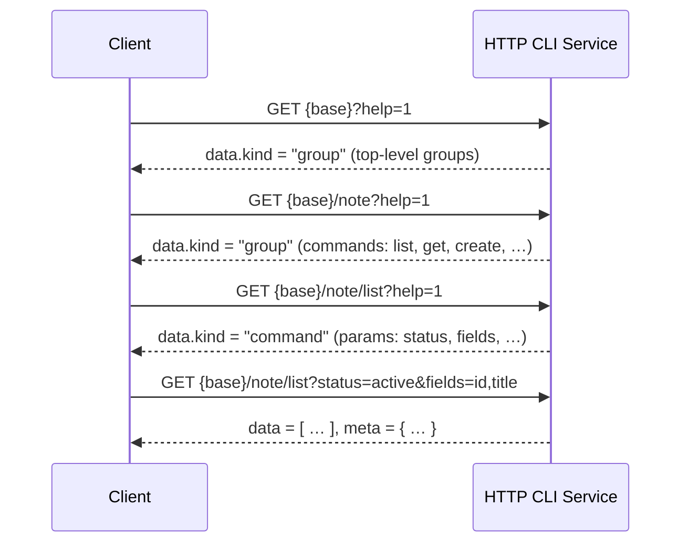

# HTTP CLI Protocol <span class="version-badge info">v1.0.0</span>

**A Specification for a Self-Describing, Help-Driven Command Tree over HTTP**

**Version:** 1.0.0
**Status:** Draft
**Created:** Oct 14, 2026
**Last Updated:** Oct 14, 2026

---

## Introduction

The HTTP CLI Protocol maps the ergonomics of a traditional command-line interface —
a hierarchical command tree, progressive `--help` documentation, and predictable
output — onto plain HTTP. Each command is a URL path segment chain; each level of
the tree documents itself on demand. A caller needs nothing more than an HTTP
client (`curl`, `fetch`, an SDK) and a credential.

The protocol is designed first-class for AI agents, which must explore unfamiliar
systems while spending as little context window as possible, and remains fully
usable by humans.

### Design goals

1. **Progressive, help-driven discovery.**
   Like `man` and `--help` in classic CLIs, every level of the command tree
   explains itself *on demand*. Callers drill down one level at a time and never
   download the whole surface. This keeps token consumption proportional to the
   task, not to the size of the system.

2. **A uniform output contract.**
   Every response — data, help, or failure — uses one envelope with one error
   model. Machine consumers parse one shape; humans read the same JSON.

3. **Pluggable authentication with an implementation duty of care.**
   Credential schemes vary by deployment, so the protocol does not mandate one.
   It does mandate *how* credentials travel, *how* failures are reported, and
   that every implementation document its authorization model for integrators
   and agents (see [Authentication & Authorization](#authentication--authorization)).

### Non-goals

- This protocol does not replace general-purpose REST/RPC APIs; it is a
  discovery- and task-oriented façade over a system's capabilities.
- It does not define any business resource or domain model. Command trees are
  entirely implementation-defined.
- It does not constrain transport beyond HTTP semantics; any HTTP/1.1 or
  HTTP/2+ client may speak it.

### Terminology

| Term | Meaning |
|------|---------|
| **Base URL** | The absolute URL prefix at which the command tree is mounted, e.g. `https://api.example.com/cli`. |
| **Command path** | The path below the Base URL that identifies a node, e.g. `/note/list`. |
| **Group node** | A tree node that has children. Its representation is a listing of its children. |
| **Command node** | A leaf node that performs an operation when invoked with its declared HTTP method. |
| **Help document** | The structured, self-describing representation of a group node or command node. |
| **Envelope** | The top-level JSON object of every successful or failed response. |
| **Projection** | Client-side selection of response fields via the reserved `fields` parameter. |

### Conformance language

The key words MUST, MUST NOT, REQUIRED, SHALL, SHALL NOT, SHOULD, SHOULD NOT,
RECOMMENDED, MAY, and OPTIONAL in this document are to be interpreted as
described in RFC 2119 and RFC 8174 when, and only when, they appear in all
capitals.

---

## Changes from previous versions

This is the first release of the HTTP CLI Protocol. See the repository
`CHANGELOG.md` for subsequent revisions.

---

## Protocol overview & data flow

A client receives a Base URL and a credential out of band. It then walks the
tree with help requests before executing commands:

```
1. GET {base}?help=1                  → root group help (top-level groups)
2. GET {base}/note?help=1             → group help (commands under note)
3. GET {base}/note/list?help=1        → command help (parameter schema)
4. GET {base}/note/list?fields=id,title  → execute
5. POST {base}/note/create  (JSON)    → execute a write
```

Every step is a normal HTTP request. Help documents and command results share
one envelope; a machine can parse them with the same code path.



---

## Core model: the command tree

### Nodes

An implementation's capabilities are exposed as a tree of **group nodes** and
**command nodes** mounted at the Base URL. The root of the tree is a group node.

- A request addressed to a **group node** returns its Help document (a listing
  of its direct children). Group nodes are never "executed".
- A request addressed to a **command node** executes the command when the HTTP
  method matches the command's declared method, or returns the command's Help
  document when help is requested.

### Naming rules

Each command path segment (node name):

- MUST match `^[a-z][a-z0-9_-]*$` (lowercase ASCII, digits, `_`, `-`).
- MUST be unique among its siblings. Names are case-sensitive; uppercase is not
  permitted.
- MUST NOT be a single `.` or `..` segment; MUST NOT contain `/`, `?`, `#`, or
  percent-encoding.

Servers SHOULD accept a trailing slash as equivalent to its absence
(`/note/list/` ≡ `/note/list`) and MAY redirect (301/308) between the two forms.

### HTTP method semantics

Each command node declares exactly one HTTP method in its Help document.

| Method | Meaning | Parameter location |
|--------|---------|--------------------|
| `GET` | Read; MUST be free of side effects. | Query string |
| `POST` | Create, act, or otherwise mutate. | JSON request body |
| `PUT` / `PATCH` | Update (optional). | JSON request body |
| `DELETE` | Remove (optional). | Query string or JSON body |

- Clients MUST invoke a command with the method declared in its Help document.
- `GET` commands MUST NOT mutate state. Servers MUST NOT require a request body
  for `GET`.
- Request bodies MUST be `application/json` (UTF-8). A non-JSON content type on
  a body-carrying method yields `415` / `unsupported_media_type`.
- Implementations that wish to restrict destructive or high-impact operations
  from non-human callers SHOULD omit those commands from the tree exposed to
  such callers, or gate them behind an explicit confirmation parameter.

### Reserved parameter names

Commands MUST NOT declare parameters named `help` or `fields`; these are
reserved for the protocol (see [Progressive help](#progressive-help-self-description)
and [Field projection](#field-projection)).

The names `page`, `limit`, `offset`, and `cursor` are RECOMMENDED for
pagination (see [Pagination](#pagination)) but are not reserved.

---

## Progressive help (self-description)

Help is the protocol's discovery mechanism. It is requested with the reserved
query parameter `help`:

```
GET {base}/{command path}?help=1
```

Accepted values: `help=1`, `help=true` (case-insensitive), and a bare `help`
parameter with an empty value (`?help`); all three request help. Any other
value MUST be rejected with `400` / `invalid_param` and a `hint` showing
`help=1`.

### Single source of truth (normative)

The Help document MUST be generated from the same command registry that
dispatches requests. Implementations MUST NOT maintain a separate, hand-written
help artifact that can drift from actual behavior. If help says a parameter
exists, the dispatcher MUST honor it; if the dispatcher rejects a parameter,
help MUST NOT advertise it.

### Group help

`GET` on a group node (with or without `help`) returns a **group Help
document**:

```json
{
  "data": {
    "kind": "group",
    "path": "/note",
    "name": "note",
    "summary": "Notes management",
    "subcommands": [
      {
        "kind": "command",
        "name": "list",
        "path": "/note/list",
        "method": "GET",
        "summary": "List notes"
      },
      {
        "kind": "group",
        "name": "archive",
        "path": "/note/archive",
        "method": "GET",
        "summary": "Archived notes"
      }
    ],
    "usage": "GET {base}/note/<command>?help=1"
  }
}
```

**Depth limiting (token economy):** group help MUST list only its *direct*
children, each with a one-line `summary`. It MUST NOT inline the full nested
tree or parameter schemas. A client discovers grandchildren by requesting the
child's own help.

The root of the tree is a group node whose `path` is `/`; its `name` is
implementation-defined but MUST follow the naming rules (for example,
`root`).

### Command help

`GET {base}/{command path}?help=1` on a command node returns a **command Help
document**:

```json
{
  "data": {
    "kind": "command",
    "path": "/note/list",
    "method": "GET",
    "summary": "List notes",
    "description": "Returns notes visible to the caller, newest first.",
    "params": [
      {
        "name": "status",
        "type": "enum",
        "enum": ["active", "archived"],
        "required": false,
        "default": "active",
        "description": "Filter by note status."
      },
      {
        "name": "limit",
        "type": "integer",
        "required": false,
        "default": "20",
        "description": "Maximum number of items per page (1-100)."
      }
    ],
    "examples": [
      "GET {base}/note/list?status=active&fields=id,title"
    ]
  }
}
```

### Help document fields

| Field | Kind | Presence | Description |
|-------|------|----------|-------------|
| `kind` | `"group"` \| `"command"` | REQUIRED | Discriminator of the Help document. |
| `path` | string | REQUIRED | Command path below the Base URL. |
| `name` | string | REQUIRED | This node's segment name. |
| `method` | string | REQUIRED | HTTP method. `GET` for group nodes. |
| `summary` | string | REQUIRED | One-line description. |
| `description` | string | OPTIONAL | Long form; RECOMMENDED on command nodes only. |
| `subcommands` | array | group only | Direct children (see below). |
| `params` | array | command only | Parameter descriptors (see below). |
| `examples` | array of strings | OPTIONAL | Copy-pasteable request lines using `{base}`. |
| `usage` | string | OPTIONAL | Human-readable invocation hint. |
| `deprecated` | object | OPTIONAL | `{"use_instead": "/new/path", "note": "…"}` when a node is deprecated. |

Each `subcommands` entry: `kind`, `name`, `path`, `method`, `summary`
(all REQUIRED). The root group help additionally MAY carry:

| Field | Description |
|-------|-------------|
| `protocol_version` | The protocol version the server implements, e.g. `"1.0.0"`. RECOMMENDED. |
| `server_version` | The implementation's own version string. OPTIONAL. |
| `authentication` | Auth discovery object (see [Auth discovery](#auth-discovery)). RECOMMENDED. |

### Parameter descriptor fields

| Field | Presence | Description |
|-------|----------|-------------|
| `name` | REQUIRED | Parameter name. |
| `type` | REQUIRED | One of `string`, `integer`, `number`, `boolean`, `enum`, `array`, `object`. |
| `required` | OPTIONAL | Default `false`. |
| `default` | OPTIONAL | Default value as a string; omitted ⇒ no default. |
| `enum` | REQUIRED when `type` is `enum` | Allowed values, as strings. |
| `description` | REQUIRED | One-line semantics. |

Values are transmitted as strings in query strings and as native JSON types in
request bodies; servers MUST coerce query strings per the declared `type`
(`"1"` is a valid `integer`, `"true"` a valid `boolean`). A value that cannot be
coerced, or an `enum` value not in the list, MUST be rejected with `400` /
`invalid_param` and the error's `hint` MUST list the allowed values.

### Self-description guarantee

Help documents are authoritative. A conformant client MAY rely on:

- every child listed in a group Help document being invocable at its `path`;
- every command Help document listing every parameter the dispatcher accepts
  (except the reserved `help` and `fields`);
- errors on unknown commands or parameters carrying a `hint` that points back to
  the nearest valid help request.

---

## Requests

### Executing a command

```
{METHOD} {base}/{command path}
Authorization: Bearer <credential>          (see Authentication)
Content-Type: application/json              (body-carrying methods)
```

- **Read:** `GET {base}/note/list?status=active&fields=id,title`
- **Write:** `POST {base}/note/create` with body
  `{"title": "Shopping list", "body": "…"}`
- On body-carrying methods, parameters may also appear in the query string; if
  the same parameter is present in both, the body value MUST win.
- Unknown parameters SHOULD be rejected with `400` / `invalid_param` and a hint
  naming the closest declared parameter, so that agent typos surface early.
  Implementations MAY instead ignore unknown parameters, but MUST document the
  choice.

### Field projection

Every command that returns JSON objects supports the reserved query parameter
`fields`, a comma-separated whitelist of top-level keys to return:

```
GET {base}/note/list?fields=id,title,status
```

- The server MUST return only the requested keys, for a single object or each
  element of an array in `data`.
- Unknown keys in `fields` MUST be ignored (forward compatibility: a client may
  request fields a server adds later).
- `fields` MUST NOT change the meaning or the `meta` block of a response.
- Nested selection syntax (dot paths) is NOT defined in this version; servers
  MUST ignore or reject dotted names consistently and document which.

Projection is the protocol's primary token-economy lever: agents request only
the columns they need.

### Pagination

List-returning commands SHOULD paginate. Two conventions are allowed; the
implementation picks one and documents it in the command's Help document:

- **Offset form:** `offset` (0-based) + `limit`; or
- **Page form:** `page` (1-based) + `limit`.

When `meta` is present on a list response, it SHOULD use:

```json
"meta": {
  "request_id": "01J8…",
  "page": 1,
  "limit": 20,
  "total": 137,
  "has_more": true
}
```

Servers MUST enforce a maximum `limit` (documented in help) and SHOULD default
to 20. Unbounded list endpoints defeat the token-economy goal and are
non-conformant with the spirit of this protocol.

### Idempotency (optional)

For `POST` commands with side effects, implementations MAY honor an
`Idempotency-Key` header: a repeated request with the same key MUST return the
original result rather than re-executing. If unsupported, the header MUST be
ignored.

---

## Responses

Every response body is a single JSON object (UTF-8, `Content-Type:
application/json; charset=utf-8`). Whitespace is not semantically meaningful;
servers MAY minify to save bytes.

### Success envelope

```json
{
  "data": { … },
  "meta": { … }
}
```

| Field | Presence | Description |
|-------|----------|-------------|
| `data` | REQUIRED | The result: object, array, scalar, or `null`. Help documents are delivered in `data` like any other result. |
| `meta` | OPTIONAL | Non-semantic metadata: `request_id`, pagination, timing. Clients MUST NOT interpret undocumented `meta` keys. |

Commands that produce no content SHOULD return `"data": null` with an
appropriate status (`200` or `204`; with `204` the body MUST be empty).

### Error envelope

```json
{
  "error": {
    "code": "invalid_param",
    "message": "parameter \"status\" has invalid value \"open\"",
    "hint": "allowed: active | archived",
    "details": { "parameter": "status" }
  }
}
```

| Field | Presence | Description |
|-------|----------|-------------|
| `code` | REQUIRED | Stable, machine-readable identifier: `^[a-z][a-z0-9_]*$`. |
| `message` | REQUIRED | Human-readable explanation. |
| `hint` | OPTIONAL | Actionable next step — RECOMMENDED on every client-fixable error. |
| `details` | OPTIONAL | Structured context (e.g. offending parameter name). |

An error response MUST NOT contain `data`; a success response MUST NOT contain
`error`.

### Standard error codes & status mapping

| HTTP | `code` | When |
|------|--------|------|
| 400 | `invalid_param` | Value fails type/enum/range validation. |
| 400 | `missing_param` | A required parameter is absent. |
| 400 | `bad_body` | Request body is not a valid JSON object. |
| 401 | `unauthorized` | Missing, malformed, or expired credential. |
| 403 | `forbidden` | Valid credential lacking permission. |
| 404 | `unknown_command` | Path does not resolve to a node. |
| 404 | `not_found` | Command exists but the target resource does not. |
| 405 | `method_not_allowed` | Path resolves, method does not match the declaration. |
| 409 | `conflict` | State conflict (duplicate, version mismatch). |
| 413 | `payload_too_large` | Body exceeds server limit. |
| 415 | `unsupported_media_type` | Non-JSON body on a body-carrying method. |
| 429 | `rate_limited` | Throttled; `details.retry_after_seconds` RECOMMENDED. |
| 5xx | `internal_error` | Unexpected server fault. |

- `unknown_command` errors MUST include a `hint` pointing at the nearest valid
  help request (e.g. `GET {base}/note?help=1 to see available subcommands`).
- Implementations MAY add custom codes; custom codes MUST NOT reuse a standard
  code with a different meaning. Clients MUST treat unknown codes generically by
  HTTP status class.

### Status code rules

- `2xx` ⇒ `data` present (except `204`).
- `4xx` ⇒ client error; `error.code` per the table.
- `5xx` ⇒ server fault; `error.code` SHOULD be `internal_error` and MUST NOT
  leak stack traces or internal identifiers.

### Naming & encoding conventions

- JSON keys: `snake_case`. Enum & error-code values: lowercase.
- Identifiers in payloads are opaque strings. Timestamps, when present, are
  RFC 3339 strings in UTC (`2026-10-14T08:00:00Z`).
- Omitted key ⇒ not provided. Senders SHOULD NOT use `null` where omission
  expresses the same meaning.
- Unknown response fields MUST be ignored by clients (forward compatibility).

---

## Authentication & Authorization

The protocol separates **what travels on the wire** (normative) from **which
credential scheme a deployment uses** (implementation-defined).

### Transport requirements

- Production deployments MUST serve the Base URL over HTTPS. Plain HTTP is
  permitted only for loopback development.
- Credentials MUST travel in request headers — RECOMMENDED:
  `Authorization: Bearer <credential>`. Credentials MUST NOT appear in URLs,
  query strings, or logs.
- Alternative schemes (custom headers, request signing, mTLS) are permitted
  when the deployment requires them; the chosen scheme MUST be documented (see
  [Auth discovery](#auth-discovery)).

### Auth discovery

Root group help SHOULD carry an `authentication` object so that both humans and
agents learn the scheme without out-of-band documentation:

```json
"authentication": {
  "scheme": "bearer",
  "header": "Authorization",
  "value_format": "Bearer <token>",
  "description": "Personal access tokens and short-lived task tokens are accepted.",
  "obtain": "Create a token in the web console under Settings → API tokens."
}
```

| Field | Description |
|-------|-------------|
| `scheme` | e.g. `bearer`, `api_key`, `signed_request`. |
| `header` | Header name carrying the credential. |
| `value_format` | Exact expected format. |
| `description` | Human/agent-readable policy summary. |
| `obtain` | How a caller legitimately obtains a credential. |

### Failure semantics

| Status | `code` | Meaning |
|--------|--------|---------|
| 401 | `unauthorized` | No/invalid credential → client should authenticate or refresh. |
| 403 | `forbidden` | Authenticated but not permitted → do NOT retry with the same credential. |

- `401` responses SHOULD include a `WWW-Authenticate` header (RFC 9110) when a
  standard scheme is used.
- Error `hint` MUST NOT reveal whether a resource exists to an unauthorized
  caller ("permission" vs "not found" must not leak existence where that is
  sensitive).

### Recommended pattern: user-issued console tokens

A practice that works well in deployment: let each user create a personal,
user-scoped credential in their own **account console** (profile / settings →
API tokens), and present a **copy-ready CLI snippet** that the user hands
directly to their agent — for example:

```bash
curl -H "Authorization: Bearer <token>" "https://api.example.com/cli/me?help=1"
```

The agent executes the snippet as-is. Because every call carries the *user's*
own credential, the server can attribute each invocation to that user without
any separate identity mapping: the caller's identity, permissions, and audit
trail are the user's. This pattern pairs naturally with an identity command
(e.g. `me`) that echoes the effective caller, so both human and agent can
verify who they are acting as.

Recommendations for this pattern:

- The snippet MUST carry the credential in a header argument, never in the URL
  — a token embedded in a query string leaks through history, proxies, and
  logs (see [Transport requirements](#transport-requirements)).
- If a hyperlink is the desired sharing UX, use a one-time redemption link
  that exchanges for the credential over an authenticated `POST`; do not put
  long-lived credentials in plain links.
- Show scope, expiry, and revocation controls at issuance; users should be able
  to delete the token themselves (instant revocation).
- Point the `obtain` field of the [auth discovery](#auth-discovery) object at
  this console page so agents can direct users there.

### Implementation guide (normative duty of care)

Any implementation of this protocol MUST provide, in its own documentation for
integrators and agents, a concrete answer to each item below. The protocol does
not prescribe the answers — it prescribes that they exist and are findable
(auth discovery + docs):

1. **Credential type.** What is issued (opaque token, signed JWT, API key,
   short-lived task credential) and what each identifies (user, service,
   tenant, task).
2. **Issuance & distribution.** How legitimate callers obtain a credential
   (console, CLI login flow, bootstrapping handshake). RECOMMENDED: inject into
   agent runtime via environment variable or secret store — never via URL.
3. **Scope & least privilege.** Which commands each credential class may call;
   read vs. write separation; tenant/project boundaries. RECOMMENDED: expose
   fewer commands to restricted credentials rather than failing late.
4. **Lifetime & revocation.** Expiry, rotation, and immediate revocation —
   task-scoped credentials SHOULD die with the task.
5. **Transport security.** TLS requirements; header-only carriage; redaction of
   credentials in logs and error messages.
6. **Failure semantics.** The 401/403 distinction above, stable error codes,
   and refresh guidance in `hint`.
7. **Audit.** Every invocation SHOULD be attributable to a credential identity,
   with parameters logged in redacted form.
8. **Agent handoff.** When a credential is given to an automated caller, the
   grantor MUST state the permitted scope and lifetime in machine-readable form
   where possible.

This checklist is the protocol's answer to "authorization varies per project":
schemes stay pluggable, but every deployment ships a documented, discoverable
authorization model.

---

## Discovery & versioning

### Finding the Base URL

The Base URL is provided out of band (deployment configuration, task
instructions). Implementations MAY publish it at
`/.well-known/http-cli` returning `{"base_url": "https://…/cli",
"protocol_version": "1.0.0"}`.

### Protocol version declaration

- Servers SHOULD return the header `X-HTTP-CLI-Version: 1.0.0` on all responses
  and SHOULD include `protocol_version` in root group help.
- This document versions the **protocol**. Implementation-specific versions
  (`server_version`) are independent; the standard version surface (below)
  carries implementation release metadata and release notes.

### Standard version surface (RECOMMENDED)

Callers — especially long-running agents — need one uniform way to learn which
implementation version they are talking to, when it was released, and what
changed since a version they already know. Implementations SHOULD expose a
standard `version` group at the tree root:

```
GET {base}/version/current     → current version metadata
GET {base}/version/releases    → release notes, newest first
```

An implementation that provides this surface MUST use these exact names
(`version`, `current`, `releases`), so agents can find it without
per-deployment documentation.

#### `GET /version/current`

`data` is a version object:

| Field | Presence | Description |
|-------|----------|-------------|
| `protocol_version` | REQUIRED | Protocol version implemented (semver). |
| `server_version` | REQUIRED | Implementation version (semver). |
| `released_at` | REQUIRED | RFC 3339 UTC timestamp of this release. |
| `build` | OPTIONAL | Build identifier. |
| `channel` | OPTIONAL | Release channel, e.g. `stable`, `beta`. |
| `commit` | OPTIONAL | Source revision of the build. |

#### `GET /version/releases`

`data` is an array of release objects, **newest first**:

| Field | Presence | Description |
|-------|----------|-------------|
| `version` | REQUIRED | Release version (semver). |
| `released_at` | REQUIRED | RFC 3339 UTC timestamp of the release. |
| `summary` | REQUIRED | One-line description of the release. |
| `notes` | OPTIONAL | Release notes body, Markdown. |
| `yanked` | OPTIONAL | `true` when the release was withdrawn. |

Parameters:

| Parameter | Type | Default | Description |
|-----------|------|---------|-------------|
| `since` | string | — | Return only releases **newer** than this version. Comparison is by Semantic Versioning; when the value cannot be compared, the server returns the full list and documents that behavior in help. |
| `limit` | integer | 10 | Maximum releases returned (bounded; RECOMMENDED maximum 50). |

Rules:

- The unfiltered `releases` list MUST place the current release first.
- `version/current` MUST agree with the `protocol_version` and
  `server_version` declared in root group help (single source of truth).
- `releases?since=<current version>` MUST return an empty array inside a normal
  success envelope.
- Release notes are informational; a server MAY keep a bounded history and
  MUST document the bound in help if it does.

#### Agent workflow (informative)

When re-engaging after an absence, an agent SHOULD first read
`/version/current`; if it remembers a version from earlier work, it then calls
`/version/releases?since=<remembered>` to learn only what is new — the
token-economy pattern applied to change discovery, instead of downloading full
release history.

### Specification versioning

This specification follows Semantic Versioning:

| Change | Bump |
|--------|------|
| Editorial fixes, clarifications | PATCH |
| New OPTIONAL fields, new reserved parameters, new standard error codes | MINOR |
| New REQUIRED fields, changed meanings, removed elements | MAJOR |

Clients MUST ignore unknown response fields; therefore MINOR additions are
non-breaking by construction.

### Forward compatibility rules

- A server MUST keep serving a deprecated node until its announced removal, and
  MUST mark it `deprecated` in help with `use_instead` when a replacement
  exists.
- A client MUST tolerate: unknown `data`/`meta` fields, unknown error codes,
  additional group-help entries, and additional `authentication` fields.
- A server MUST tolerate: unknown HTTP headers; it MUST reject unknown
  parameters only per its documented policy.

---

## Token economy (informative)

Context-window cost is a first-class constraint for agent callers. This
protocol's mechanisms, in order of impact:

1. **Progressive help** — one level per request; no "download the schema"
   moment. Depth-limited group listings keep each response small.
2. **Field projection** — `fields=` returns only needed keys.
3. **Pagination with bounded `limit`** — no unbounded lists.
4. **Compact summaries** — one-line `summary` at group level; full `description`
   only at command level.
5. **Stable, small error envelopes** — errors teach the next request via `hint`
   instead of forcing another exploration round-trip.

Implementations SHOULD document a "cheat sheet" of the most common commands for
their tree, but the cheat sheet MUST NOT contradict help (single source of
truth).

---

## Security considerations

- **Credential hygiene:** header-only carriage, HTTPS, redaction in logs, short
  lifetimes for machine credentials, revocation on task completion.
- **Discovery surface:** help reveals the capability surface. If that is
  sensitive, require authentication for help too (MAY); never put secrets in
  help documents.
- **Injection:** commands that relay arguments into shells, queries, or
  templates MUST validate per parameter schema and MUST NOT concatenate
  untrusted input. (This protocol's `type`/`enum` validation is a floor, not a
  complete defense.)
- **Destructive operations:** prefer omission from agent-visible trees, or
  explicit confirmation parameters; make `DELETE`-class commands unmistakable
  in name and summary.
- **Rate limiting:** throttle per credential; report `429` / `rate_limited` with
  `retry_after_seconds`.
- **Error verbosity:** `5xx` messages MUST NOT leak internals; `4xx` hints MUST
  NOT leak other tenants' data.

---

## Conformance checklist (informative)

A conformant implementation:

- [ ] Serves a command tree at a documented Base URL over HTTPS.
- [ ] Names every node per the naming rules; unique per sibling set.
- [ ] Dispatches exactly the declared HTTP method per command node.
- [ ] Generates help from the dispatch registry (no drift).
- [ ] Supports `help=1`/`help=true` at every node; group help lists direct
      children only.
- [ ] Returns every response in the success/error envelope with the standard
      error codes.
- [ ] Supports `fields=` projection on object-returning commands.
- [ ] Bounds list sizes and documents the pagination form.
- [ ] Carries credentials in headers; rejects bad credentials with
      `401`/`403` per the failure semantics.
- [ ] Publishes the auth discovery object and an integrator-facing
      authorization guide covering the eight duty-of-care items.
- [ ] Declares its protocol version (`X-HTTP-CLI-Version` and/or root help).
- [ ] (If the standard version surface is provided) serves
      `version/current` and `version/releases` under the exact standard names,
      newest release first, with working `since` filtering and agreement
      between root help and `version/current`.

A conformant client:

- [ ] Explores via help before executing; never assumes undocumented parameters.
- [ ] Uses `fields=` and bounded `limit` where available.
- [ ] Ignores unknown response fields and unknown error codes.
- [ ] Never places credentials in URLs or logs.

---

## Example: end-to-end walkthrough

A minimal notes service mounts its tree at `https://api.example.com/cli`.

```bash
BASE=https://api.example.com/cli
AUTH='Authorization: Bearer <credential>'

# 1. Root discovery
curl -s -H "$AUTH" "$BASE?help=1"
# → data.kind="group", subcommands: [ me, note ], authentication: { … }

# 2. Group drill-down
curl -s -H "$AUTH" "$BASE/note?help=1"
# → subcommands: list, get, create, update

# 3. Command schema
curl -s -H "$AUTH" "$BASE/note/list?help=1"
# → params: [ {name: "status", type: "enum", enum: ["active","archived"], …},
#             {name: "limit", type: "integer", default: "20", …} ]

# 4. Read with projection
curl -s -H "$AUTH" "$BASE/note/list?status=active&fields=id,title&limit=5"
# → { "data": [ {"id":"n_01","title":"…"}, … ],
#     "meta": { "request_id":"…", "limit":5, "has_more":true } }

# 5. Write
curl -s -H "$AUTH" -H 'Content-Type: application/json' \
  -d '{"title":"Weekly plan","body":"…"}' "$BASE/note/create"
# → { "data": { "id":"n_02", "title":"Weekly plan", … } }

# 6. Error teaches the next move
curl -s -H "$AUTH" "$BASE/note/list?status=open"
# → { "error": { "code":"invalid_param",
#       "message":"parameter \"status\" has invalid value \"open\"",
#       "hint":"allowed: active | archived" } }

# 7. Unknown command hints back to help
curl -s -H "$AUTH" "$BASE/not/list"
# → { "error": { "code":"unknown_command",
#       "message":"unknown command \"not\" under /",
#       "hint":"GET {base}?help=1 to see available subcommands" } }
```

---

## Appendix A: machine-readable schemas

Normative JSON Schemas for the envelope and Help documents ship alongside this
document in the `schemas/` directory of this version:

- `envelope.schema.json` — success & error envelopes
- `help.schema.json` — group & command Help documents
- `parameter.schema.json` — parameter descriptors

In case of conflict between this document and the schemas, this document is
normative.

## Appendix B: glossary

| Term | Definition |
|------|------------|
| Projection | Filtering response keys via `fields=`. |
| Registry | The in-process command tree definition from which both dispatch and help are derived. |
| Task credential | A short-lived credential bound to one automated unit of work. |
