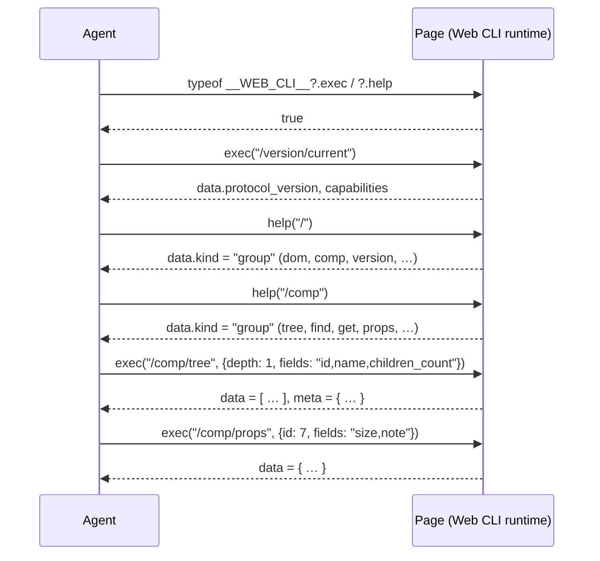

# Web CLI Protocol <span class="version-badge info">v1.0.0</span>

**A Specification for a Self-Describing, In-Page Command Tree for Web Applications**

**Version:** 1.0.0
**Status:** Draft
**Created:** Oct 29, 2026
**Last Updated:** Oct 29, 2026

---

## Introduction

The Web CLI Protocol maps the ergonomics of a traditional command-line
interface — a hierarchical command tree, progressive `--help` documentation,
and predictable output — onto the JavaScript runtime of a web page. A web
application (or a runtime injected into one) installs a single global entry
point; a caller explores and operates the live page through structured
commands such as `/comp/tree` or `/dom/box` and receives uniform JSON
envelopes. The caller needs nothing more than the ability to evaluate
JavaScript in the page (`page.evaluate`, a devtools console, a test runner).

The protocol is designed first-class for AI agents, which must explore
unfamiliar pages while spending as little context window as possible, and
remains fully usable by humans.

Web CLI is the sibling of the [HTTP CLI Protocol](http-cli.md). The two share
one output envelope, one error model, one progressive-help philosophy, and one
versioning discipline; where this document restates a shared mechanism it is
normative for Web CLI, and the HTTP CLI document remains the reference for the
shared envelope shape (`schemas/envelope.schema.json`).

### Design goals

1. **Progressive, help-driven discovery.**
   Every level of the command tree explains itself *on demand*. Callers drill
   down one level at a time and never download the whole surface. Token
   consumption stays proportional to the task, not to the size of the page.

2. **A uniform output contract.**
   Every result — data, help, or failure — uses one envelope, one error model,
   and one async model (bounded, cancellable, settle-aware). Machine consumers
   parse one shape; humans read the same JSON.

3. **Declared component semantics.**
   The distinctive goal of Web CLI: components, exposed functions, and
   parameters carry *author-written descriptions* — purpose, prop semantics,
   enums, error codes, internationalization metadata — authored at
   development time and **injected into the compiled bundle** as data. An
   agent reading `/comp/get` learns what a component is *for*, not merely what
   its DOM looks like.

4. **Framework-neutral core, official bindings.**
   The command tree and envelope are framework-agnostic. The registration
   contract is normative; the React and Vue bindings sketched in this document
   are informative reference forms. Other frameworks follow the same contract.

5. **Graceful degradation and safe defaults.**
   Runtimes without descriptors still serve structural introspection
   (`origin: "inferred"`). Mutation commands are opt-in, confirmation-gated,
   and off in production profiles by default.

### Non-goals

- This protocol does not replace DOM APIs, test frameworks, or browser
  automation drivers; it is a discovery- and task-oriented façade over a live
  page's structure and semantics.
- It does not define any application resource or domain model. Descriptors and
  command extensions are entirely implementation-defined.
- It does not support runtime insertion of new hooks into already-mounted
  components (component lifecycles forbid it by construction). Observability
  extensions may address tracing in a future version.
- It does not require a network server. Everything happens in the page's
  JavaScript runtime.

### Terminology

| Term | Meaning |
|------|---------|
| **Entry point** | The single global object (`__WEB_CLI__`) through which all calls pass. |
| **Command path** | The slash-separated, root-anchored path that identifies a node, e.g. `/comp/props`; `/` is the root. |
| **Group node** | A tree node that has children. Its representation is a listing of its children. |
| **Command node** | A leaf node that performs an operation when invoked through `exec`. |
| **Descriptor** | An author-written, JSON-serializable document describing a component, module, or hook: its purpose, props, exposed functions, error codes, and i18n metadata. |
| **Registry** | The in-page store of descriptors and their runtime bindings, from which both dispatch and help are derived. |
| **Component id** | An auto-increment integer that identifies one live component instance (or DOM element) for its whole life within a page document; assigned at first discovery, never reused. See [Ids](#ids-component-identity). |
| **Origin** | Whether a node's semantics are `declared` (a descriptor exists) or `inferred` (runtime introspection only). |
| **Adapter** | The framework binding (React, Vue, …) that materializes component-level commands from live framework internals. |
| **Envelope** | The top-level JSON object of every successful or failed result. |
| **Projection** | Client-side selection of result fields via the reserved `fields` parameter. |
| **Settle** | The point at which a write's effect becomes observable (the adapter's commit/flush). Write success envelopes are produced only after it. |
| **Async boundary** | A lazy/async component placeholder that has not resolved yet; tree nodes report it as `status: "pending"`. |

### Conformance language

The key words MUST, MUST NOT, REQUIRED, SHALL, SHALL NOT, SHOULD, SHOULD NOT,
RECOMMENDED, MAY, and OPTIONAL in this document are to be interpreted as
described in RFC 2119 and RFC 8174 when, and only when, they appear in all
capitals.

---

## Changes from previous versions

This is the first release of the Web CLI Protocol. See the repository
`CHANGELOG.md` for subsequent revisions.

---

## Protocol overview & data flow

A caller first detects the entry point, then walks the tree with `help()`
calls before executing commands:

```
0. typeof __WEB_CLI__?.exec === "function" && ?.help === "function"  → detection
1. exec("/version/current")                        → protocol & capability negotiation
2. help("/")                                      → root group help (top-level groups)
3. help("/comp")                                  → group help (commands under comp)
4. help("/comp/props")                            → command help (parameter schema)
5. exec("/comp/tree", {depth: 1})                  → one level of the component tree
6. exec("/comp/props", {id: 7})            → execute
```

Every step is a plain JavaScript call returning a promise of a JSON envelope.
Help documents and command results share one envelope; a machine parses them
with the same code path.



---

## Detection & bootstrap

### The entry point

A conformant runtime installs exactly one global binding:

```js
globalThis.__WEB_CLI__ = {
  protocol_version: "1.0.0",
  exec(path, args) { /* returns a Promise<Envelope> */ },
};
```

| Member | Presence | Description |
|--------|----------|-------------|
| `protocol_version` | REQUIRED | Semver string of the protocol the runtime implements. |
| `exec` | REQUIRED | `(path: string, args?: object, options?: object) => Promise<Envelope>`. Command execution; never returns help. |
| `help` | REQUIRED | `(path?: string, options?: object) => Promise<Envelope>`. Help retrieval for any node; `path` defaults to the root. |
| `authorize` | OPTIONAL | Handshake for token-gated runtimes (see [Security considerations](#security-considerations)). |

- The binding MUST be a plain data-and-function object on `globalThis`; it
  MUST NOT require construction, imports, or module loaders to reach.
- `exec` and `help` MUST always return promises. They MUST NOT reject on
  call failure; failures are delivered inside the error envelope. They MAY
  reject (or throw synchronously) only on programming errors such as a
  non-string `path`.
- `help(path?, options?)` addresses exactly one node — group or command —
  and returns its Help document in the success envelope. Help is a method of
  the entry point, **never a parameter of `exec`**. `path` is a canonical
  command path (leading slash, e.g. `/comp/props`); the slash-less form is
  accepted as equivalent. Omitting it — or passing `"/"` or `""` — addresses
  the root.
  `options` MAY carry `detail` (boolean) and `locale` (BCP-47), plus
  `timeout` and `signal` from the async model.
- `exec` accepts an OPTIONAL third argument `options`; its only standard key
  in this version is `signal` (an `AbortSignal`), used for caller-side
  cancellation (see
  [Async calls, concurrency & cancellation](#async-calls-concurrency--cancellation)).
- Implementations MAY expose additional members but MUST NOT change the
  meaning of the members above. Clients MUST ignore unknown members.

### Detection procedure (informative)

```js
const cli = globalThis.__WEB_CLI__;
if (!cli || typeof cli.exec !== "function" || typeof cli.help !== "function") {
  // No Web CLI here — fall back to DOM scripting.
} else {
  const v = await cli.exec("/version/current");   // negotiate before use
  // v.data.protocol_version, v.data.capabilities, v.data.origin
}
```

An agent SHOULD treat detection as a cheap capability probe and fall back to
conventional DOM/JS exploration when the entry point is absent. The entry
point is a **main-world** binding: code running in isolated worlds (content
scripts, some automation sandboxes) that cannot see page globals MUST evaluate
the probe in the page's main world.

### Capability negotiation

`/version/current` is the authoritative statement of what a runtime supports.
Its `capabilities` array lists enabled surface groups and features:

| Capability | Meaning |
|------------|---------|
| `dom` | `/dom/*` commands are available. |
| `comp` | `/comp/*` commands are available. |
| `style` | Computed-style reads are available (`/dom/style`). |
| `declared` | At least one descriptor is registered; `/comp/get` can return authored semantics. |
| `write` | Mutation commands (`/comp/set`, `/comp/call` with `effects: "write"`) are enabled. |
| `wait` | The `/wait/for` command is available. |
| `net`, `log` | Extension groups (see [Extension groups](#extension-groups-optional)). |

A capability absent from the array MUST be treated as unavailable; attempting
its commands MUST fail with `unsupported` (not `unknown_command`, which
reserves "path does not exist at all").

### Degradation modes

| Mode | When | Behavior |
|------|------|----------|
| `declared` | Descriptors registered (app ships Web CLI) | Full semantics: summaries, prop docs, enums, error codes, i18n metadata. |
| `inferred` | Runtime only (injected into a third-party page, or app ships no descriptors) | Structural introspection only; nodes carry `origin: "inferred"`; `/comp/call` is unavailable unless the runtime registered function bindings. |

A single runtime MAY mix modes: a component with a descriptor is `declared`,
one without is `inferred`. Per-node `origin` is normative; clients MUST NOT
assume declared text exists.

---

## Core model: the command tree

### Nodes

A runtime's capabilities are exposed as a tree of **group nodes** and
**command nodes** rooted at the entry point. The root of the tree is a group
node addressed as `/` (path normalization below).

- A call addressed to a **group node** returns its Help document (a listing of
  its direct children). Group nodes are never "executed".
- A call addressed to a **command node** executes the command with the
  supplied `args`; its Help document is obtained through `help()`.

Command paths are rooted at `/`, mirroring the URL-path style of HTTP CLI:
the root is `/`, and below it `/comp/props`, `/dom/box`, `/version/current`.
This leading-slash form is canonical — help documents emit it and every
example uses it. Runtimes MUST accept the canonical form; they MUST also
accept the same path with its leading slash omitted ("comp/props" ≡
"/comp/props") and with a trailing slash added ("/comp/props/" ≡
"/comp/props"). Omitted `path` in `help()` (or `""`) addresses the root like
`"/"`.

### Naming rules

Each path segment (node name):

- MUST match `^[a-z][a-z0-9_-]*$` (lowercase ASCII, digits, `_`, `-`).
- MUST be unique among its siblings. Names are case-sensitive; uppercase is not
  permitted.
- MUST NOT contain `/`, `.`, `?`, `#`, or whitespace.

Standard top-level group names are reserved for their standard meaning:
`version`, `dom`, `comp`, `net`, `log`, `wait`. Implementations MAY add custom
groups (e.g. `app`), which SHOULD NOT collide with the reserved names.

### Command effects

Each command node declares an `effects` class in its Help document, replacing
HTTP methods:

| `effects` | Meaning |
|-----------|---------|
| `none` | Pure metadata; free of side effects (help, version). |
| `read` | Reads page state; MUST be free of side effects. |
| `write` | Mutates page state (props, values, invocation of mutating functions). |
| `varies` | The effect depends on arguments (e.g. `/comp/call` on a function's own declaration). |

- `none` and `read` commands MUST NOT mutate page state.
- `write` commands and `varies` commands resolving to a write MUST require the
  reserved `confirm` parameter (see [Mutation & confirmation](#mutation--confirmation)).
- Implementations that wish to keep destructive or high-impact operations away
  from non-human callers SHOULD omit those commands from the tree, or ship
  with the `write` capability disabled.

### Reserved parameter names

Commands MUST NOT declare parameters named `help`, `fields`, `detail`,
`locale`, `confirm`, or `timeout`; these names belong to the protocol
surface:

- `help` and `detail` are consumed by the `help()` entry-point method (help
  is a method, never a parameter — see
  [Progressive help](#progressive-help-self-description)).
- `fields`, `locale`, `confirm`, and `timeout` are consumed as reserved keys
  inside `exec` args.

Because the names are reserved, `exec` MUST reject an `args` object
containing `help` or `detail` with `invalid_param` and a `hint` naming
`help()`; the other reserved keys are always interpreted by the protocol,
never by the command. `timeout` (integer milliseconds) bounds a single
call's wall-clock time and is honored by every command; on expiry the call
settles with a `timeout` error rather than hanging (see
[Async calls, concurrency & cancellation](#async-calls-concurrency--cancellation)).

The names `limit`, `offset`, `page`, and `cursor` are RECOMMENDED for
pagination but are not reserved.

---

## Component descriptors

Descriptors are the protocol's answer to "what is this component *for*?"
They are authored by developers next to the code they describe, serialized as
data, and **injected into the compiled bundle's registry** so that runtime
introspection carries human-written semantics.

### Authoring locations (informative)

A descriptor MUST be JSON-serializable. Typical authoring forms:

- a colocated module (`NoteCard.webcli.js`) exporting the descriptor object;
- a component-level option (`webcli: { … }` in a Vue component, a static
  property or registration call in React);
- a standalone manifest (`webcli.descriptors.json`) merged at build time.

All three compile down to the same registry entries; the serialized form below
is normative.

### Serialized descriptor

```json
{
  "id": "note-card",
  "name": "NoteCard",
  "kind": "component",
  "summary": "Displays one note with preview text and selection handling.",
  "description": "Renders a single note as a clickable card. Empty notes show
     a placeholder. Selection is delegated to the onSelect function prop.",
  "version": "1.2.0",
  "tags": ["notes", "card"],
  "props": [
    {
      "name": "note",
      "type": "object",
      "required": true,
      "description": "The note to display; must carry id, title, and body."
    },
    {
      "name": "size",
      "type": "enum",
      "enum": ["sm", "md", "lg"],
      "default": "md",
      "description": "Visual size variant."
    },
    {
      "name": "onSelect",
      "type": "function",
      "required": false,
      "description": "Called with the note id when the card is activated."
    }
  ],
  "state": [
    { "name": "expanded", "type": "boolean", "description": "Whether the body is expanded.", "readonly": false }
  ],
  "functions": [
    {
      "name": "refresh",
      "summary": "Re-fetches the note and re-renders.",
      "params": [],
      "returns": { "type": "object", "description": "The refreshed note." },
      "effects": "read",
      "async": true,
      "timeout_ms": 5000,
      "errors": ["note/not_found"]
    }
  ],
  "error_codes": [
    {
      "code": "note/not_found",
      "summary": "The referenced note does not exist.",
      "hint": "List available ids via note/list."
    }
  ],
  "i18n": { "default_locale": "en", "locales": ["en", "de"] }
}
```

### Descriptor fields

| Field | Kind | Presence | Description |
|-------|------|----------|-------------|
| `id` | slug | REQUIRED | Stable identifier, unique within the registry. Matches `^[a-z][a-z0-9_-]*$`. |
| `name` | string | REQUIRED | Human-readable name, typically the export/component name. |
| `kind` | enum | REQUIRED | `component`, `module`, or `hook` (a React hook or Vue composable). |
| `summary` | text | REQUIRED | One-line purpose. RECOMMENDED ≤ 120 characters. |
| `description` | text | OPTIONAL | Long form: behavior, edge cases, composition. |
| `version` | string | OPTIONAL | Descriptor version (semver RECOMMENDED), independent of app version. |
| `tags` | string[] | OPTIONAL | Free-form labels for search (`/comp/find?tag=`). |
| `props` | prop[] | OPTIONAL | Input parameters (attributes). Empty/absent ⇒ none documented. |
| `state` | state[] | OPTIONAL | Exposed internal state entries readable via `/comp/state`. |
| `functions` | function[] | OPTIONAL | Functions the component exposes for invocation via `/comp/call`. |
| `error_codes` | error[] | OPTIONAL | Error codes this component/function family may return. |
| `i18n` | object | OPTIONAL | `{ "default_locale": "en", "locales": ["en", "de"] }` — the component's own internationalization surface. |
| `deprecated` | object | OPTIONAL | `{"use_instead": "note-card-v2", "note": "…"}`. |

**Prop descriptors** (entries of `props`):

| Field | Presence | Description |
|-------|----------|-------------|
| `name` | REQUIRED | Prop name (identifier-shaped). |
| `type` | REQUIRED | One of `string`, `integer`, `number`, `boolean`, `enum`, `array`, `object`, `function`, `element`, `node`, `any`. |
| `required` | OPTIONAL | Default `false`. |
| `default` | OPTIONAL | Default value, native JSON type. Omitted ⇒ no default. |
| `enum` | REQUIRED when `type` is `enum` | Allowed values, as strings. MUST be absent otherwise. |
| `description` | REQUIRED | One-line semantics. |
| `readonly` | OPTIONAL | Default `false`. `true` for props that must not be written via `/comp/set`. |
| `example` | OPTIONAL | A representative value. |

**State descriptors** (entries of `state`): `name`, `type`, `description`
(REQUIRED), `readonly` (OPTIONAL, default `true`).

**Function descriptors** (entries of `functions`):

| Field | Presence | Description |
|-------|----------|-------------|
| `name` | REQUIRED | Function name (identifier-shaped). |
| `summary` | REQUIRED | One-line purpose. |
| `description` | OPTIONAL | Long form. |
| `params` | OPTIONAL | Parameter descriptors (same shape as props minus `readonly`/`example`). |
| `returns` | REQUIRED | `{ "type": <value type>, "description": <text> }`. Use `type: "any"` and a description of `void`-like semantics for side-effect-only functions. For `async` functions, `returns` describes the **resolved** value. |
| `effects` | REQUIRED | `none`, `read`, or `write`. Declares the function's own side-effect class for `/comp/call` gating. |
| `async` | OPTIONAL | Default `false`. `true` when the function returns a promise; `/comp/call` awaits it (bounded by `timeout`). |
| `timeout_ms` | OPTIONAL | Recommended await bound for this function in milliseconds; the runtime default applies when absent. |
| `errors` | OPTIONAL | Error codes (strings) this function may return. |
| `deprecated` | OPTIONAL | As above. |

**Error descriptors** (entries of `error_codes`):

| Field | Presence | Description |
|-------|----------|-------------|
| `code` | REQUIRED | Stable identifier matching `^[a-z][a-z0-9_]*(/[a-z][a-z0-9_]*)*$`. Custom codes SHOULD be namespaced `<scope>/<code>` (e.g. `note/not_found`); bare codes are reserved for the [standard table](#standard-error-codes). |
| `summary` | REQUIRED | One-line meaning. |
| `description` | OPTIONAL | Long form. |
| `hint` | OPTIONAL | Actionable next step — RECOMMENDED on every caller-fixable error. |

### Localized text

Any human-readable text field (`summary`, `description`, `hint`) MAY be
accompanied by a sibling field named `<field>_i18n` whose value is an object
mapping BCP-47 locale tags to translations:

```json
"summary": "Displays one note with preview text and selection handling.",
"summary_i18n": { "de": "Zeigt eine einzelne Notiz als Karte mit Vorschautext und Auswahlverhalten." }
```

When `locale` is supplied (a reserved `exec` args key, or a `help()` option),
a runtime that has a translation for the requested locale MUST return the
translated text, falling back to the unlocalized field otherwise. Localized
text applies to help documents and descriptor text alike.

### Registration & build injection (normative)

1. Descriptors MUST be available from the registry at runtime — either
   embedded in the compiled bundle or served as a lazily loaded manifest — and
   MUST be reachable through the standard `exec` surface regardless of
   storage.
2. Descriptors are **data**: they MUST survive minification and bundling
   unchanged. Implementations MUST NOT rely on function names, reflection, or
   source comments surviving compilation.
3. Registration MUST be idempotent; re-registering an `id` replaces the
   previous entry.
4. Function *bindings* (the callable implementations behind
   `functions[].name`) are kept in memory alongside the serialized descriptor
   and MUST NOT be serialized. A descriptor documents a function; a binding
   makes it callable. `/comp/call` resolves `(component id, function name)`
   through the binding table; when no binding exists the command fails with
   `unsupported`.
5. Production profiles SHOULD gate discovery: either register descriptors
   only in development builds, or serve them in `read`-only profiles with
   mutations disabled. Descriptors MUST NOT contain secrets (see
   [Security considerations](#security-considerations)).

### Descriptor ↔ live instance linking

Query commands (`/comp/tree`, `/comp/find`) return nodes shaped as:

```json
{
  "id": 7,
  "descriptor_id": "note-card",
  "name": "NoteCard",
  "origin": "declared",
  "summary": "Displays one note with preview text and selection handling.",
  "children_count": 2
}
```

- `id` is REQUIRED on every live node: the instance's auto-increment
  component id (see [Ids](#ids-component-identity)). Targeting commands and
  query filters accept it; a dead instance's id fails with `stale_id`.
- `descriptor_id` is present iff `origin` is `declared`; `name` is the runtime
  component name (possibly minified for `inferred` nodes in production).
- `summary` is present iff a descriptor exists; clients MUST tolerate its
  absence.
- `status`, when present, is `ready` or `pending`. `pending` marks an async
  boundary (a lazy/async component placeholder) whose subtree may still
  change when it settles; `children_count` on a `pending` node is provisional.

---

## Progressive help (self-description)

Help is the protocol's discovery mechanism. It is a first-class method of the
entry point — never a parameter of `exec`:

```js
await __WEB_CLI__.help("/");              // root: the top-level map
await __WEB_CLI__.help("/comp");          // one group's direct children
await __WEB_CLI__.help("/comp/props");    // one command's parameter schema
```

- `help(path?, options?)` addresses exactly one node and returns its Help
  document in the success envelope. (`exec` on a group node also returns that
  group's Help document; group nodes are never executed.)
- `options.detail` (boolean) selects the detail level (see below);
  `options.locale` requests localized text; `options.timeout` and
  `options.signal` bound and cancel the call per the async model.
- An unknown `path` fails with `unknown_command` and a `hint` pointing at the
  nearest valid `help()` call.

### Single source of truth (normative)

The Help document MUST be generated from the same registry that dispatches
calls. Implementations MUST NOT maintain a separate, hand-written help
artifact that can drift from actual behavior. If help says a parameter
exists, the dispatcher MUST honor it; if the dispatcher rejects a parameter,
help MUST NOT advertise it. The same rule binds descriptors: a
`functions[].params` entry is a promise the binding table must keep.

### Group help

A `help()` call on a group node returns a **group Help document**:

```json
{
  "data": {
    "kind": "group",
    "path": "/comp",
    "name": "comp",
    "summary": "Component tree and instance operations",
    "subcommands": [
      { "kind": "command", "name": "tree",    "path": "/comp/tree",    "effects": "read",  "summary": "List one level of the component tree" },
      { "kind": "command", "name": "find",    "path": "/comp/find",    "effects": "read",  "summary": "Search components by name, tag, or text" },
      { "kind": "command", "name": "get",     "path": "/comp/get",     "effects": "read",  "summary": "Descriptor and live data for one component" },
      { "kind": "command", "name": "props",   "path": "/comp/props",   "effects": "read",  "summary": "Current prop values of a component" },
      { "kind": "command", "name": "state",   "path": "/comp/state",   "effects": "read",  "summary": "Exposed state entries of a component" },
      { "kind": "command", "name": "call",    "path": "/comp/call",    "effects": "varies","summary": "Invoke a function the component exposes" },
      { "kind": "command", "name": "set",     "path": "/comp/set",     "effects": "write", "summary": "Write prop values on a live component" }
    ],
    "usage": "exec('/comp/<command>', { … })"
  }
}
```

**Depth limiting (token economy):** group help MUST list only its *direct*
children, each with a one-line `summary` and its `effects` class. It MUST NOT
inline the nested tree or parameter schemas. A client discovers grandchildren
by requesting the child's own help.

The root group help additionally MAY carry `protocol_version`,
`runtime_version`, `adapter`, `origin`, and `capabilities`
(see [Capability negotiation](#capability-negotiation)).

### Command help

A `help()` call on a command node returns a **command Help document**:

```json
{
  "data": {
    "kind": "command",
    "path": "/comp/props",
    "name": "props",
    "effects": "read",
    "summary": "Current prop values of a component",
    "description": "Returns the live prop values of the component identified by id.",
    "params": [
      { "name": "id",   "type": "integer", "required": true,  "description": "Target component id from /comp/tree or /comp/find." },
      { "name": "keys", "type": "array",  "required": false, "description": "Restrict to these prop names; omit for all." }
    ],
    "examples": [
      "exec('/comp/props', { id: 7, fields: 'size,note' })"
    ]
  }
}
```

### Help document fields

| Field | Kind | Presence | Description |
|-------|------|----------|-------------|
| `kind` | `"group"` \| `"command"` | REQUIRED | Discriminator of the Help document. |
| `path` | string | REQUIRED | Command path; `"/"` for the root node. |
| `name` | string | REQUIRED | This node's segment name. |
| `effects` | string | command only | `none`, `read`, `write`, or `varies`. |
| `summary` | string | REQUIRED | One-line description. |
| `description` | string | OPTIONAL | Long form; RECOMMENDED on command nodes only. |
| `subcommands` | array | group only | Direct children: `kind`, `name`, `path`, `effects`, `summary` (all REQUIRED). |
| `params` | array | command only | Parameter descriptors (see below). |
| `examples` | array of strings | OPTIONAL | Copy-pasteable `exec` calls. |
| `usage` | string | OPTIONAL | Human-readable invocation hint. |
| `deprecated` | object | OPTIONAL | `{"use_instead": "comp/get", "note": "…"}`. |

### Parameter descriptor fields

| Field | Presence | Description |
|-------|----------|-------------|
| `name` | REQUIRED | Parameter name. MUST NOT be a reserved name. |
| `type` | REQUIRED | One of `string`, `integer`, `number`, `boolean`, `enum`, `array`, `object`. |
| `required` | OPTIONAL | Default `false`. |
| `default` | OPTIONAL | Default value, native JSON type; omitted ⇒ no default. |
| `enum` | REQUIRED when `type` is `enum` | Allowed values, as strings. |
| `description` | REQUIRED | One-line semantics. |

Arguments are passed as native JSON values; there is no query-string coercion
layer. A value that fails the declared type, or an `enum` value not in the
list, MUST be rejected with `invalid_param` and the error's `hint` MUST list
the allowed values. Unknown arguments SHOULD be rejected with `invalid_param`
and a hint naming the closest declared parameter (implementations MAY instead
ignore them, but MUST document the choice).

### Two-level help: summary by default, detail on demand

- **Summary level (default).** Group help: direct children with `kind`,
  `name`, `path`, `effects`, `summary`, plus `usage`; no `description`.
  Command help: `params` and `usage`; no long-form `description` or
  `examples`.
- **Detail level (`help(path, { detail: true })`).** The same document plus
  long-form `description` and `examples`.

Rules: `detail` is a boolean `help()` option (`true` selects detail,
`false`/absent selects summary; any other value ⇒ `invalid_param`); the
summary document MUST be a strict subset of the detail document; clients
MUST tolerate missing fields at summary level.

### Self-description guarantee

Help documents are authoritative. A conformant client MAY rely on:

- every child listed in a group Help document being invocable at its `path`;
- every command Help document listing every parameter the dispatcher accepts
  (except reserved names);
- errors on unknown commands or parameters carrying a `hint` that points back
  to the nearest valid help request.

---

## Requests

### Executing a command

```js
const envelope = await __WEB_CLI__.exec(path, args);
```

- **Read:** `exec("/comp/props", { id: 7, fields: "size,note" })`
- **Write:** `exec("/comp/set", { id: 7, props: { size: "lg" }, confirm: true })`
- **Help:** `help("/comp/set", { detail: true })` — the `help()` method, never
  an `exec` parameter.
- `args` is a plain object; omitted ⇒ `{}`. Non-object `args` MUST be
  rejected as a programming error.
- Reserved keys inside `args` (`fields`, `locale`, `confirm`, `timeout`) are
  always interpreted by the protocol, never by the command; `help` and
  `detail` MUST NOT appear in `args` (see
  [Reserved parameter names](#reserved-parameter-names)).

### Field projection

Every command that returns JSON objects supports the reserved `fields`
parameter, a comma-separated whitelist of top-level keys to return:

```js
exec("/comp/get", { id: 7, fields: "id,name,props" });
```

- Only the requested keys are returned, for a single object or each element of
  an array in `data`.
- On live-node results, `id` is always retained even when `fields` omits it —
  projection MUST NOT destroy the targeting key.
- Unknown keys in `fields` MUST be ignored (forward compatibility).
- `fields` MUST NOT change the meaning of a result or the `meta` block.
- Nested selection (dot paths) is NOT defined in this version; runtimes MUST
  ignore or reject dotted names consistently and document which.

Projection is the protocol's primary token-economy lever: agents request only
the columns they need.

### Pagination

List-returning commands SHOULD paginate. Two conventions are allowed; the
implementation picks one and documents it in the command's Help document:

- **Offset form:** `offset` (0-based) + `limit`; or
- **Page form:** `page` (1-based) + `limit`.

When `meta` is present on a list result it SHOULD use:

```json
"meta": { "request_id": "r_01J8…", "limit": 20, "total": 137, "has_more": true }
```

Runtimes MUST enforce a maximum `limit` (documented in help) and SHOULD
default to 20. Unbounded listings defeat the token-economy goal.

### Async calls, concurrency & cancellation

The page is asynchronous by nature — components resolve lazily, functions
return promises, renders commit on later ticks. The protocol's async model:

- **Calls MAY overlap.** `exec` and `help` invocations in flight at the same
  time settle independently. Runtimes MUST dispatch effectful work in arrival
  order but MAY interleave during internal awaits; clients MUST NOT rely on
  cross-call ordering beyond the settle guarantee. `meta.request_id` is
  RECOMMENDED on every result for correlation.
- **Every call is bounded.** The reserved `timeout` (integer ms; an `exec`
  args key, a `help()` option) limits a single call's wall-clock time; on
  expiry the call settles with a `timeout` error envelope. A runtime's
  default bound MUST be documented in help and a call MUST NOT hang
  indefinitely.
- **Cancellation is caller-side.** When `options.signal` aborts, the promise
  settles promptly with an `aborted` error envelope (it still resolves — the
  envelope is the single parse path); work already started in the page MAY
  still complete.
- **Reads observe instants, not states.** Async rendering mutates the tree
  between calls; two reads may legitimately disagree. For a consistent
  window, prefer one call with `fields`, or sequence write → read through the
  [settle guarantee](#mutation--confirmation) and `/wait/for`.

### Ids (component identity)

Every live component and DOM element carries an **id** (component id): an
auto-increment integer that precisely identifies that instance for its whole
life.

- **Assignment at first discovery.** The first component-tree walk
  materializes the registry and assigns each live component its id in
  depth-first, document order; elements get theirs at first appearance in a
  `/dom/query` result. A component mounted later is assigned on the walk that
  first sees it. The sequence is integers starting at 1, +1 per assignment.
- **Never reused within a page document.** An id keeps pointing at the same
  instance across renders and SPA route changes; a dead instance's id is
  retired, not recycled. A new document restarts the sequence at 1.
- **Precise targeting & querying.** Targeting commands take `id`; query
  syntax supports it directly — `/comp/find {id: [3, 7]}`,
  `/comp/find {parent: 7}`, `/comp/tree {parent: 7}`,
  `/dom/query {scope: 7}`. One integer token re-targets a known instance;
  no re-exploration.
- **Death of an id.** Targeting an unmounted instance — or an id from before
  a navigation or `/comp/reset` — MUST fail with `stale_id` and a `hint` to
  re-query (`/comp/tree` or `/comp/find`). An id that was never assigned
  fails with `not_found`.
- Tree reads are point-in-time snapshots. Async rendering mutates the tree
  between calls; re-query after `wait/for` or a write's settle, and do not
  poll blindly.
- `/comp/reset` (OPTIONAL command) invalidates all live ids and releases
  retained instances — RECOMMENDED for long agent sessions on heavy pages.
  The counter does not rewind; ids are still never reused.

### Mutation & confirmation

- Commands with `effects: "write"` (and `varies` commands resolving to a
  write) MUST reject invocations lacking `confirm: true` with the error code
  `confirm_required`. This is the in-page counterpart of HTTP CLI's
  destructive-operation discipline: a mutation is never accidental.
- `/comp/set` MUST refuse `readonly` props with `invalid_param` and a hint
  naming the offending prop.
- Runtimes shipped with the `write` capability disabled MUST fail writes with
  `read_only`, keeping the commands discoverable but inert.

**Settle guarantee (read-after-write consistency):** a write command's
success envelope MUST NOT be produced before the adapter has observed the
corresponding state commit (render flush / next tick). A client that reads
after a successful write therefore sees the write's effects or a later state
— never the pre-write value with success reported. Runtimes that cannot
observe commits MUST document the weaker guarantee in help; `meta` MAY carry
`settled_at` for timing-sensitive clients. UI-visible effects (pixels on
screen) may trail the commit — use `/wait/for` for those.

---

## Responses

Every result is a single JSON object — the Web CLI **envelope**, identical in
shape to the HTTP CLI envelope (`schemas/envelope.schema.json`):

### Success envelope

```json
{
  "data": { … },
  "meta": { … }
}
```

| Field | Presence | Description |
|-------|----------|-------------|
| `data` | REQUIRED | The result: object, array, scalar, or `null`. Help documents are delivered in `data` like any other result. |
| `meta` | OPTIONAL | Non-semantic metadata: `request_id`, pagination, `locale`, timing. Clients MUST NOT interpret undocumented `meta` keys. |

### Error envelope

```json
{
  "error": {
    "code": "stale_id",
    "message": "id 7 is no longer live",
    "hint": "re-query with /comp/tree or /comp/find to obtain live ids",
    "details": { "id": 7 }
  }
}
```

| Field | Presence | Description |
|-------|----------|-------------|
| `code` | REQUIRED | Stable, machine-readable identifier: `^[a-z][a-z0-9_]*$`. |
| `message` | REQUIRED | Human-readable explanation. |
| `hint` | OPTIONAL | Actionable next step — RECOMMENDED on every caller-fixable error. |
| `details` | OPTIONAL | Structured context (e.g. offending parameter name). |

An error result MUST NOT contain `data`; a success result MUST NOT contain
`error`. The two shapes are mutually exclusive — one parse path suffices.

### Standard error codes

| `code` | When |
|--------|------|
| `invalid_param` | Value fails type/enum/range validation. |
| `missing_param` | A required parameter is absent. |
| `unknown_command` | Path does not resolve to a node. |
| `not_found` | Command exists but the target (id never assigned, descriptor, resource) does not. |
| `stale_id` | The supplied id was assigned, but its instance is no longer live (unmounted, or a navigation/reset has occurred). |
| `unsupported` | The path exists but the capability is disabled or unbound (e.g. `/comp/call` without a binding). |
| `read_only` | A mutation was attempted in a runtime without the `write` capability. |
| `confirm_required` | A mutating call omitted `confirm: true`. |
| `forbidden` | Token missing, malformed, or mismatched (see Security). |
| `conflict` | State conflict (duplicate, version mismatch). |
| `timeout` | The call did not settle within the `timeout` bound. `details.elapsed_ms` and `details.pending` RECOMMENDED; the hint suggests a larger `timeout` or `/wait/for`. |
| `aborted` | The caller cancelled via `options.signal`. Work already started MAY still complete. |
| `internal_error` | Unexpected runtime fault. |

- `unknown_command` errors MUST include a `hint` pointing at the nearest valid
  `help()` call (e.g. `help('/comp') to see available subcommands`).
- Implementations MAY add custom codes; custom codes MUST NOT reuse a standard
  code with a different meaning. Component-level codes SHOULD be namespaced
  (`note/not_found`) and MUST be documented in the owning descriptor's
  `error_codes`. Clients MUST tolerate unknown codes generically.

### Naming & encoding conventions

- JSON keys: `snake_case`. Enum and error-code values: lowercase.
- Identifiers in payloads (refs, ids) are opaque strings. Timestamps, when
  present, are RFC 3339 strings in UTC.
- Omitted key ⇒ not provided. Senders SHOULD NOT use `null` where omission
  expresses the same meaning.
- Unknown result fields MUST be ignored by clients (forward compatibility).

---

## Command surface

The commands below form the standard library. REQUIRED commands are mandatory
for core conformance; RECOMMENDED commands are expected in full-profile
runtimes; the rest are OPTIONAL.

### `/version/current` (REQUIRED)

No parameters. Returns:

| Field | Description |
|-------|-------------|
| `protocol_version` | REQUIRED. Protocol version implemented (semver). |
| `runtime_version` | REQUIRED. Runtime/implementation version (semver). |
| `adapter` | OPTIONAL. Framework adapter in effect: `react`, `vue`, `vanilla`, … |
| `origin` | REQUIRED. `declared` or `inferred` (dominant mode; nodes may still differ). |
| `capabilities` | REQUIRED. Array of capability strings (see [Capability negotiation](#capability-negotiation)). |
| `created_at` | OPTIONAL. RFC 3339 UTC timestamp of runtime installation. |

### Root help (REQUIRED)

`help("/")` — equivalently `help()` with no path — returns root group help:
top-level groups with summaries, plus the negotiation fields above. This is
the agent's map of the page.

### `/dom/query` (RECOMMENDED)

Find elements and obtain refs.

| Param | Type | Required | Description |
|-------|------|----------|-------------|
| `selector` | string | one of selector/text | CSS selector. |
| `text` | string | one of selector/text | Substring match on visible text. |
| `scope` | integer | no | Limit to the subtree of this component or element id. |
| `limit` / `offset` | integer | no | Pagination. |

`data`: array of `{ id, tag, text_preview, bbox? }`; `meta` carries
pagination. `bbox` is present with the `style` capability.

### `/dom/box` (RECOMMENDED)

Box-model geometry for one element.

| Param | Type | Required | Description |
|-------|------|----------|-------------|
| `id` | integer | yes | Target element id. |

`data`:

```json
{
  "id": 12,
  "rect": { "x": 12, "y": 40, "width": 320, "height": 96 },
  "margin":  { "top": 8, "right": 0, "bottom": 8, "left": 0 },
  "padding": { "top": 12, "right": 16, "bottom": 12, "left": 16 },
  "border":  { "top": 1, "right": 1, "bottom": 1, "left": 1 },
  "box_sizing": "border-box"
}
```

### `/dom/style` (OPTIONAL, `style` capability)

Computed styles for one element.

| Param | Type | Required | Description |
|-------|------|----------|-------------|
| `id` | integer | yes | Target element id. |
| `props` | array | no | Restrict to these CSS property names; omit for a documented default set. |

`data`: `{ "id": 7, "computed": { "display": "flex", … } }`. Runtimes MUST
bound the default property set and document it in help.

### `/comp/tree` (RECOMMENDED, `comp` capability)

One level of the component tree — the protocol's progressive-help principle
applied to trees.

| Param | Type | Required | Description |
|-------|------|----------|-------------|
| `parent` | integer | no | Parent component id; omit for the roots. |
| `depth` | integer | no | Levels to return (default 1; runtime-documented maximum). |
| `limit` / `offset` | integer | no | Pagination over the listed level. |

`data`: array of node objects (`id`, `descriptor_id?`, `name`, `origin`,
`summary?`, `children_count`, `children?` when `depth` > 1); `meta` carries
pagination. Depth is deliberately shallow by default: drill down with
`parent`, exactly as help drills down one level at a time.

### `/comp/find` (RECOMMENDED)

Search components; returns a flat, paginated list of nodes (same shape as
`/comp/tree` items).

| Param | Type | Required | Description |
|-------|------|----------|-------------|
| `id` | array | one of id/name/text/tag | Restrict to these component ids (exact match). |
| `parent` | integer | no | Only direct children of this component id. |
| `name` | string | one of id/name/text/tag | Substring match on component name. |
| `text` | string | one of id/name/text/tag | Substring match on rendered text. |
| `tag` | string | one of id/name/text/tag | Match `descriptor.tags`. |
| `prop` | string | no | Filter `"key=value"` on prop values. |
| `limit` / `offset` | integer | no | Pagination. |

### `/comp/get` (RECOMMENDED)

Descriptor + live summary for one component.

| Param | Type | Required | Description |
|-------|------|----------|-------------|
| `id` | integer | yes | Target component id. |

`data`:

```json
{
  "id": 7,
  "descriptor_id": "note-card",
  "origin": "declared",
  "descriptor": { "…full serialized descriptor…" },
  "live": { "name": "NoteCard", "props_present": ["note", "size"], "children_count": 2 }
}
```

`descriptor` is omitted for `origin: "inferred"` nodes. This command is the
"what does this component do" read: summary, prop semantics, enums, exposed
functions, error codes, and i18n metadata in one round-trip.

### `/comp/props` (RECOMMENDED)

Current prop values.

| Param | Type | Required | Description |
|-------|------|----------|-------------|
| `id` | integer | yes | Target component id. |
| `keys` | array | no | Restrict to these prop names. |

`data`: `{ "id": 7, "props": { … } }`. Prop values are JSON-representable
projections; functions render as `"<function>"`, elements/nodes as
`"<element>"`, unsettled promises as `"<promise>"`, and cyclic structures as
`"<circular>"` — runtimes MUST bound serialization and document the
projections.

### `/comp/state` (OPTIONAL)

Exposed state entries (from `state` descriptors, or adapter-introspectable
state).

| Param | Type | Required | Description |
|-------|------|----------|-------------|
| `id` | integer | yes | Target component id. |
| `keys` | array | no | Restrict to these entry names. |

`data`: `{ "id": 7, "state": [ { "name": "expanded", "value": false } ] }`.

### `/comp/call` (OPTIONAL, `write` gating per function)

Invoke an exposed function.

| Param | Type | Required | Description |
|-------|------|----------|-------------|
| `id` | integer | yes | Target component id. |
| `function` | string | yes | Function name from the descriptor's `functions`. |
| `args` | object | no | Positional-by-name arguments per the function's `params`. |
| `confirm` | boolean | for `effects: "write"` | Must be `true` to permit mutation. |

`data`: `{ "result": <return value, projected as in /comp/props> }`. Failures:
`unsupported` when no binding is registered, `missing_param`/`invalid_param`
per the function's `params`, component error codes from `error_codes` on
business failure.

**Async functions:** when the bound function returns a thenable, the runtime
MUST await it and place the resolved value in `result`, bounded by the
reserved `timeout` parameter (default bound documented in help; RECOMMENDED
≤ 30000 ms). Descriptors flag such functions `async: true`; any thenable is
treated as async regardless of the flag. A function that does not settle
within the bound fails with `timeout` (`details.elapsed_ms` and
`details.pending: true` RECOMMENDED) and a hint to retry with a larger
`timeout` or observe the effect via `/wait/for`. Long-running functions MAY
document a collect-on-reinvoke pattern in their `description`; this version
defines no job handles.

### `/comp/set` (OPTIONAL, `write` capability)

Write prop values.

| Param | Type | Required | Description |
|-------|------|----------|-------------|
| `id` | integer | yes | Target component id. |
| `props` | object | yes | Map of prop name → new value. |
| `confirm` | boolean | yes | Must be `true`. |

`data`: `{ "id": 7, "applied": { "size": "lg" }, "skipped": { … } }`.
`applied` reports accepted writes; `skipped` reports rejected ones with
per-key reasons — partial success is reported, not thrown.

### `/wait/for` (RECOMMENDED, `wait` capability)

Condition-based waiting — the protocol's replacement for blind sleeps and
hand-rolled poll loops. Resolves when the condition holds, or fails with
`timeout`.

| Param | Type | Required | Description |
|-------|------|----------|-------------|
| `id` | integer | one condition family | Target id from `/comp/tree`, `/comp/find`, or `/dom/query`. |
| `state` | enum | with `id` | `visible`, `hidden`, or `gone` — wait until the id reaches this state (`gone` = unmounted/detached). |
| `prop` | string | with `id` | Wait until this prop holds `value`. |
| `value` | any | with `prop` | Expected value (JSON). |
| `selector` | string | one condition family | Wait until an element matching this selector appears. |
| `text` | string | one condition family | Wait until this string appears in visible text. |
| `timeout` | integer | no | Reserved; bound in ms. Default documented in help; RECOMMENDED ≤ 30000. |

Exactly one condition family MUST be supplied: `id`+`state`, `id`+`prop`+
`value`, `selector`, or `text`. More or fewer ⇒ `invalid_param` /
`missing_param` with a hint listing the families.

`data`: `{ "waited": true, "elapsed_ms": 80, "id": 7 }` (`id` present
when the condition resolved one). On expiry: `timeout` with
`details.elapsed_ms` and a hint to widen `timeout` or re-read current state.

### `/version/releases` (OPTIONAL), `/comp/reset` (OPTIONAL), extension groups (OPTIONAL)

- `/version/releases` mirrors the HTTP CLI version surface
  (`since`, `limit`, newest first) for runtimes that ship independently of the
  page bundle.
- `/comp/reset` clears all live ids (see [Ids](#ids-component-identity)).
- **Extension groups** `net` (request observation) and `log` (page errors)
  follow the same node/help/envelope contract. Runtimes that provide them
  MUST document their commands in help and declare the matching capability.
  `wait` is not an extension: `/wait/for` is a standard command (see above).

---

## Integration guide: adding Web CLI to an application

This section is the normative outline an implementing agent follows when
modifying a codebase to support Web CLI.

1. **Add the runtime.** Install (or vendor) a Web CLI runtime and have it
   install `globalThis.__WEB_CLI__` at application startup, before or during
   first render.
2. **Author descriptors.** For each public component/module/hook, write a
   descriptor (colocated module, component option, or manifest) covering:
   purpose (`summary`/`description`), `props` (types, enums, defaults,
   semantics), `functions` (params, returns, effects, error codes),
   `error_codes`, and `i18n` metadata.
3. **Register.** Call the runtime's registration API with each descriptor and
   its function bindings. Registration MUST be idempotent and MUST survive
   minification (descriptors are data).
4. **Wire the adapter.** Enable the framework adapter (React, Vue, …) so that
   `/comp/*` commands resolve live instances. Without an adapter only `/dom/*`
   and `version`/help are available.
5. **Choose the profile.** Development: full capabilities. Production:
   RECOMMENDED `read` profile (`write` capability off) and secret-free
   descriptors; optionally omit descriptors entirely (`origin: "inferred"`).
6. **Verify.** Run the conformance probes: `exec("/version/current")`,
   `help("/")`, `help("/comp")`, round-trip `/comp/get` on a known component, and
   confirm every declared function either binds or is marked unavailable.

### React binding (informative)

- Register descriptors at module scope next to the component; keep the
  serialized descriptor in the bundle as data.
- Back `/comp/tree` / `/comp/get` by walking the framework's instance tree from
  the root container; link DOM nodes ↔ instances to resolve refs.
- Back `/comp/call` through explicit bindings registered with the descriptor
  (imperative handles for function components; instance methods for class
  components). Do not rely on function `.name` surviving minification.
- `/comp/state` maps to exposed state/hook values where the adapter can
  introspect them; document any gaps in help.

### Vue binding (informative)

- Declare descriptors as a component option (`webcli: { … }`) collected by a
  plugin at `app.use(...)`, or register them explicitly at startup.
- Back `/comp/*` by walking the application instance's component tree
  (`app._instance` and the `subTree`/vnode chain), resolving
  container ↔ instance links for refs.
- Exposed functions bind via `expose()`/`setup` returns or explicit
  registration; two-way props mark `readonly: false` for `/comp/set`.

### Third-party pages: injected runtimes (informative)

An agent may install a runtime into a page it does not own (via
`addInitScript`, a devtools snippet, or an automation bridge):

- The runtime MUST run in the page's **main world** — framework internals live
  on page-visible objects and are invisible to isolated worlds.
- Injection is per-document: a full navigation clears it; re-inject on each
  document (init-script hooks do this automatically). SPA route changes do
  NOT clear it.
- Without descriptors the runtime serves `origin: "inferred"` mode: `/dom/*`,
  structural `/comp/tree`, and — where the adapter can introspect the detected
  framework — inferred component names and props. `/comp/call` is `unsupported`
  without registered bindings.
- Injected runtimes SHOULD be token-gated and read-only by default (see
  Security).

---

## Discovery workflows (informative)

### Agent exploring a page (goal: use Web CLI when present)

```
1. Probe:  typeof __WEB_CLI__?.exec === "function" && typeof __WEB_CLI__?.help === "function"
2. exec("/version/current")      → record protocol_version + capabilities
3. help("/")                    → top-level groups
4. Drill one level at a time:   help("/comp") …
5. exec("/comp/tree", {depth: 1, fields: "id,name,summary,children_count"})
6. exec("/comp/get", {id})      → learn what a component is for (descriptor)
7. exec("/comp/props", {id})    → live values; use fields= and limit= throughout
8. Writes only when needed:     exec("/comp/set", {…, confirm: true})
9. Async flows: `/wait/for` for conditions; never blind sleeps
```

### Agent enabling Web CLI in a codebase (goal: make a page support Web CLI)

Follow the [Integration guide](#integration-guide-adding-web-cli-to-an-application);
the deliverable is (a) the runtime installed at startup, (b) descriptors for
public components in serialized form, (c) registrations with function
bindings, (d) an enabled adapter, (e) a chosen profile, and (f) a passing
conformance probe sequence.

---

## Security considerations

- **Exposure:** the entry point is callable by *all* main-world code,
  including the page's own scripts and any third-party script on the page.
  Never assume `exec` is reachable only by the agent.
- **Token gating:** runtimes in untrusted contexts (injected into third-party
  pages, or production profiles) SHOULD require a per-session secret
  negotiated out of band — e.g. the installer captures a random token in the
  `exec` closure, or `authorize(token)` returns a scoped call handle. Calls
  without a valid token MUST fail with `forbidden`.
- **Read-only by default:** production profiles MUST NOT enable `write`
  without an explicit decision. Discovery (help, descriptors) is itself an
  information surface — if that is sensitive, gate it behind the token too.
- **Descriptor hygiene:** descriptors are shipped in the bundle and readable
  by anyone who can run the detection probe. They MUST NOT contain secrets,
  internal URLs, credentials, or personal data. Human-readable text is
  rendered as data by clients; runtimes MUST NOT emit executable content in
  descriptor fields.
- **Mutation safety:** `confirm: true` is a floor, not a full defense.
  Implementations SHOULD additionally bound `/comp/call` to explicitly
  registered bindings (never raw reflection), validate `args` against the
  declared `params`, and provide audit hooks (e.g. `log`) for writes.
- **Value projections:** `/comp/props`/`/comp/state` serialize live values.
  Runtimes MUST redact values matching credential shapes (tokens, keys) or
  document that they do not.
- **Error verbosity:** `internal_error` messages MUST NOT leak stack traces
  or internal identifiers; hints MUST NOT leak data the caller could not
  otherwise see.

---

## Token economy (informative)

Context-window cost is a first-class constraint for agent callers. The
mechanisms, in order of impact:

1. **Progressive help** — one level per `help()` call; two-level help (summary
   by default, `detail: true` on demand) keeps prose off the wire until a
   command is shortlisted.
2. **Progressive trees** — `/comp/tree` returns one level with
   `children_count`; deeper structure is fetched by `parent`, mirroring help
   drill-down. No "download the whole component tree" moment.
3. **Field projection** — `fields=` returns only needed keys on every
   object-returning command.
4. **Ids instead of re-querying** — one integer id identifies a component for
   its whole life; re-targeting a known instance costs one small call, not a
   re-exploration.
5. **Descriptors on demand** — `/comp/get` returns semantics for exactly one
   component; `summary` lines on tree nodes let agents triage before paying
   for full descriptors.
6. **Bounded lists and projections of live values** — pagination limits and
   `"<function>"`-style value projections prevent value explosions.
7. **Condition waiting** — `/wait/for` replaces blind sleeps and poll loops:
   one bounded call instead of repeated timing guesses and re-reads.

---

## Versioning & forward compatibility

This specification follows Semantic Versioning:

| Change | Bump |
|--------|------|
| Editorial fixes, clarifications | PATCH |
| New OPTIONAL fields, new reserved parameters, new standard error codes | MINOR |
| New REQUIRED fields, changed meanings, removed elements | MAJOR |

- Clients MUST ignore unknown result fields, unknown `exec` members, unknown
  error codes, and additional help entries; therefore MINOR additions are
  non-breaking by construction.
- Runtimes MUST tolerate unknown argument keys per their documented policy
  and MUST NOT change command meaning within a protocol major version.
- `/version/current.protocol_version` reports the protocol; `runtime_version`
  reports the implementation. The two evolve independently.

---

## Conformance checklist (informative)

A conformant runtime:

- [ ] Installs `globalThis.__WEB_CLI__` with `protocol_version`, `exec`, and
      `help` returning promises of envelopes; never rejects on call failure.
- [ ] Addresses the root with `""` and `"/"`; accepts a leading slash on every
      path; names every node per the naming rules.
- [ ] Generates help from the dispatch registry (no drift); group help lists
      direct children only, with `effects`.
- [ ] Serves help via the `help()` method — never as an `exec` parameter —
      and rejects `help`/`detail` keys in `exec` args with `invalid_param`
      hinting at `help()`.
- [ ] Serves two-level help: summary by default, `detail: true` for long
      form, summary a strict subset of detail.
- [ ] Returns every result in the shared envelope with the standard error
      codes; success and error are mutually exclusive.
- [ ] Supports `fields=` projection and bounded pagination on list commands.
- [ ] Declares `effects` per command; enforces `confirm: true` on writes;
      fails writes with `read_only` when the `write` capability is off.
- [ ] Answers `/version/current` with `protocol_version`, `runtime_version`,
      `origin`, and `capabilities` that agree with actual behavior.
- [ ] Assigns auto-increment ids at first discovery, never reuses them within
      a page document, and fails dead ones with `stale_id` plus a re-query
      hint.
- [ ] Bounds every async operation (thenable returns, `/wait/for`) with a
      documented `timeout` and fails with `timeout`; never hangs a call
      indefinitely; settles aborted calls with `aborted`.
- [ ] Honors the settle guarantee: write envelopes only after the adapter
      observes the commit (or documents a weaker guarantee in help).
- [ ] Awaits thenables from bound functions and projects unsettled promises
      as `"<promise>"`.
- [ ] (Declared mode) Serves descriptors as authored data — `id`, `kind`,
      `summary`, `props` (with enums), `functions` (with params/returns/
      effects), `error_codes`, `i18n` — surviving minification, secret-free.
- [ ] (Write profile) Binds `/comp/call` only to registered bindings and
      validates args against declared `params`.

A conformant client:

- [ ] Probes for the entry point and falls back gracefully when absent.
- [ ] Negotiates via `/version/current` before assuming capabilities.
- [ ] Explores via `help()` and one-level trees before executing; never
      assumes undocumented parameters.
- [ ] Uses `fields=`, bounded `limit`, and ids instead of re-exploration.
- [ ] Ignores unknown fields, members, and error codes; treats unknown
      capabilities as absent.
- [ ] Uses `/wait/for` for conditions instead of blind sleeps; on
      `timeout`/`aborted` re-reads state instead of assuming failure.
- [ ] Sends `confirm: true` deliberately, never by default.

---

## Example: end-to-end walkthrough

A notes web application installs the runtime and registers descriptors. An
agent explores it through the page's JavaScript bridge:

```js
// 0. Detection
const cli = globalThis.__WEB_CLI__;                       // → present

// 1. Negotiation
await cli.exec("/version/current");
// → { "data": { "protocol_version": "1.0.0", "runtime_version": "1.0.0",
//       "adapter": "react", "origin": "declared",
//       "capabilities": ["dom","comp","style","declared","write","wait"] } }

// 2. Root map
await cli.help("/");
// → data.kind="group", subcommands: [ dom, comp, version ], capabilities: …

// 3. Group drill-down
await cli.help("/comp");
// → subcommands: tree, find, get, props, state

// 3b. Command usage — help is a method, not an exec parameter
await cli.help("/comp/props", { detail: true });
// → params: [ { "name": "id", … }, { "name": "keys", … } ] + description & examples

// 4. One level of the component tree (progressive)
await cli.exec("/comp/tree", { depth: 1, fields: "id,name,summary,children_count" });
// → [ { "id": 7, "descriptor_id": "note-card", "name": "NoteCard",
//       "origin": "declared", "summary": "Displays one note with preview text…",
//       "children_count": 2 } ], meta: { "has_more": false }

// 5. What is this component for?
await cli.exec("/comp/get", { id: 7, fields: "descriptor" });
// → descriptor.summary, props (size: enum sm|md|lg), functions (refresh),
//   error_codes (note/not_found), i18n (en, de)

// 6. Live values with projection
await cli.exec("/comp/props", { id: 7, fields: "size,note" });
// → { "id": 7, "props": { "size": "md", "note": { "id": "n_01", … } } }

// 7. Box geometry of the rendered card
await cli.exec("/dom/box", { id: 12 });
// → { "rect": { … }, "margin": { … }, "padding": { … }, "border": { … } }

// 8. Error teaches the next move
await cli.exec("/comp/props", { id: 99 });
// → { "error": { "code": "stale_id",
//       "message": "id 99 is no longer live",
//       "hint": "re-query with /comp/tree or /comp/find to obtain live ids" } }

// 9. A mutation, deliberately
await cli.exec("/comp/set", { id: 7, props: { size: "lg" }, confirm: true });
// → { "data": { "id": 7, "applied": { "size": "lg" }, "skipped": {} } }

// 10. An async function: awaited, bounded, resolved value returned
await cli.exec("/comp/call", { id: 7, function: "refresh", timeout: 5000 });
// → { "data": { "result": { "id": "n_01", … } }, "meta": { "request_id": "…", "elapsed_ms": 310 } }

// 11. Condition-based waiting instead of sleeping
await cli.exec("/wait/for", { id: 7, state: "visible", timeout: 3000 });
// → { "data": { "waited": true, "elapsed_ms": 80 } }
```

---

## Appendix A: machine-readable schemas

Normative JSON Schemas ship alongside this document in the `schemas/`
directory of this version:

- `webcli-descriptor.schema.json` — component/module/hook descriptors
- `webcli-help.schema.json` — group & command Help documents
- `envelope.schema.json` — the shared success & error envelopes (also used by
  HTTP CLI)
- `parameter.schema.json` — parameter descriptors (shared base)

In case of conflict between this document and the schemas, this document is
normative.

## Appendix B: glossary

| Term | Definition |
|------|------------|
| Projection | Filtering result keys via `fields=`. |
| Registry | The in-page descriptor + binding store from which both dispatch and help are derived. |
| Id (component id) | An auto-increment integer identifying one live component or element for its whole life within a page document; assigned at first discovery, never reused. |
| Declared vs inferred | Whether a node's semantics come from an authored descriptor or from runtime introspection alone. |
| Binding | The in-memory callable behind a documented `functions[].name`. |
| Profile | A runtime configuration deciding which capabilities are enabled (e.g. development-full vs production-read). |
